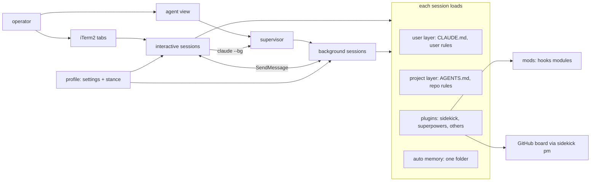

# Control centre

Status: exploring · Scale: explore · 2026-10-12

How the operator runs Claude Code as a control centre. Many sessions run at once, each loading only what its work needs, remembering at the right scope, and visible from one place. Opened from an exploration on 2026-10-11 and 2026-10-12 that the operator expects to seed R9. No gate is credited yet; the next session starts at gate 1.

Research: [`docs/research/control-centre/`](../../research/control-centre/README.md). Rendered companions, whose sources sit in `pages/`: [Many Sessions, One Desk](pages/many-sessions.html) and [Where Memory Lives](pages/memory-map.html).

## Problem

The operator uses Claude Code for development, production incidents, and work beyond code, often in many parallel sessions. What they said, 2026-10-11 and 2026-10-12:

- They find organising ideas, research and review, and visualising what is happening hard. The PM layer and the review machinery exist for that reason.
- Context switching between parallel sessions is costly, which is why they pushed the worker handoff.
- Context is precious: the most capable model is for reasoning.
- Memory hygiene is already poor, and parallel work makes it worse.
- Long plans and designs are hard to take in; a visual page with diagrams, examples, and sections works better.

Goals, each marked stated or inferred. None is confirmed at gate 1 yet.

| # | Goal | Mark |
|---|---|---|
| G1 | See which sessions need the operator, and what each is doing, without switching between them | stated |
| G2 | Declared profiles: a session, background ones included, loads only the plugins, rules, and stance its work needs | stated |
| G3 | Keep each session's context lean, so the reasoning model spends its window on the work | stated |
| G4 | Leave GSD, with a sidekick-owned context monitor and a separate status line | stated |
| G5 | Scope memory and context per profile, and fix memory hygiene under parallel work | stated as a hunch; the scope axes are open |
| G6 | Modules beyond development, such as prod-issues, product, sales, and finance, switched by profile | stated |
| G7 | Visual pages for complex research, designs, and plans, in a chosen style | stated |
| G8 | Capture a problem without stopping the work | stated; parked by the operator for now |
| G9 | Automate the loop where a pause does not guard quality (#140) | stated |
| G10 | Use mods for visibility of sessions, agents, context, and status | stated |

Non-goals, stated: installing a third-party mod without reviewing it; Moltamp; profile composition as a blocker.

## Constraints

Verified, with the source in the research reports:

- Mods run in-process and unsandboxed, on an early-access API that moves between releases. Each plugin has one hooks module, and mods draw only in the terminal and the Desktop app.
- Background sessions are separate processes under a supervisor. They run where dispatched, isolate edits in worktrees, run the same hooks, accept `--settings` and `--append-system-prompt`, and refuse untrusted folders.
- A session in sidekick starts at 74,229 tokens; about 42k of that is Claude Code's own.
- `--settings` switches whole plugins, rule files, connectors, bypass mode, and the auto-memory folder per session. Nothing found switches loose agents or user-settings hooks per session.
- Auto memory is one folder per repo, shared across worktrees, never expired; a session gets one folder.
- The user instruction layer (`~/.claude/CLAUDE.md`, `~/.claude/rules/`) loads in every session.
- sidekick's rules installer writes and prunes only `sk-*.md` files (`bin/helpers/rules.ts`).

Assumed, not checked:

- `$.ui.status` entries show beside a custom `statusLine`.
- A background session accepts a slash command such as `/sk-worker` as its first prompt.
- A profile can load a shared notes file read-only.

Read for this note: the two research reports, ADR-0009, `sk-execute` §Hand off to a worker, issues #101, #140, and #146, and the docs layout. Not read: ADR-0010 and ADR-0011 in full, and the Workflow authoring reference.

## System map



Extension points today: the profile file is a registration; a new module is a new plugin; a mod is that plugin's one hooks module. sidekick's own hooks are settings hooks in `plugin/hooks/hooks.json`.

## Lenses

Draft; to be confirmed before gate 3.

| Lens | Load-bearing | Where it bites |
|---|---|---|
| Data model | yes | memory scopes and who writes each; profile files; the capture queue |
| Boundaries | yes | plugin split along pm, dev, and ops; one mod per plugin |
| Extension points | yes | a new profile or module should be a file, not a code change |
| Contracts | yes | the mod API is early access; `claude agents --json` is the supported session interface |
| Concurrency and failure | yes | parallel memory writes; two drivers on an attached session |
| Operability | yes | the whole goal: seeing sessions, profiles, and context |
| Testability | yes | `claude plugin test` for mods; probes for profile behaviour |
| Security | yes | unsandboxed mods; prod credentials; untrusted alert content and memory poisoning |
| Performance | yes | the startup token budget per session |
| Reversibility | partly | profiles and mods are files, cheap to undo; a plugin split changes install records |

## Prior art

Each find is a candidate until the options are written; rejections carry the reason.

- **Use now:** native `--settings` profiles (no profile manager exists to integrate); agent view and `claude --bg`; `autoMemoryDirectory`; the user rules layer.
- **Borrow ideas, review before any install:**
  - harness-scope: mod-level filtering, per repo.
  - ostrakon: capture while busy.
  - `token-weather` and `blast-radius`: Anthropic's samples.
  - Flightdeck: a single-session dashboard.
  - `catchup`: a re-entry summary.
  - segmem: typed and scoped memory.
  - VoltAgent memory-curator: closes a fact with a status line.
  - session-handoff: per-session handoffs.
  - Claude HUD: a status line.
- **Rejected:** Moltamp, ruled out by the operator; wshobson's `context-management`, prose with no mechanism; `ralph-loop`, which loses Ralph's fresh context.

## Sub-problems

Each is a thread the operator can pull at gate 2. What is known, what is ruled, and what is open.

1. **Profiles and modularity.** Ruled: declared profiles through aliases; split sidekick into plugins exactly where a profile must separate things, pm, dev, and ops. Ruled 2026-10-12: profiles are built and documented properly, not kept as local drafts. Trial `core` and `prod-issues` drafts were tested on 2026-10-11 and then deleted; the surface report keeps the results. Open: the catalogue, composition, and the gaps for loose agents and settings hooks.
2. **Sessions and agents.** Background sessions make the orchestrator pattern real (#101). Open: `sk-worker` through `claude --bg`, automatic worktrees against the handoff's branch rules, and a model per worker.
3. **Visibility.** Agent view covers which session needs the operator. Open: what a mod adds, such as profile, context, unit of work, and re-entry.
4. **Context budget.** Open: the levers, ranked: profiles, GSD's listings, a brief instead of the whole `sk-orient` text at session start, and lean worker launches.
5. **Memory scoping.** Ruled: facts about the operator live in a user rule file, not in auto memory. Open: what each profile should remember, and who may write memory. Also open: when a fact ends, whether prod-issues sessions write memory at all, the audit of one memory folder, and parallel writes.
6. **Loop improvements and automation.** Take from Ralph fresh context per unit, a machine-checkable done, and an iteration cap. Open: #140's exploration of each pause, and workflows for the unattended stretches.
7. **Visual outputs.** Pages generated from the source document and never hand-edited, so they stay a view and not a second copy. Open: the style, the trigger, and where the source lives.
8. **Capture without stopping.** Parked by the operator. Shape from ostrakon: a command that runs with no turn, a model tool, and a queue.
9. **Trust and production safety.** Open: the prod-issues module's guards, alert content as data, and whether prod-issues sessions write memory at all.
10. **Leaving GSD.** Ruled: the status line is the operator's choice; the monitor is sidekick's (#146, comment of 2026-10-11). Open: the read-injection scanner.
11. **Extension mechanism.** Open: whether sidekick ships mods, as an ADR; whether `skill.prompt` meets ADR-0009's revisit condition and changes ADR-0010's hook approach.

## Candidate mods

A sketch the operator asked for on 2026-10-12, high level, to be designed properly later. Each mod is one plugin's hooks module, so each rides the module a profile switches.

| Mod | Module | Does | Built on |
|---|---|---|---|
| gauge | core | context and profile in the status line; warns the model before the window fills; flags an unprofiled session | `$.session.usage()`, `session.measure`, `$.ui.status`, `$.session.append` |
| scope | core | per-session filtering native settings cannot do: loose agents, single plugin skills, tools; `/profile` lists what loaded and its start cost | `agent.offer`, `prompt.attachment`, `tool.describe`, `$.command.register` |
| desk | orchestration | a band naming sessions that need the operator, in any session; a workers pane; a `dispatch_worker` tool; a "since you left" summary on attach | `claude agents --json` through `$.process.run`, `$.clock.every`, `$.tool.register`, `session.attach`, `$.model.fork` |
| board | pm | the board pickup as a band instead of injected text; `/issue` with no turn; a capture tool and queue | `$.command.register`, `$.tool.register`, `$.store`, `ui.render` on `AbovePrompt` |
| memory | core | a guard on memory writes that refuses a stale overwrite and untrusted sessions; a review pane to promote, close, or move entries | `tool.call`, `$.fs.stat`, `$.ui.open` |
| ops | prod-issues | holds prod-changing commands for a yes with undo noted; marks monitoring results as data; `/note` timeline | `tool.call`, `session.append`, `$.command.register` |

Visual outputs are mostly a skill and a house style; a mod would add only the trigger.

A development session in a tracked repo, with core, pm, and desk:

```text
 ⏺ …transcript…                                        │ Desk
                                                        │ ● worker-146   needs you ▸
                                                        │   #146 · ctx 41% · backend
                                                        │ ○ mem-audit    working
                                                        │   ctx 18% · core
                                                        │ ✓ prod-db      done 4m ago
 ──────────────────────────────────────────────────────┴──────────────────────────
  R9 · plan B in progress · next #140   captured 2 [file] [drop]      ← board band
 ❯ _
  backend · ctx 37% · 5h 22% · Opus 5.5                              ← gauge
```

A prod-issues session holding a change:

```text
  PROD-ISSUES · read-only until you say · timeline 7 [open]          ← ops band
 ┌ Hold: kubectl rollout restart deploy/payments -n prod ──────────┐
 │ changes: restarts 6 pods · undo: none needed (stateless)         │
 │ [ Run ]  [ Cancel ]  [ Note it ]                                 │
 └──────────────────────────────────────────────────────────────────┘
```

What changes for the operator: which session needs them, which profile it runs, and how full it is are on screen in every session. Capturing costs no turn. Dispatching a worker is a tool call. A memory write is reviewed and safe under parallel work. A prod session has a boundary.

Carried costs: each mod is code with full access, written and tested here. Every Claude Code release can move the API, and background sessions draw nothing until attached.

## Options

Not yet. Gate 1, the problem and constraints, comes first.

## Recommendation

Not yet.

## Blast radius

Not yet a breakdown. Claude proposed an outcome for R9 on 2026-10-11, not yet confirmed: "GSD can be uninstalled with nothing lost, and parallel work runs from one desk." Visual outputs were named as the alternative headline. The operator said the whole exploration might be R9.

## Decision

None yet.

## Review

Not run. The adversarial review in `sk-design`'s `references/review.md` runs before gate 3.

## Next session

- Gate 1: confirm or correct the goals and constraints.
- Research still owed: ADR-0010 and ADR-0011 against `skill.prompt`; the Workflow authoring reference for #140; the three assumed constraints.
- Experiments: audit one memory folder; test `autoMemoryDirectory` in a profile; two background writers on one memory folder.
- Then plan R9 through `sk-milestone`, from this note's breakdown.
