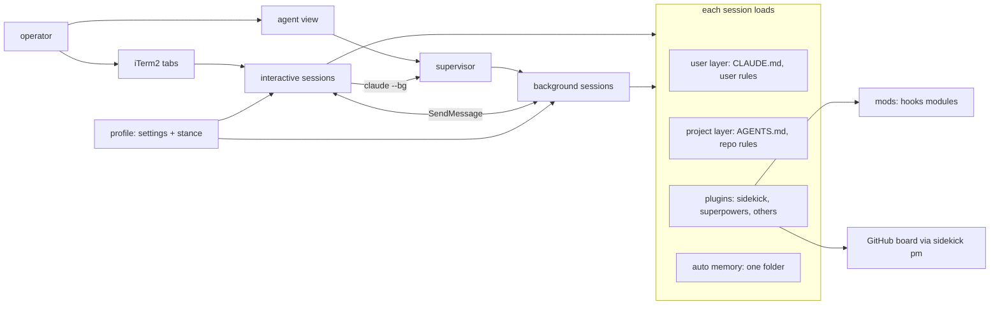

# Control centre

Status: exploring · Scale: explore · 2026-10-12

How the operator runs Claude Code as a control centre. Many sessions run at once, each loading only what its profile declares, all visible and controllable from inside Claude Code. Memory and the loop itself are a second initiative, as §Two initiatives says. Opened from an exploration on 2026-10-11 and 2026-10-12 that the operator expects to seed R9. Gates 1 and 2 are credited; the adversarial review and gate 3 are next.

Research: [`docs/research/control-centre/`](../../research/control-centre/README.md). Rendered companions, whose sources sit in `pages/`: [Many Sessions, One Desk](pages/many-sessions.html) and [Where Memory Lives](pages/memory-map.html).

## Problem

The operator uses Claude Code for development, production incidents, and work beyond code, often in many parallel sessions. What they said, 2026-10-11 and 2026-10-12:

- They find organising ideas, research and review, and visualising what is happening hard. The PM layer and the review machinery exist for that reason.
- Context switching between parallel sessions is costly, which is why they pushed the worker handoff.
- Context is precious: the most capable model is for reasoning.
- Memory hygiene is already poor, and parallel work makes it worse.
- Long plans and designs are hard to take in; a visual page with diagrams, examples, and sections works better.

### Two initiatives

The operator split the goals into two initiatives on 2026-10-12. This design covers the first, the control centre, which the operator expects to be R9 and the largest. The second is the loop: memory, context, agents, skills, and tools from official and community work. It follows the control centre and gets its own design when it starts. Its goals are recorded under §Handed to the loop design so nothing is lost before then.

Goals of the control centre, each confirmed by the operator at gate 1 on 2026-10-12.

| # | Goal | Mark |
|---|---|---|
| G1 | See which sessions need the operator, and what each is doing, without switching between them | confirmed |
| G2 | A sound management system for declared profiles: create, list, switch, and launch sessions with one, background sessions included. A session loads only the plugins, rules, and stance its profile declares | confirmed, reframed from the profiles themselves to their management. What "sound" means, and what Claude Code allows, is explored in the issues |
| G3 | Keep each session's start cost lean, so the reasoning model spends its window on the work | confirmed; the in-session half went to the loop design |
| G4 | GSD can be uninstalled with nothing lost: a sidekick-owned context monitor, and a status line of the operator's choice | confirmed, reworded as the outcome |
| G11 | Manage sessions, agents, and profiles from inside Claude Code: dispatch, steer, stop, and switch profile, with no process to start by hand outside a session | confirmed |

Rulings on 2026-10-12:

- **Profiles are content; the system is the goal.** A specific profile, such as one for production issues, is made ad hoc between the two initiatives, possibly in another repo such as odin. Production issues may need several, for front end and back end. One test profile serves as the test bench.
- **Everything runs in session.** The operator wants no ad hoc process to start by hand; every worker is visible and reachable from a session.
- **One milestone, R9.** The operator prefers one fully working release to partial pieces that might behave unpredictably, and accepts the longer wait for it.
- **Order inside the control centre:** first profile management and GSD out, then background agents, then the visibility and control mods.
- **Mods:** the control centre takes all the candidate mods it can; the memory mod moved to the loop design. At gate 2 the operator moved the ops mod there too, as [plugins.md](plugins.md) records. The piece is fixed by what it must achieve, G1 and G11; which mods it takes is designed in its own issue, not at Opening.

G10, "use mods for visibility of sessions, agents, context, and status", moved to the constraints as the operator's preferred surface. G6, modules beyond development, became the profile-management goal G2 plus profiles made ad hoc.

Non-goals, stated: installing a third-party mod without reviewing it; Moltamp; profile composition as a blocker; building any one domain profile inside this initiative.

### Handed to the loop design

Stated goals the loop design takes up, with what is known so far:

- **Memory and context management** (was G5). Each fact has one home at the right scope and is retired where it lives. The operator wants more research on tools and approaches to adopt first.
- **The autonomous loop** (was G9, #140). Proposed wording: hold the pauses that guard neither quality nor an outward write, and make the rest cheaper to answer.
- **In-session context** (the second half of G3).
- **Views** (was G7) of plans, designs, and the loop itself. Made ad hoc on request until then.
- **Adopting official and community skills, agents, and tools.**
- **Prompt consistency** (#202).
- **Capture without stopping** (was G8), with its queue and triage, moved here on 2026-10-12. It changes `sk-track`'s "file it now" rule, and its open questions are memory's: where the queue lives, its scope across repos, and parallel writers. `$.store` is one JSON file per plugin under the user's configuration folder, shared by every repo (bundled types, read 2026-10-12). The loop design extends the board mod for it.
- **The memory mod** from §Candidate mods: a guard on memory writes and a review pane. What is remembered, where, and when it ends is this design's question, moved here on 2026-10-12.
- **The ops mod and a `sidekick-ops` plugin,** with thread 9, moved here at gate 2 on 2026-10-12. The operator expects the loop milestone to set concrete targets for what each plugin bundles.
- **The plugin split,** moved here after gate 2's review on 2026-10-12. R9 keeps one plugin. When the split comes, the core is the base the others depend on, and [plugins.md](plugins.md) holds the findings it must answer.

## Constraints

Stated by the operator: mods are the preferred surface for visibility and control, agreed 2026-10-12. They run unsandboxed on an early-access API, as the verified list says.

Verified, with the source in the research reports:

- Mods run in-process and unsandboxed, on an early-access API that moves between releases. Each plugin has one hooks module, and mods draw only in the terminal and the Desktop app.
- Background sessions are separate processes under a supervisor. They run where dispatched, isolate edits in worktrees, run the same hooks, accept `--settings` and `--append-system-prompt`, and refuse untrusted folders.
- A session in sidekick starts at 74,229 tokens. An estimated 42k of that is Claude Code's own: the remainder after estimating the other parts.
- `--settings` switches whole plugins, rule files, connectors, bypass mode, and the auto-memory folder per session. Nothing found switches loose agents or user-settings hooks per session.
- Auto memory is one folder per repo, shared across worktrees, never expired; a session gets one folder.
- The user instruction layer (`~/.claude/CLAUDE.md`, `~/.claude/rules/`) loads in every session.
- sidekick's rules installer writes and prunes only `sk-*.md` files (`bin/helpers/rules.ts`).

Verified on 2026-10-12, in the probes report:

- A mod's `$.ui.status` line draws directly above a custom `statusLine`, and both stay drawn. The engine prefixes it with `⚠` and the plugin's name.
- A background session takes a plugin slash command as its first prompt, and the skill expands. It was probed with a harmless skill, not `sk-worker`.
- A background session loads a mod from `--plugin-dir`. Every `--bg` probe ran in auto mode, from a source not found.
- A profile loads a shared notes file through `--append-system-prompt-file`. An `Edit(path)` deny rule keeps the edit tools and parsed Bash writes off it, even in bypass mode, but a `python3` write got through. Read-only is a guard on the model's tools, not an enforcement boundary.
- `autoMemoryDirectory` in `--settings` moves memory writes in headless and background sessions. It moves the startup index in headless ones; the background case was not checked.
- Claude Code's file tools carry a precondition. `Write` refuses a file changed since it was read. `Edit` applies while its anchor still matches, and says the file changed. Two background writers on one memory folder lost no index line.
- `skill.prompt` rewrites a superpowers skill's text, whether typed as a command or loaded by the Skill tool, in the extension-fit report.
- A background session that edited in a worktree it entered commits without asking and pushes its branch. The exception is a task, `CLAUDE.md`, or memory saying the operator handles git. Read in the agent view docs, cited in the extension-fit report.

Read for this note: the four research reports, ADR-0009, ADR-0010, ADR-0011, `sk-execute` §Hand off to a worker, issues #101, #140, and #146, and the docs layout. The Workflow authoring reference was read by a subagent for the extension-fit report.

## System map



Extension points today: the profile file is a registration; a new module is a new plugin; a mod is that plugin's one hooks module. sidekick's own hooks are settings hooks in `plugin/hooks/hooks.json`.

## Lenses

Draft; to be confirmed before gate 3.

| Lens | Load-bearing | Where it bites |
|---|---|---|
| Data model | yes | profile files and who writes them; the memory scopes and capture queue moved to the loop design |
| Boundaries | yes | one plugin in R9, so one module holds every mod; the split moved to the loop design |
| Extension points | yes | a new profile or module should be a file, not a code change |
| Contracts | yes | the mod API is early access; `claude agents --json` is the supported session interface |
| Concurrency and failure | yes | parallel memory writes; two drivers on an attached session |
| Operability | yes | the whole goal: seeing sessions, profiles, and context |
| Testability | yes | `claude plugin test` for mods; probes for profile behaviour |
| Security | yes | unsandboxed mods; prod credentials; untrusted alert content and memory poisoning |
| Performance | yes | the startup token budget per session; the monitor hook's `node` start and transcript read per tool call |
| Reversibility | partly | profiles and mods are files, cheap to undo; the deferred split changes install records when it comes |

## Prior art

Each find is a candidate until the options are written; rejections carry the reason.

- **Use now:** native `--settings` profiles (no profile manager exists to integrate); agent view and `claude --bg`; `autoMemoryDirectory`; the user rules layer.
- **Weigh for G1, found by the review:** the footer's count of waiting background agents, and the `Notification` hook's `agent_needs_input` and `agent_completed` types. The reviewer read both in the docs; Claude has not re-read them. Agent teams are left out, since teammates share the lead's setting sources, so no worker gets its own profile.
- **Borrow ideas, review before any install:**
  - harness-scope: mod-level filtering, per repo.
  - ostrakon: capture while busy.
  - `token-weather` and `blast-radius`: Anthropic's samples.
  - Flightdeck: a single-session dashboard.
  - `catchup`: a re-entry summary.
  - segmem: typed and scoped memory.
  - VoltAgent memory-curator: closes a fact with a status line.
  - session-handoff: per-session handoffs.
  - Claude HUD: a status line.
- **Rejected:** Moltamp, ruled out by the operator; wshobson's `context-management`, prose with no mechanism; `ralph-loop`, which loses Ralph's fresh context.

## Sub-problems

Each is a thread the operator can pull at gate 2. What is known, what is ruled, and what is open. Since the split on 2026-10-12, threads 5, 6, 7, and 8 belong to the loop design, and so does the in-session half of thread 4. Thread 9 followed the ops mod there at gate 2. They stay here, with what was learned, until that design starts.

1. **Profiles and modularity.** Ruled: declared profiles through aliases; split sidekick into plugins exactly where a profile must separate things, pm, dev, and ops. After gate 2's review, the split moved to the loop design, since no R9 profile must separate them yet. Ruled 2026-10-12: profiles are built and documented properly, not kept as local drafts. Trial `core` and `prod-issues` drafts were tested on 2026-10-11 and then deleted; the surface report keeps the results. Open: the catalogue, composition, and the gaps for loose agents and settings hooks. The format and the store were decided at gate 2, in [profiles.md](profiles.md).
2. **Sessions and agents.** Background sessions make the orchestrator pattern real (#101). Known 2026-10-12: a `--bg` session takes a slash command as its first prompt, and one that edits in its own worktree commits and pushes by default. `sk-worker`'s "never push" is then an instruction the model follows, not a guard. Open: `sk-worker` through `claude --bg` and its authority premise, a guard on push or isolation off, and a model per worker.
3. **Visibility.** Agent view covers which session needs the operator. Open: what a mod adds, such as profile, context, unit of work, and re-entry.
4. **Context budget.** Open: the levers, ranked: profiles, GSD's listings, a brief instead of the whole `sk-orient` text at session start, and lean worker launches.
5. **Memory scoping.** Ruled: facts about the operator live in a user rule file, not in auto memory. Known 2026-10-12, from the probes report: Claude Code's file tools already stop lost updates between parallel writers. The audit of sidekick's folder judged 7 of 27 notes current on 2026-10-12. Most of the damage comes from no lifecycle: notes retired only in the index, shipped rulings never removed, supersession recorded on one side. The parallel-session damage is handoff through shared notes, not races. Open: what each profile should remember, who may write memory, when a fact ends, and whether prod-issues sessions write memory at all.
6. **Loop improvements and automation.** Take from Ralph fresh context per unit, a machine-checkable done, and an iteration cap. Known 2026-10-12, from the extension-fit report: no one mechanism fits #140. Handoff pauses fit background sessions with messaging; routing pauses fit a stated default in the skill. Outward writes and quality pauses stay with the operator, and a mechanism can only make the wait cheaper. The Workflow tool has no mid-run input, so it fits the sealed reviews before a pause, not the pause. Open: which pauses to change first, and how `sk-worker`'s operator-started authority survives a dispatched worker.
7. **Visual outputs.** Pages generated from the source document and never hand-edited, so they stay a view and not a second copy. Open: the style, the trigger, and where the source lives.
8. **Capture without stopping.** Parked by the operator. Shape from ostrakon: a command that runs with no turn, a model tool, and a queue.
9. **Trust and production safety.** Known 2026-10-12: a permission deny rule keeps the model's tools off a path but not code it runs. It cannot be the prod boundary alone. Open: the prod-issues module's guards, the `sandbox` settings as a harder boundary, alert content as data, and whether prod-issues sessions write memory at all.
10. **Leaving GSD.** Ruled: the status line is the operator's choice; the monitor is sidekick's (#146, comment of 2026-10-11). Open: the read-injection scanner.
11. **Extension mechanism.** Known 2026-10-12, from the extension-fit report: `skill.prompt` rewrites superpowers' skills, probed. That meets ADR-0010's first revisit condition, and ADR-0009's override condition in mechanism, on an early-access API. ADR-0011 is unaffected. Decided at gate 2 on 2026-10-12, in [mods.md](mods.md). sidekick ships mods only where a mod alone can do the job, each on a stated rung that never approves a call. It keeps the hooks on superpowers' skills.

## Candidate mods

A sketch the operator asked for on 2026-10-12, high level, to be designed properly later. Each mod is one plugin's hooks module, so each rides the module a profile switches. In R9 every mod shares sidekick's one module; the module column names where each would go after the split.

| Mod | Module | Does | Built on |
|---|---|---|---|
| gauge | core | context and profile in the status line; flags an unprofiled session. Since the review, the warning to the model runs as a settings hook | `$.session.usage()`, `session.measure`, `$.ui.status` |
| scope | core | per-session filtering native settings cannot do: loose agents, single plugin skills, tools; `/profile` lists what loaded and its start cost | `agent.offer`, `prompt.attachment`, `tool.describe`, `$.command.register` |
| desk | orchestration | a band naming sessions that need the operator, in any session; a workers pane; a `dispatch_worker` tool; a "since you left" summary on attach | `claude agents --json` through `$.process.run`, `$.clock.every`, `$.tool.register`, `session.attach`, `$.model.fork` |
| board | pm | the board pickup as a band; capture, its queue, and triage moved to the loop design on 2026-10-12 | `$.command.register`, `$.tool.register`, `$.store`, `ui.render` on `AbovePrompt` |
| memory | moved to the loop design on 2026-10-12 | a guard on memory writes that refuses a stale overwrite and untrusted sessions; a review pane to promote, close, or move entries | `tool.call`, `$.fs.stat`, `$.ui.open` |
| ops | moved to the loop design at gate 2 | holds prod-changing commands for a yes with undo noted; marks monitoring results as data; `/note` timeline | `tool.call`, `session.append`, `$.command.register` |

Visual outputs are mostly a skill and a house style; a mod would add only the trigger.

A development session in a tracked repo, with core, pm, and desk:

```text
 ⏺ …transcript…                                        │ Desk
                                                        │ ● worker-146   needs you ▸
                                                        │   #146 · ctx 41% · backend
                                                        │ ○ mem-audit    working
                                                        │   ctx 18% · core
                                                        │ ✓ prod-db      done 4m ago
 ──────────────────────────────────────────────────────┴──────────────────────────
  R9 · plan B in progress · next #140                                 ← board band
 ❯ _
  backend · ctx 37% · 5h 22% · Opus 5.5                              ← gauge
```

A prod-issues session holding a change, a sketch the loop design inherits:

```text
  PROD-ISSUES · read-only until you say · timeline 7 [open]          ← ops band
 ┌ Hold: kubectl rollout restart deploy/payments -n prod ──────────┐
 │ changes: restarts 6 pods · undo: none needed (stateless)         │
 │ [ Run ]  [ Cancel ]  [ Note it ]                                 │
 └──────────────────────────────────────────────────────────────────┘
```

What changes for the operator: which session needs them, which profile it runs, and how full it is are on screen in every session. Dispatching a worker is a tool call. A memory write is reviewed and safe under parallel work. A prod session has a boundary.

Carried costs: each mod is code with full access, written and tested here. Every Claude Code release can move the API, and background sessions draw nothing until attached.

## Options

Gate 2's four decisions each hold their options in a sibling note: [mods.md](mods.md), [profiles.md](profiles.md), [workers.md](workers.md), and [plugins.md](plugins.md). The integrated options come at gate 3.

## Recommendation

Not yet.

## Blast radius

Not yet a breakdown. Claude proposed an outcome for R9 on 2026-10-11, not yet confirmed: "GSD can be uninstalled with nothing lost, and parallel work runs from one desk." On 2026-10-12 the operator named the control centre as R9, one milestone, ordered as §Two initiatives says.

## Decision

Gate 2's four decisions are recorded in their sibling notes, named in §Options. The integrated decision comes at gate 3.

## Review

One round on 2026-10-12, by a fresh subagent given `sk-design`'s review prompt, this note, and its four sibling notes. Claude re-read or re-ran the evidence each answer rests on.

1. **A dispatched worker's worktree starts at the remote's default branch, without the plan, and cannot write beside it.** Accepted, verified in the worktrees docs. [workers.md](workers.md) gains W9 and W10. Part 3 now sets `worktree.baseRef` to `"head"`, reads the plan in the main checkout, and writes the run report in the worktree.
2. **A live worktree under `.claude/worktrees/` dirties the main checkout and breaks its gates.** Accepted. [workers.md](workers.md) gains W11. The launcher excludes the folder through `.git/info/exclude` before a repo's first dispatch, and an assumption names tools that may not honour that file.
3. **The CLI reads skill and rule files from its own plugin folder, so moving them breaks the nudges and the PM rule silently.** Accepted, verified at `bin/cli.ts:87`, `bin/helpers/hook.ts:41-42,177,181`, and `bin/helpers/rules.ts:53-54,98`. [plugins.md](plugins.md) records it for whenever the split runs.
4. **pm and dev reference each other, and R9 builds no profile that must separate them.** Accepted, verified at `sk-execute/SKILL.md:83`, `sk-design/SKILL.md:138`, `sk-milestone/SKILL.md:43`, and `release-review.md:58`. It changed Claude's recommendation for decision 4. The operator agreed on 2026-10-12: one plugin in R9, and the split moved to the loop design.
5. **`--setting-sources` gives a native plugin allowlist.** Partly accepted, re-run on 2026-10-12. [profiles.md](profiles.md) gains P10 and routes the choice of compile target to the profile issue. Option C stands, since rules, scope filters, and a description still need the manifest.
6. **The context monitor's warning to the model should not ride a mod.** Accepted. By decision 1's own rule, a settings hook already does that job: #146 records reading usage from the transcript, checked on 2026-09-29. It also fires per tool call, where `session.measure` fires per main-thread turn. The monitor becomes a settings hook, at the cost of an approximate figure and a window size looked up from the model. The gauge mod keeps the display, and [mods.md](mods.md)'s assumption is amended. The operator accepted the approximation, noting that GSD's monitor is a hook too. Claude checked: it is a `PostToolUse` hook, but it reads an exact figure that GSD's own status line writes to a bridge file (`~/.claude/hooks/gsd-statusline.js:321-334`). sidekick cannot rely on the operator's chosen status line, so its figure approximates.
7. **The worker cannot verify that the operator chose the mode.** Accepted. [workers.md](workers.md)'s card now rests the authority on the orchestrating session following `sk-execute`, and on the desk showing every dispatch.

Minor, as reported:

- §Next session said no constraint was left assumed, though the sibling notes carry unchecked items. Reworded.
- `$.env.get` exists, and `$.env.set` lets any mod lift the push block. [profiles.md](profiles.md) and [workers.md](workers.md) (W12) updated.
- The agent-view docs say what deleting a worker's session does to its branch. [workers.md](workers.md)'s assumption updated.
- "Never pushed unasked" came from interactive sessions. Noted in [workers.md](workers.md)'s decision.
- Missed prior art for G1: the footer's count of waiting background agents, the `Notification` hook's `agent_needs_input` and `agent_completed` types, and agent teams. Added to §Prior art.
- The order put GSD's removal first, though its monitor was a mod. Resolved by finding 6.
- A hold's `.catch` gets one second, and an unloaded module holds nothing. [mods.md](mods.md) Part 2 updated.
- [plugins.md](plugins.md) said the skills' commands keep their names while skill names change. It meant the CLI's commands; reworded.
- Install records naming only `sidekick@rikmorn` would load the core alone after a split. Recorded in [plugins.md](plugins.md).
- Agent view keeps a session's `--settings` across restarts, so the compiled file's place matters. Routed in [profiles.md](profiles.md).
- K12 counted two typed loads; one was the grep's own output. Corrected in [mods.md](mods.md).
- The desk's polling cost is not estimated. Routed to the desk's issue, with the `Notification` hook as a way to avoid polling.

### Round 2

A second round ran on 2026-10-12, since round 1's answers changed the recommendation. It is the last, so what it leaves open is named, not reviewed again. Claude re-read the evidence each answer rests on.

1. **A background session moves into its worktree only before its first edit, so `sk-worker`'s start checks and baseline gates run in the main checkout.** Accepted, verified in the agent-view docs. [workers.md](workers.md) gains W13: the worker enters its worktree before its scan, and the worktree gets its dependencies and the gitignored files it needs. The workers issue picks the mechanism.
2. **The dispatch hold in round 1's answer 7 contradicts [mods.md](mods.md), and a raw `claude --bg` bypasses any hold.** Accepted. The hold is withdrawn. R9 carries the debt that a session can start a worker through `claude --bg` without the operator's choice of the mode, and without the launcher's push block. Agent view shows every such session. The operator agreed on 2026-10-12.
3. **One plugin carries superpowers and `code-review` into every profile that uses sidekick, until the split.** Accepted as a stated cost, verified in `plugin/.claude-plugin/plugin.json`. Claude recommends carrying it until the split; dropping the manifest's dependencies is the lever if a profile needs sidekick without them sooner. The operator agreed on 2026-10-12.
4. **`--agent` runs the main thread with its own prompt, tools, model, MCP servers, and hooks, and the notes never weigh it.** Accepted as prior art. [profiles.md](profiles.md) gains P11 and routes it to the profile issue. The manifest still holds plugins, rules, and scope filters, which `--agent` does not reach.
5. **One `CLAUDE_CONFIG_DIR` per profile switches the whole user layer, and nobody weighed it.** Rejected for R9. Each folder needs its own login (session memory, 2026-10-11), and runs its own supervisor with its own sessions (agent-view docs). Agent view would then split by profile, against G1. [profiles.md](profiles.md) records it as the fallback if scope filtering proves too weak.
6. **G2 and G11 ask to switch a session's profile, and no note says how.** Accepted. [profiles.md](profiles.md) routes it to the profile issue, on the unchecked premise that a switch relaunches or resumes the session under the new profile's settings.
7. **"C holds both meanings, so trying both costs nothing" is false: the allowlist half alone needs the compile step.** Accepted. Claude now recommends building the manifest without a compile step in R9, with "only what it names" tried through `--setting-sources` (P10). The operator agreed on 2026-10-12.
8. **Agent view is a research preview, and its instability is not costed.** Accepted, verified in the agent-view docs. [workers.md](workers.md) gains W14, and the desk and the workers carry it as they carry the mod API's.
9. **Durable content sits in a folder that R9's close deletes.** Accepted, verified: `sk-milestone` §Closing deletes the design folders its audit lists. Before R9's Opening, §Handed to the loop design, threads 5 to 9, and the split's findings move to `docs/designs/loop/`. The mods ADR, with ADR-0010's amendment for the rewrite rung, becomes a piece of R9's breakdown. The operator agreed on 2026-10-12.

Minor, as reported:

- "About 42k of that is Claude Code's own" is an estimate from a remainder. Reworded in §Constraints.
- Round 1's answer 3 cited `hook.ts:40-41`; the constants sit at `:41-42`, and the folder read at `:177`. Corrected.
- `$.settings.read({ source: "flag" })` returns what `--settings` carries, so a mod can read the profile without an environment variable. [profiles.md](profiles.md) updated.
- A model id carries no window size, so the monitor hook cannot look it up. The gauge mod could write `$.session.usage()` to a file the hook reads, falling back to the transcript, as GSD's status line feeds its monitor. Routed to #146's design.
- The monitor hook costs a `node` start and a transcript read per tool call, about what GSD's monitor costs now. Added to the Performance lens.
- A mod's status line always carries a `⚠` prefix, and the operator's status line already shows context. The gauge's issue decides what the gauge shows, and where.
- With one plugin, every worker loads the desk and the board. The manifest's scope filters can switch mod parts as data, so no code branches on the profile. Routed to the scope mod's issue.
- "Sessions launch through aliases" sits beside "no process started by hand". The second covers workers. Clarified in [profiles.md](profiles.md).
- `using-git-worktrees` may run `npm install` in a bun repo and leave a stray lockfile. Unverified; routed to the workers issue.

The operator agreed to all four rulings on 2026-10-12. Still open after round 2: each item the sibling notes mark unchecked.

## Gates

- **Gate 1, credited 2026-10-12.** The operator confirmed the goals, the constraints, the two initiatives, and the rulings in §Two initiatives, answer by answer in a session with Claude. This note records each answer; the commit that lands it names the gate.
- **Gate 2, credited 2026-10-12.** The operator decided the four questions §Next session lists, answer by answer in a later session with Claude. Each sibling note's §Decision records the answers. After the review, the operator revised decision 4: R9 keeps one plugin. What a profile's declaration means was left to use, by the operator's choice.

## Next session

The owed research and the three experiments were done on 2026-10-12, in the probes and extension-fit reports. Gate 2's notes still carry a few unchecked items, each marked where it sits and routed to an issue.

Gate 2 is light, agreed with the operator on 2026-10-12. Each thread's open questions are sorted into two kinds. Those that cross pieces and are costly to undo are decided at this gate. The rest go into the breakdown as questions for each issue's own design, when it is picked up. Four questions are decided here, in this order, since the other three lean on the first:

1. **Whether sidekick ships mods**, as an ADR. The context monitor (#146) and every R9 mod depend on it, and it settles ADR-0010's revisit; the extension-fit report holds the four options. Its options and a recommendation are in [mods.md](mods.md), written 2026-10-12. The operator decided all three parts that day, as the recommendation gave them. The ADR lands in `docs/adr/` once the decision settles.
2. **Where profiles live and how one is declared.** Launching workers, the gauge, and scope filtering all read this data model. Decided in [profiles.md](profiles.md) on 2026-10-12. A thin manifest is compiled to native settings and stored at user and repo level. What a declaration means is left to use.
3. **`sk-worker` dispatched from a session.** Its premise that only the operator starts it, and a guard against a background session's default push. Decided in [workers.md](workers.md) on 2026-10-12. A session dispatches a worker after the operator chooses the mode, git blocks its pushes, and it works in its own worktree.
4. **The plugin split** along pm, dev, and ops, which changes install records in every repo that uses sidekick. Decided in [plugins.md](plugins.md) on 2026-10-12, then revised after the review: R9 keeps one plugin, and the split moved to the loop design with the ops mod.

All four were decided on 2026-10-12, and the adversarial review ran two rounds the same day, answered in §Review. Next:

1. Confirm the lens table.
2. Write the breakdown in §Blast radius. It includes the mods ADR with ADR-0010's amendment, which must land before R9 closes.
3. Gate 3: the integrated note, once.
4. Move §Handed to the loop design, threads 5 to 9, and the split's findings to `docs/designs/loop/`, so R9's close deletes none of them.
5. R9's Opening through `sk-milestone`.

Questions already routed to an issue's design:

- The band's issue decides what stays in the model's context at start. Measured 2026-10-12: `plugin/hooks/session-start` injects the pickup brief (148 characters, no milestone open) and the body of `sk-orient` (4,766 characters). Keeping the brief and dropping the body keeps the model oriented.
- What "sound" means for profile management, and what Claude Code allows, per G2.
- Which mods the visibility and control piece takes, per §Two initiatives.
