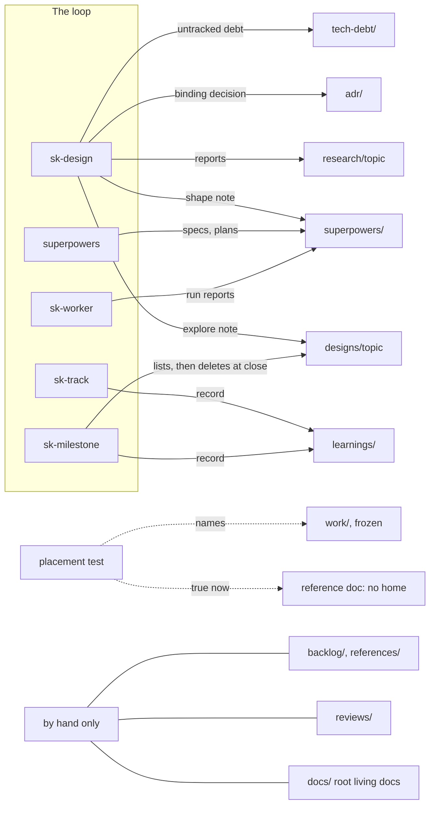

# How docs/ is laid out, owned, and kept true

Status: planned (#193, #190, #189, #192, #100, #137, #105) · Scale: explore · 2026-10-10, gate 3 approved 2026-10-11

Issues: #193 (the layout's living side), #190 (Rule 10's scope), #189 (guard `plugin/bin/package.json`), and #192 (lint for working-file citations), in R8's plan Docs guidance. #100 (compaction) and #137 (the ADR index) are in Docs compaction, and #105 (links and the docs check) in Docs links and check.

The operator approved gate 1 (problem, constraints, system map) on 2026-10-10, with the goals and non-goals as §Problem marks them. Gate 2 took the sub-problems one at a time. The operator approved gate 3, the integrated note, on 2026-10-11, and PM filed and regrouped its pieces into three R8 plans the same day.

## Problem

`docs/` still has the research programme's shape, and the plugin's layout for the folders its skills write has gaps that reach every consumer repo. The three issues are symptoms of one cause: some folders and duties have no owner in the loop, so nothing keeps them true.

### Goals

Each goal is marked **stated**, when the operator said or confirmed it, or **inferred**.

1. **Stated** (this session): list everything in `docs/` and map each entry to what the loop does with it, if anything.
2. **Stated** (this session, and on #100 on 2026-09-25): delete the frozen folders `backlog/`, `work/`, and `references/`, once an audit shows nothing is lost.
3. **Stated** (this session): consider going further than the last session's work on the layout the plugin ships, `plugin/skills/sidekick/references/docs-layout.md`. Look for gaps and improvements not yet seen.
4. **Stated** (#100, 2026-09-26): the guidance for `docs/superpowers/` and the practice agree. The choices on record are deletion at issue close, deletion at milestone close, or keeping the files locally and saying so. The first sweep waits for your yes, because the files are gitignored.
5. **Stated** (R8's outcome sentence): #100, #105, and #137 are resolved or closed with a verdict.
6. **Stated** (inferred, then confirmed 2026-10-10): every folder under `docs/` has a lifecycle and an owner. The owner is either a skill or rule that writes and deletes it, or a line saying the folder is this repo's own.
7. **Stated** (inferred, then confirmed 2026-10-10): the plugin's layout gives a home to every destination its placement test names. Today "true now → reference doc" has none.
8. **Stated** (inferred, then confirmed 2026-10-10): the plugin carries no fact that is true only of sidekick. This is #165's direction applied to docs.
9. **Stated** (inferred, then confirmed 2026-10-10): drift that a machine can see is caught by a check, not by a reviewer. That covers links, indexes, and status lines.

### Non-goals

All stated by the operator on 2026-10-10.

- Rewriting the body of any record, and the content shapes of issues, milestones, and docs. Both wait for #128.
- Touching the consumer repos (aesir, furnace, odin). Drift found there is reported, not fixed.
- Deleting research topics.

This session also checks two pieces of the last session's work in use. One is sk-design's goal marks (#142), and the other is the plan handoff asking once on superpowers 6.4.1 (#188). The marks in §Goals are the first part of that check.

### Findings

Each finding is ranked by blast radius, widest first: a finding in plugin content reaches every consumer repo.

| # | Finding | Evidence | What it costs |
|---|---|---|---|
| F1 | The placement test names "reference doc" as the home of true-now content, and the layout defines no such folder | `plugin/rules/sk-pm-conventions.md:13`; `docs-layout.md` has sections for `designs/`, `research/`, `adr/`, `learnings/`, `tech-debt/`, and `superpowers/` only | Each repo invents a home. sidekick uses its `docs/` root, while aesir and furnace use `docs/reference/`. No lifecycle or index is stated for the most-read docs |
| F2 | Nothing deletes `docs/superpowers/` files, although the rule and the layout both say they go when their work closes | `sk-pm-conventions.md` §Working docs; `docs-layout.md` §superpowers/; no deletion step in `sk-milestone`, `sk-track`, `sk-execute`, or `sk-worker`. Superpowers 6.4.1 deletes only its `.superpowers/sdd/` workspace | 98 files dating from 2026-06-10, measured 2026-10-10 with `find docs/superpowers -type f \| wc -l`. A duty the guidance states and no step performs |
| F3 | The portable rule names a sidekick-only folder | `sk-pm-conventions.md:15`, "sidekick's `docs/work/` holds per-item records…" | Every consumer repo loads a fact about sidekick's history. If `work/` is deleted, the sentence goes stale everywhere at once |
| F4 | Taxonomy READMEs restate the plugin's layout and drift from it | `docs/README.md` summarises the layout's rows; aesir's `docs/README.md` says research sits beside `design.md` until it outlives the design, while `docs-layout.md` §designs/ now sends it to `research/<topic>/` when written | Against "No mirroring" (`sk-pm-conventions.md` §Where things live). Each layout change silently strands the copies |
| F5 | Indexes drift because nothing checks them | `docs/adr/README.md` lists ADR-0001 to 0005 of 11 (#137). None of the 11 research topics has the `README.md` index `docs-layout.md` §research/ asks for. `docs/research/README.md` is a programme map | The PM hand-off (`explore.md` §Hand-off to PM) adds issues to each cited topic's index, which legacy topics lack |
| F6 | 31 relative links are broken, and CI checks none | Measured 2026-10-10 by resolving every relative link in tracked Markdown; `.github/workflows/ci.yml` runs check, typecheck, and test only | #105 counted 30 on 2026-09-18. The extra one is ADR-0005's link to `.claude/rules/`, which the repo no longer carries |
| F7 | Two living docs still describe the retired shape | `docs/DESIGN-PRINCIPLES.md` speaks of "the harness", "the specialist zoo", and "E11". `docs/research/README.md` frames sidekick as a research programme and points at `../EPIC.md` | A reader starting there gets the pre-pivot model. Nothing in `plugin/` loads either, and the rules and `NORTH-STAR.md` restate most of the principles |
| F8 | `reviews/` has no owner in the loop and no section in the layout | No skill or rule names it. #128's inventory says the shape of reviews is stated "Nowhere" | #186's release check produces review-like output and needs a destination |
| F9 | The frozen folders hold one fact recorded nowhere else: why `plugin/bin/package.json` exists | [`frozen-folders-audit.md`](./frozen-folders-audit.md). Without that file, the CLI exits 0 and prints nothing under an up-tree `"type": "commonjs"`, as in `~/.claude/` (reproduced 2026-10-10) | Deleting `backlog/` removes the only explanation of a load-bearing file. CI cannot catch its removal, and a silent CLI would also stop every hook that calls it. Routed to #189 (a test and an `AGENTS.md` line), which joined this plan on 2026-10-10 |
| F10 | Deleting the frozen folders makes six living texts false | [`frozen-folders-audit.md`](./frozen-folders-audit.md) §What else must change: the rule (F3), `docs/README.md`, `README.md:88`, `research/README.md:82`, the ADR index's crosswalk pointer, and #105's repairs | The deletion is one change with these edits, not a removal on its own |

### Forces

The changes known to be coming are these:

- #165 moves sidekick's own release facts out of `sk-milestone` and `sk-track`. It edits the step that deletes design folders at a milestone's close.
- #186 designs a release-wide check, and needs a home for what it finds.
- #128 decides the content shapes of issues, milestones, and docs after R8.
- Each new ADR, research topic, or design adds to an index that nothing checks today.

## Constraints

Each constraint is marked **verified** (read or run this session) or **assumed**.

- **Verified**: R8 is sealed. Only issues found by R8's own work may join, and anything else is filed for triage (R8's description).
- **Verified**: a record takes a repaired link, a dated amendment line, and a promotion status line, and nothing else. A record in a frozen folder takes the first alone (`docs/README.md` §Lifecycle classes).
- **Verified**: a rule edited in `plugin/rules/` takes effect only after a release, and the edit reaches every repo that installs the rules (`AGENTS.md` §Working here). The same holds for `docs-layout.md`, which ships in the plugin.
- **Verified**: `docs/superpowers/` is gitignored, so a sweep cannot be undone.
- **Verified**: CI runs `bun run check`, `bun run typecheck`, and `bun run test`, which is `bun test bin/` (`ci.yml`, `package.json`). `bun run prose` is not in CI.
- **Verified**: the tag `pre-pivot-2026-09` is on GitHub. It holds `docs/backlog/`, `docs/references/`, `docs/work/bench/`, `docs/work/ops/`, and `docs/EPIC.md` at the root, because `EPIC.md` and `EPIC-STATE.md` moved into `work/` after it. A permalink to a deleted file must name a commit that holds that path.
- **Verified**: aesir retired its `history/` and `backlog/` in #98 on 2026-09-30, and its `docs/README.md` names the commit that keeps them (`1b6d6ce9`) and the `git show` way in.
- **Verified**: nothing in `bin/` reads `docs/`. The only path the CLI matches is a superpowers review diff under `.superpowers/sdd/` (`bin/helpers/hook.ts:56`).
- **Assumed**: plan 10 (#143, #165) runs after this plan, so an edit here to `sk-milestone`'s close step lands first and #165 builds on it.

### What I read

Read whole: `docs/README.md`, `NORTH-STAR.md`, `DESIGN-PRINCIPLES.md`, `LIMITS.md`, `docs-layout.md`, `sk-design`'s `SKILL.md` and `references/explore.md`, `docs/learnings/README.md`, aesir's `docs/README.md`, and issues #100, #105, #137, #128, #143, #165, and #186.

Read in part: the openings of `USAGE.md` and `LOOP.md`, and the first 30 lines of `docs/research/README.md` and `docs/adr/README.md`. Also `docs/references/README.md`, `sk-pm-conventions.md` lines 6–16, `sk-milestone` steps 4–5, `sk-worker`'s run-report line, and the first 60 lines of odin's `docs/README.md`.

Searched: every `docs/` path named in `plugin/` and `bin/`, every relative link in tracked Markdown, and superpowers 6.4.1's skills for the paths it writes and deletes.

Delegated and re-checked: the frozen folders' 31 files, read whole by a subagent. Its one loss was reproduced in this session ([`frozen-folders-audit.md`](./frozen-folders-audit.md)).

Skipped: the bodies of ADRs, research reports, reviews, and learnings beyond their links. Whether `USAGE.md` and `LOOP.md` have drifted from each other. Furnace's `docs/reference/docs-system.md`. Consumer repos' links into the frozen folders.

## System map

As it stands on 2026-10-10. "Loop" means the plugin's skills and rules, plus superpowers.

| Entry | What it holds | Lifecycle (`docs/README.md`) | Written by | Read or deleted by | Plugin knows it |
|---|---|---|---|---|---|
| `README.md` | This repo's taxonomy | Living | By hand | Nothing | Generically: "a repo's `docs/README.md` … can cite this file" |
| `NORTH-STAR.md`, `DESIGN-PRINCIPLES.md`, `LIMITS.md`, `USAGE.md`, `LOOP.md` | Steering and reference docs | Living | By hand | Nothing in the loop | No; the placement test's "reference doc" has no defined home |
| `adr/` (11 ADRs and a README) | Binding decisions | Record | `sk-design` routes binding decisions here | Nothing updates the index | Yes, §adr/ |
| `research/` (11 topics, 5 programme files, and a README) | Grounding reports | Record | `sk-design` writes reports | `sk-design` cites them; the PM hand-off adds issues to a topic's index | Yes, §research/; legacy topics have no index |
| `reviews/` (6) | Audits and surveys | Record | By hand | Nothing | No |
| `learnings/` (2 and a README) | Learning records | Record | `sk-track`, `sk-milestone` | Nothing | Yes, §learnings/ |
| `designs/` (this note only) | Designs in progress | Ephemeral | `sk-design` at explore scale | `sk-milestone` lists notes marked `ready for PM` at an opening, and deletes closed ones at a close | Yes, §designs/ |
| `tech-debt/` (absent) | Small debt in an untracked repo | Ephemeral | `sk-design`, in untracked repos only | By hand when paid | Yes, §tech-debt/ |
| `backlog/` (13) | Notes from before GitHub | Frozen record | Nobody now | Nothing | No |
| `work/` (16) | The EPIC frame and per-item records | Frozen record | Nobody now | Nothing | Yes: the rule names it (F3) |
| `references/` (2) | Provenance for one shipped change | Frozen record | Nobody now | Nothing | No |
| `superpowers/` (98, gitignored) | Specs, plans, run reports, and shape notes | Ephemeral | Superpowers (specs, plans), `sk-design` (shape notes), `sk-worker` (run reports) | Nothing deletes them (F2) | Yes, §superpowers/ |

The loop owns the writes to `designs/`, `research/`, `learnings/`, `tech-debt/`, and `superpowers/`. It owns the deletion of `designs/` alone. The root living docs, `reviews/`, and the frozen folders sit outside the loop entirely. The ADR index and the research indexes are named by the layout, and nothing keeps them current.

## Prior art

Pending gate 2. The survey is [`docs/research/docs-structure/2026-10-10-docs-lifecycle-prior-art.md`](../../research/docs-structure/2026-10-10-docs-lifecycle-prior-art.md). From the operator's own repos: aesir's `reference/` folder and its retirement of `history/` and `backlog/` in #98, odin's `docs/README.md` as a map of where docs live, and furnace's `docs/reference/`.

## Options

Gate 2 took the sub-problems one at a time, each in its own file:

- [`layout.md`](./layout.md): what the layout defines. Decided 2026-10-10: a default `reference/` home, an owner line per folder, and a repo's `docs/README.md` listing only what it adds or overrides.
- [`superpowers.md`](./superpowers.md): when `docs/superpowers/` goes. Finally decided 2026-10-11: no command ships. The folder is local scratch the operator clears when they choose, and nothing durable cites it.
- [`working-file-citations.md`](./working-file-citations.md): durable things that depend on working files, raised by the operator after review round 2. Decided 2026-10-11: a rule line says what may be pointed at, `sidekick pm lint` reports an open issue naming `docs/superpowers/`, and the two open dependencies are repaired.
- [`compaction.md`](./compaction.md): the frozen folders, `reviews/`, the old doctrine, and the texts the deletion makes false. Decided 2026-10-10: deleted folders are reached by permalinks, the surveys move to `research/pm-layer/` and `research/guidance-authoring/`, and `DESIGN-PRINCIPLES.md` retires. The research root files have what is still relevant extracted into topic folders, then go. After review, the rule keeps the record discipline, rewritten generically.
- [`checks.md`](./checks.md): links and the layout's invariants. Decided 2026-10-11 and revised after review: a small sidekick-local check, run in CI. Hygiene for other repos is #191, in `backlog`.
- [`critical-pass.md`](./critical-pass.md): every folder looked at critically, as the operator asked on 2026-10-10. Decided 2026-10-11: `learnings/README.md` goes, `USAGE.md` and `LOOP.md` lose restated procedure, and each legacy research topic gets an index.

## Recommendation

Carry out the six sub-decisions in three plans: the guidance and its lint, then the compaction, then sidekick's links and docs check.

Together they give every folder a lifecycle and an owner (goal 6) and give true-now docs a home (goal 7). They take sidekick's own facts out of the plugin (goal 8). In sidekick, they put the drift a machine can see behind a check (goal 9). The compaction deletes what the loop no longer uses (goal 2); the audit showed one loss, now #189. Practice and guidance for `superpowers/` agree, because nothing durable may depend on it (goal 4).

The recommendation rests on these assumptions. If one is wrong, the named piece changes:

- Most consumer repos keep living docs in a docs folder. If not, the `reference/` default is noise, and the layout names the decision without a default (`layout.md` Option 2).
- The rule and the lint stop new dependencies on working files. The lint catches only the path form; prose without a path rests on the rule. If prose citations keep appearing, the lint widens.
- The 11 legacy research topics take an index before the docs check gates CI. Verified that today none has one.
- remark-validate-links keeps working with `repository: false`. Verified on 2026-10-11 for 13.1.0.
- CI's checkout fetches full history for the permalink check, with `fetch-depth: 0`. Verified that today it is shallow.
- Plan 12's #165 runs after this, editing `sk-milestone`, which this design leaves alone.

### Lenses

| Lens | Load-bearing? | Where it bites |
|---|---|---|
| Data model, lifecycle, who writes | Yes | Each folder's lifecycle and owner is goal 6. Each section of the layout names its writer and deleter, and cites the rule for what a record may take |
| Boundaries and dependency direction | Yes | The plugin's layout and rules state nothing true only of sidekick. Durable things depend only on durable things, which the new rule line states |
| Extension points | Yes | A new kind of doc is a section in the layout, plus a function in sidekick's check, not a branch in each skill |
| Contracts, including what an LLM reads | Yes | Skills in every consumer repo read the layout, and every session loads the rule. The new section and the lint check are additive. The rule's rewritten paragraph and new line reach every repo with the release |
| Concurrency and failure | Yes, mildly | Nothing deletes working files automatically, so work in progress is never at risk from a command. The docs check would fail CI before the legacy indexes exist, so it lands after them |
| Operability | Yes | The lint and the docs check name each breach by issue or path |
| Testability | Yes | Fixtures test the lint's new count and the docs check. #189 tests the CLI under an up-tree `"type": "commonjs"` |
| Security and data sensitivity | Not load-bearing here | No command deletes untracked or ignored files |
| Performance | Not load-bearing here | Docs and two small checks carry no hot path |
| Reversibility | Yes | Every repo change returns from git, and a shipped section is withdrawn by a release |

## Blast radius

### What changes

- **Plugin content, reaching every consumer repo with 0.5.0:** `docs-layout.md`, `sk-pm-conventions.md`, and `sk-agent-prompts.md` (#190). Plus `sidekick pm lint`'s new count, and the rebuilt `plugin/bin/sidekick`.
- **Sidekick only:** `docs/**`, `AGENTS.md`, `README.md`, a docs check script beside `bin/prose.ts`, `package.json` (remark as a dev dependency, and a script), and `.github/workflows/ci.yml`.
- **On GitHub:** #116 and #140 carry what they took from run reports. Comments on #100, #105, and #137 carry their decided scope, and #174 and #140 get the new paths of the docs they cite.
- **What cannot be undone:** nothing. Every change returns from git or a later release.

### The pieces

Existing issues keep their numbers. Their decided scope goes on each as a comment that stands without this folder. Two new issues are filed through `sk-track`.

1. **New: the layout's living side, and the rule's two edits.**
   - `docs-layout.md` gains a `reference/` section with `docs/reference/` as the default home, an owner line per folder, and the folder-earning test for repos adding folders.
   - Its §superpowers/ says the folder is local scratch, cleared when the operator chooses, and cited by nothing durable. It cites the rule for what a record may take.
   - `sk-pm-conventions.md`'s frozen-history paragraph becomes a generic statement: the three edits a record takes, promoting true-now content, and keeping identifiers.
   - §No mirroring gains the line that the one place a fact lives outlives whatever points at it, so nothing durable cites a working file.
   - §Working docs keeps one line pointing at the layout.
   - *Verified by* `bun run prose` on each changed file, and a `git grep` showing no plugin file names `docs/work/`.
2. **#190: Rule 10's scope.** One clause.
3. **#189: guard `plugin/bin/package.json`.** It lands before the compaction deletes the backlog note explaining the file.
4. **New: `sidekick pm lint` reports an open issue whose body names `docs/superpowers/`.** It works like the count for a `backlog` issue missing its condition, with fixtures and a rebuild. The same piece repairs the two open dependencies: #116 carries its table, and #140 carries what it needs from the run reports behind #121. *Verified by* the tests, and by lint reading zero on this repo once both are repaired.
5. **#100: the compaction.** Delete `backlog/`, `work/`, and `references/`. Rehome `reviews/`: the three surveys go to `research/pm-layer/` and `research/guidance-authoring/`, each topic with an index, and the three evaluations go. Retire `DESIGN-PRINCIPLES.md`. Extract gsd's eval blueprint into `research/eval-harness/`, then delete the four research root files. Rewrite `research/README.md` as a plain index, and give each legacy topic a short index. Move `NORTH-STAR.md`, `LIMITS.md`, `USAGE.md`, and `LOOP.md` to `docs/reference/` without their frontmatter. Cut `USAGE.md` and `LOOP.md` to orientation, keeping true-now content found nowhere else, such as §The commands. Rewrite `docs/README.md` to cite the layout, naming the commit that keeps the deleted files. Delete `learnings/README.md`, and fix `README.md:88`. Each record's link to a moved or deleted file is repaired; code spans in records stay as written. A deleted file's link becomes a permalink to a commit already on `origin/master`. Comment the new paths on #174 and #140. *Depends on* pieces 1 and 3.
6. **#137: the ADR index.** Every ADR with its standing, written from its status line, and an opening that describes the bundle. *Lands with* piece 5.
7. **#105: links, and sidekick's docs check.** Repair what piece 5 leaves broken: ADR-0005's rule link to `plugin/rules/`, and ADR-0006's `smokes/` link to a permalink at `pre-pivot-2026-09`. Add the check script, run in CI with `fetch-depth: 0`. It runs remark-validate-links with `repository: false`, confirms each permalink's `<sha>:<path>` exists, and checks that the ADR index lists every ADR file. It also checks that each research topic's index links its other files, and that each `design.md` has a valid status line. Last, no tracked Markdown may link into `docs/superpowers/`. *Depends on* pieces 5 and 6.

### Order and plans

Three plans, each sized to a session, replacing Docs tidy in R8's plans header:

1. **Docs guidance:** pieces 1–4 (the new layout issue, #190, #189, and the new lint issue).
2. **Docs compaction:** pieces 5 and 6 (#100 and #137).
3. **Docs links and check:** piece 7 (#105).

One release order (#143, #165) and The release checked as a whole (#186) follow, renumbered after them. The first plan's issues stay In Progress. The later plans' cards return to Backlog until each is picked up.

## Decision

Decided by the operator at gate 3, 2026-10-11: do it now. As a Y-statement:

- **In the context of** a `docs/` still shaped by a parked research programme, and a plugin layout with no living home and no owners,
- **facing** drift that nothing checks: 31 broken links, a 5-of-11 ADR index, and issues that depend on working files,
- **we decided for** a layout that names a reference home and an owner per folder. A rule says nothing durable cites a working file, and a lint checks it. A compaction deletes or rehomes what the loop no longer uses, and a sidekick-local check guards links and indexes,
- **to achieve** docs the loop keeps true, in sidekick now and in other repos once #191 is taken up,
- **accepting** a larger R8 with two new issues, and a check script with a dev dependency on remark-validate-links. The working folder grows until the operator clears it.

## Review

Round 1, 2026-10-11: a fresh subagent given only this note's path and `sk-design`'s review prompt. The orchestrating session re-checked each finding's evidence before answering. Answers 1–4 and 7 changed decisions the operator had taken, and the operator accepted them on 2026-10-11. The operator also noted that furnace has not moved to sidekick's layout yet, so its layout is no evidence. Its checker's design remains the prior art. Hygiene for other repos is filed as #191.

1. **Furnace, the closest prior art, was skipped.** Furnace runs a docs checker in `bun run check`: 431 lines, 513 lines of tests, and an index generator. It re-derives an index and diffs it, checks that cited paths exist with records exempt, and archives scaffolding by slug rather than deleting it.
   **Accepted.** Verified in `furnace/package.json` (`"check": "… && bun scripts/check-docs.ts"`) and `furnace/docs/reference/docs-system.md:310,323,407,411,421`. Furnace's design reshapes answers 4–6. On archiving versus deleting: furnace and GSD archive. The operator has ruled that sidekick needs no frozen history folders (#100, 2026-09-25), which is the same choice for working files. So deletion stands, with the trigger changed by answer 3.
2. **The first sweep would delete a file an open issue calls its full record.** #116, open and labelled `backlog`, says "Full record: the 'Tests that could not fail' table in the #109 run report", meaning `docs/superpowers/plans/2026-09-19-pm-seat-run-report.md`.
   **Accepted.** Verified with `gh issue view 116`, and the file exists. #116 breaks "each of those issues stands alone" (`sk-pm-conventions.md` §Where things live). Proposed: the compaction promotes the table into #116 before any sweep. The sweep keeps every file an open issue's body cites, which it can read with `gh`.
3. **A whole-folder sweep fails when milestones overlap, and Option B was rejected on a false premise.** The rule already requires each working doc to name its issue.
   **Accepted.** Measured 2026-10-11: 37 of the 77 Markdown files under `docs/superpowers/` name an issue in their first 15 lines, including every spec and shape note since R6. Plans, run reports, and after-files share their spec's date-and-slug stem. The 40 untagged files are pre-GitHub plans and those stem-linked files. **Proposed revision of `superpowers.md`:** the sweep lists a working file as done once every issue it names has closed, and no open issue cites it. A file names its issues directly, or through its stem group. That is the trigger `designs/` already uses. A file that names no issue is listed for the operator and never deleted unasked. Aesir's test-bench log is one, and so is everything in an untracked repo. The operator's "default to leave it without the PM layer" then holds by construction. It runs at a milestone's close or by hand, lists by default, and deletes on an explicit flag.
4. **`docs check` hard-codes layout defaults that repos override in prose.** Furnace, which is tracked, keeps flat dated research with an `assets/` exemption, and keeps ADRs under `reference/adr/`. Run at its close, the check would misfire.
   **Accepted.** Verified in `furnace/docs/reference/docs-system.md:58,147` and `furnace/docs/reference/`. Furnace already runs its own, richer checker. The operator ruled on 2026-10-11 that external repos need their own strategies. **Proposed revision of `checks.md`:** Option 1, sidekick-local, modelled on furnace's checker rather than shipped. It is a repo script beside `bin/prose.ts`, the precedent for a check that is not part of the shipped CLI, and CI runs it. `sk-milestone`'s close gains no docs check.
5. **The ADR index's standing is unchecked.** Some standing lives in other ADRs' prose: ADR-0009 parks 0006–0008 without naming them.
   **Accepted.** Proposed: the sidekick-local check regenerates the index from each ADR's status line and diffs it, as furnace does for its index (`docs-system.md:411`). A later ADR sometimes changed an ADR's standing without naming it. There the compaction adds a dated amendment line at the changed ADR's top, which a record may take. The index then derives from the records alone.
6. **The link check cannot see what the compaction breaks.** With `repository: false`, remark skips permalinks, their files and their anchors alike. Code-span citations go unread. A rebase could rewrite the permalinks' SHA.
   **Accepted, with one part answered.** Proposed: the sidekick-local check also confirms that each permalink's `<sha>:<path>` exists, using `git cat-file -e`. It also checks code-span paths in living docs, exempting records, as furnace does (`docs-system.md:407,421`). The compaction repairs code-span citations of the files it moves or deletes, ADR-0009:48 among them. On rebases: the permalinks name a commit already on `origin/master` when the plan starts, which no rebase of the plan's branch rewrites.
7. **D5 moves the record discipline out of an always-loaded rule.** `sk-pm-conventions.md` has no `paths:` frontmatter, while only four skills read the layout.
   **Accepted.** Verified: `sk-pm-conventions.md`, `sk-working-standards.md`, `sk-language.md`, and `sk-guidance-authoring.md` load unscoped, while the layout is read by `sidekick`, `sk-design`, `sk-milestone`, and `sk-track`. **Proposed revision of D5:** only the sentence naming sidekick's `docs/work/` goes. The record discipline stays in the rule, stated generically, and the layout cites it rather than restating it. A rule scoped to `docs/**` was weighed and not taken. Rules install at user level, so it would inject sidekick's layout into every repo's docs, odin's included.
8. **The close step is edited ahead of #186, which designs what runs at the close and what blocks a release.**
   **Partly accepted.** With answer 4, the close gains no docs check, so nothing here pre-empts #186's blocking decisions. The sweep remains, as housekeeping that blocks nothing. The close step is still edited three times in R8, here and in #165 and #186, in that order, each building on the last.

Minor findings, as they came:

- Pieces 7 and 8 form a new plan, so they do not fit an existing one, the size test in `sk-pm-conventions.md` §Change control. The operator decides the grouping either way.
- "aesir's 14 ADRs" is wrong: aesir has 13 ADR files and a README, all listed. *Acted on:* `checks.md` corrected.
- The CLI cannot tell the operator's yes from a model passing the delete flag. *Acted on:* the yes is the skill's gate, and the CLI's part is a dry-run default and a scope fixed in code. The breakdown says so.
- Superpowers lets a user move its plans elsewhere, and a sweep fixed to `docs/superpowers/` misses them. A known limit, accepted.
- This design must read `planned (#…)` before `sk-milestone`'s close deletes it. *Acted on:* the PM hand-off sets that status.
- "Each research topic's index links its reports" is undefined for legacy files not named by date. *Acted on:* the check counts every Markdown file in a topic except its `README.md`.
- "Two consumer repos converged on this default" overstates it, since furnace's `reference/` also holds records under an exception. *Acted on:* `layout.md` softened.
- Reproduced as stated: the 31 broken links, the 98 working files, and the 11 unindexed topics. Also the ADR index stopping at 0005, the tag's `docs/EPIC.md`, `hook.ts:56`, remark's behaviour, and #138's transcripts.

A second round runs because the accepted answers changed the recommendation.

### Round 2

2026-10-11, a fresh subagent with the same prompt. The orchestrating session re-checked findings 3, 4, 5, 7, 11, and 12 before answering. This is the last round. What it leaves open is in §Still open after review, for the operator.

1. **The sweep's citation check would have missed #116.** #116 cites the run report by paraphrase, and the rule says to join by issue number, never by path. **Accepted.** A path match cannot protect what issues cite in prose.
2. **`#NN` strings are not always issues.** Odin's working files name PRs and orders, and sidekick's after-files say "Board #2". **Accepted.** In an untracked repo the trigger would read PR numbers as issues.
3. **The stem join rests on a false premise.** Specs and plans are named separately, and the real links are explicit. The run-report template opens `Plan: <path>. Spec: <path>.`, and 17 plans carry a `**Spec:**` line. **Accepted, verified.** A join through those lines still leaves about 30 of 77 files to the operator, by the reviewer's simulation.
4. **`git cat-file -e` fails in CI's shallow checkout.** `ci.yml` runs `actions/checkout@v7` with no `fetch-depth`. **Accepted, verified.** The permalink check needs `fetch-depth: 0` in CI, which a repo this size can afford.
5. **ADR-0009's status line already names ADR-0006 to ADR-0008.** **Accepted, verified at `docs/adr/0009-pivot-to-plugin-bundle.md:9`.** The amendment lines are dropped. Round 1's answer 5 claimed otherwise without reading that line.
6. **Regenerating the ADR index needs a status vocabulary nobody has, and log4brains' option of committing no index went unweighed.** **Accepted.** The check confirms only that every ADR file is listed, which is the failure #137 found. The standing in each line stays hand-written.
7. **The record rule loses its home.** The three edits a record may take are stated only in `docs/README.md`, which piece 4 rewrites. `sk-pm-conventions.md:15` speaks only of a frozen directory. **Accepted, verified.** The rule's paragraph is rewritten generically. It states the three edits a record takes, promotion of true-now content, and kept identifiers, and it drops the frozen directory and the sidekick sentence. The layout cites it. The note's two descriptions of that change now agree.
8. **Rewriting code spans in records breaks the record rule.** **Accepted.** Only links are repaired, which is the edit a record may take. Code spans in records stay as written.
9. **The code-span path check has no grammar, and it would fail at every design's close.** **Accepted.** The check is dropped. Links, permalinks, and indexes are checked; prose paths are not.
10. **The sweep at every tracked repo's close repeats the reasoning that removed the docs check.** **Partly accepted.** The plugin already states the working folder is disposable in every repo (`docs-layout.md` §superpowers/), so a sweep would enforce an existing policy. But a repo that archives, as furnace does, would need an override. That weighs with findings 1–3 and 11 in §Still open after review.
11. **Option C was rejected on an untested premise, and un-ignoring the folder went unconsidered.** Verified: `rg -l 'run report' docs` reaches no working file, while `--no-ignore` reaches 35. **Accepted.** Stale plans do not surface in searches that respect `.gitignore`. Keeping the files costs disk, not confusion.
12. **Moving and cutting `USAGE.md` and `LOOP.md` touches open issues and unique content.** #174 cites `USAGE.md`'s exit-code paragraph, and #140 cites `LOOP.md`'s pauses. `USAGE.md` §The commands is the only reference for what each `sidekick pm` verb prints. **Accepted, verified.** P3 cuts only restated procedure that a skill holds. True-now content found nowhere else stays, such as the commands' reference, and #174 and #140 get comments naming the new paths.
13. **Pieces 1–6 do not fit one session, and the check was undersized.** **Accepted.** With answers 6 and 9 the check shrinks: remark, permalink existence, ADR and research index membership, and design status lines. The grouping becomes three plans, set out in §Still open after review.

Minor findings, as they came:

- The note's count of 37 used `#[0-9]{2,3}`, and `#[0-9]+` gives 39. *Acted on:* the regex is named wherever the count is used.
- A working file citing a `backlog` issue would never be swept. Moot under the recommended sweep option.
- Stale text: `critical-pass.md` still named `sidekick docs check`, and the order named "pieces 7 and 8". *Acted on:* both corrected.
- Dropping `status: living` frontmatter loses a machine-readable lifecycle marker. No check needs it now, so the frontmatter still goes.
- Nine auto-memory files cite moved or deleted `docs/` paths. *Acted on:* the memory update joins the compaction's execution, since memory is the session's own.
- A bare `#NN` does not say which repo it means, and GitHub search lags. Moot under the recommended sweep option.

### Still open after review

Both items were settled on 2026-10-11. The working folder is decided in `working-file-citations.md`: no sweep, and nothing durable cites the folder. The grouping is the three plans in §Order and plans, put to the operator with the hand-off.
