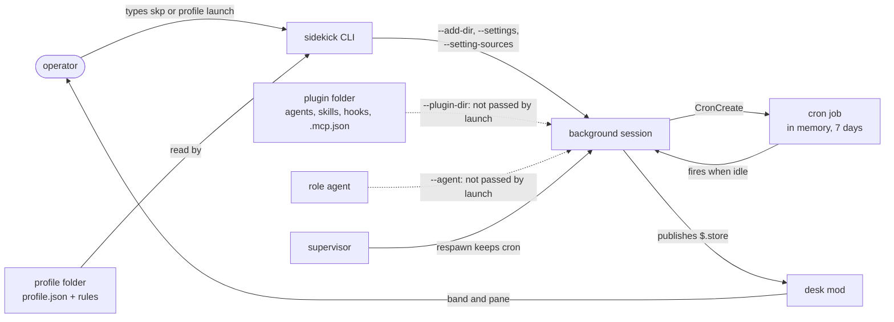

# Loop

Status: ready for PM · Scale: explore · opened for R11 on 2026-11-11, gate 3 passed on 2026-11-12

The design for R11, "loops and profiles", which is not yet opened on `Rikmorn/sidekick`. The operator agreed on 2026-11-08 that this design comes before R11's Opening. It takes #140's question as far as R11 reaches. [carried.md](carried.md) keeps what the control-centre design handed here on 2026-10-12, and [plugins.md](plugins.md) the plugin-split findings.

Research: [`docs/research/loop/`](../../research/loop/README.md), in particular [the loop probes](../../research/loop/2026-11-08-loop-probes.md) and [the re-read on 2.1.322](../../research/loop/2026-11-11-native-facts-recheck.md). Earlier work is in [`docs/research/control-centre/`](../../research/control-centre/README.md).

## Gates

| Gate | State |
|---|---|
| 1. Problem and constraints | credited 2026-11-11: the operator's answers to Q1 to Q5 in this session, recorded in §Gate 1 answers |
| 2. Sub-problems, one at a time | credited 2026-11-11: S1 to S7 ruled by the operator in this session, each recorded under its section |
| 3. The integrated note, after review | credited 2026-11-12: the operator's "yeah go ahead" in this session, after review round 2 and the summary of options and recommendation |

## Problem

The operator starts, steers, and restarts every piece of work sidekick does. #140 calls those pauses "by far the biggest bottleneck in any milestone". Claude Code has the parts of a loop. A cron job runs inside a session, background sessions outlive a terminal, and `--agent` gives a session a role. Nothing in sidekick joins them, and each part has a gap:

- **Nothing defines a loop.** `profile.json` is a strict object of four keys: `description`, `settingSources`, `settings`, and `hide` (`bin/helpers/profile-manifest.ts:36-57`). It cannot name a role agent, a plugin folder, or a schedule.
- **Nothing starts one with its role.** `profile launch` passes `bgArgs` a session name and a prompt only (`bin/helpers/profile.ts:406-410`). `bgArgs` takes `--plugin-dir`, `--permission-mode`, and `--worktree` (`bin/helpers/profile-launch.ts:347-361`), and launch passes none of them (#248).
- **Nothing keeps one running.** A cron job lives in the session's memory and expires after seven days (C1, C2). A reboot stops every background session (C8).
- **Nothing bounds what one may do but its prompt.** A deny rule keeps the model's tools off a path, not code the model runs (C22). Under `bypassPermissions`, which the operator uses almost everywhere, nothing prompts (C27, C28).

The person affected is the operator, in sidekick, furnace, aesir, and the work repos.

### Goals

| # | Goal | Status | Source |
|---|---|---|---|
| G1 | A repo can define a profile and a loop with sidekick's authoring skill | stated | the draft outcome the operator liked on 2026-11-08; the scope ruling that the authoring skill is in R11 |
| G2 | One command starts a loop | stated | the draft outcome |
| G3 | A loop keeps running across a respawn and the seven-day expiry. After a reboot the operator restarts loops by hand | stated | the draft outcome; Q1, 2026-11-11 |
| G4 | A loop acts only within its mandate | stated | the draft outcome |
| G4a | The mandate has four parts: what the loop reads, may do, must ask about, and never does | inferred; settled in sub-problem S3 | the foundation sketch of 2026-11-08, not recorded as ruled |
| G4b | A loop's `never` is enforced by settings Claude Code checks, such as deny rules, with the agent's stance as a second line | stated | Q2, 2026-11-11 |
| G5 | Personal by default. In a work repo, a loop lives in a user store keyed to the repo; only a loop a team adopts is committed | stated | the operator agreed on 2026-11-08 |
| G6 | A loop changes nothing for a colleague who does not use sidekick | stated | inferred from the sketch and ADR-0013; confirmed in Q5, 2026-11-11 |
| G7 | Trust grows by promotion. A new loop records what it would do, and the operator promotes it one action class at a time | stated | Q3, 2026-11-11 |
| G8 | A running loop adds nothing to watch. It reports where the operator already looks, and asks only where its mandate says to | stated | inferred from `about-me.md` and the sketch; confirmed in Q5, 2026-11-11 |
| G9 | Long term: sidekick as autonomous as possible, measured as the operator's attention per shipped change | stated as a long-term aim, not R11's to reach | the operator, 2026-11-08 |
| G10 | A loop can be changed and iterated on: its tick, stance, mandate, and schedule. A change takes effect by a known route, and a promotion is one such change | inferred; settled in sub-problem S5 | from the operator's question in Q3, 2026-11-11 |

### The first loop

Stated by the operator on 2026-11-11, as what R11's tooling is for:

> sidekick is very difficult for me to keep up with, there are issues coming in all the time, i want to make one or more loops to actually prune the issues, triage them, design the fix and make a release, for bugs this is obvious, for features it should ignore so we can do it together, the tradeoff is potentially less quality, but much faster iteration, if the fix is wrong that's another bug ticket and around we go, coupled with guidance to push issues as they're found i'm hoping to increase speed and remove myself from being a bottle neck so i'm involved mostly in features

Building that loop stays a loop-building session's work (N1). R11's tooling must serve it, so each sub-problem tests its stance against it.

### Non-goals

| # | Non-goal | Status | Source |
|---|---|---|---|
| N1 | Specific loops: PR review, triage, a production assistant, a fix loop, self-improvement. They are built in loop-building sessions after R11 | stated | the scope ruling of 2026-11-08: the tooling only |
| N2 | #140's pauses in sidekick's own milestones. They are the content of a sidekick loop, and the mandate supplies the mechanism | stated | proposed 2026-11-08; confirmed in Q5, 2026-11-11. Opening rewrites #140's `Revisit when:` |
| N3 | Views, capture without stopping, the memory mod, prompt consistency (#202), and the plugin split (#246) | stated | proposed 2026-11-08; confirmed in Q5, 2026-11-11. The split's cascade stays a constraint (C20) |
| N4 | Loops in the cloud: routines and Claude Code Projects | stated | proposed from C10 and a research agent's reading of Projects on 2026-11-08; confirmed in Q5, 2026-11-11 |
| N5 | A measure of the operator's attention per shipped change (G9) | stated | Q4, 2026-11-11: the operator will feel the need and prioritise it. File it as a `backlog` issue before R11 closes |
| N6 | Restarting loops after a reboot without the operator | stated | Q1, 2026-11-11 |
| N7 | Loops talking to each other, or a master session that routes between them. Each loop is independent and self-sustaining, and raises only to the operator, through the desk | stated | the operator, 2026-11-12: "loops should be self sustaining and independent" |

### Gate 1 answers

The operator's answers on 2026-11-11, in this design's session:

- **Q1, which restarts:** a respawn and the expiry are covered; after a reboot, the operator restarts by hand (G3, N6).
- **Q2, where `never` is enforced:** in settings Claude Code checks, with the stance as a second line (G4b).
- **Q3, the trust model:** record-only first, then promotion one action class at a time (G7). The operator asked how a loop is changed and iterated on, which became G10.
- **Q4, the measure:** later, when the operator feels the need (N5).
- **Q5:** G6, G8, and N2 to N4 confirmed.

## Constraints

Grades: **measured** (probed, with the date and build), **read** (in code or docs, with the source), **stated** (the operator said it), and **assumed**. The two loop reports are cited as "the probes" and "the re-read".

### Scheduling

| # | Constraint | Grade |
|---|---|---|
| C1 | A cron job lives in the session's memory, and `durable` has no effect | read in this session's `CronCreate` schema, 2.1.322, 2026-11-11 |
| C2 | A recurring job fires one final time on day 7, then is deleted. The documented way past it is to cancel and recreate the job before it expires | read: the schema; the re-read, scheduled-tasks §Seven-day expiry |
| C3 | A job fires only while the session is idle, up to 50% of its period late, at most 30 minutes | read: the schema |
| C4 | A durable mode exists, writing `.claude/scheduled_tasks.json`, behind the server flag `tengu_kairos_cron_durable`. It is off for this account and has no documented switch. `CLAUDE_CODE_LOOP_PERSISTENT=1` changed nothing visible for a fixed-interval loop | the flag measured off in the probes, 2.1.319; its names still in the 2.1.322 binary (the re-read) |
| C5 | A cron job survives `claude stop` then `claude respawn` | measured: the probes, 2.1.319 |
| C6 | A pending cron job keeps an unattached background session alive; a session with nothing pending is stopped after about an hour | measured: the probes, 2026-11-09, 2.1.319; read: the re-read, agent-view |
| C7 | A resume restores cron jobs, except expired ones; it does not restore a self-paced loop | read: the re-read, scheduled-tasks §Limitations |
| C8 | Background sessions survive sleep. A reboot stops them, and one restarts only on an attach or a reply within 48 hours | read: the re-read, agent-view |
| C9 | A hook cannot call a tool. `SessionStart` adds context, and outside `-p` nothing more. After a respawn, the resume hook's context did not reach the transcript | read: the re-read, hooks; measured: the probes |
| C10 | Routines run in the cloud on a fresh clone, at most hourly, with no local files. Desktop scheduled tasks need the app open and the Mac awake | read: the re-read |

### Role and launch

| # | Constraint | Grade |
|---|---|---|
| C11 | An agent from a `--plugin-dir` plugin, passed with `--agent`, loads as the main session with its model and prompt. The plugin's skill runs as the cron's tick. Both persisted through a respawn | measured: the probes, 2.1.319 |
| C12 | A plugin agent's `initialPrompt` is ignored, so the launch prompt must carry the `/loop` | measured: the probes; read: the re-read, sub-agents §Frontmatter reference |
| C13 | A plugin agent drops `hooks`, `mcpServers`, and `permissionMode` from its frontmatter. A loop's permissions and hooks go in settings or the plugin's own files | read: the re-read, sub-agents §Frontmatter reference |
| C14 | `--plugin-dir`, `--settings`, `--setting-sources`, `--add-dir`, and `--mcp-config` carry into a background session and survive a respawn, with its permission mode and model. `--agent` is not on the docs' list | read: the re-read, agent-view; `--agent` measured through a respawn in the probes |
| C15 | `profile launch` passes no `--plugin-dir`, `--agent`, or `--permission-mode`. `profile.json` accepts four keys and refuses others, so a new key is a contract change | read: `bin/helpers/profile.ts:406-410`, `bin/helpers/profile-manifest.ts:36-57` |
| C16 | A profile folder may hold only `.claude/rules/`. Agents, skills, and hooks go in a plugin the profile enables | read: `plugin/skills/sidekick/references/profiles.md` §What the CLI refuses in a folder; the layout check's code not re-read |
| C17 | Rules in a repo folder reach any session that reads a file there, whether or not it launched the profile | measured 2026-10-14, 2.1.299 (`profiles.md` §The repo store) |
| C18 | A repo profile launches with no trust gate, and can set hooks and permissions | read: `profiles.md` §The repo store; #223 |
| C19 | A profile holds no secret. Settings `env` reaches Bash children, shows in `ps`, and is stored in the job record. A background session has no measured way to receive one. claude.ai connectors stay available | read: `profiles.md` §No secrets and §What each mode drops |
| C20 | Every session that loads sidekick also loads superpowers and `code-review`, through the manifest's dependencies | measured 2026-10-12, 2.1.296 ([plugins.md](plugins.md) S2) |
| C21 | The CLI dispatches each verb family from one `if` chain in `bin/cli.ts:145-225`, so a `loop` family is one more branch | read |

### Authority

| # | Constraint | Grade |
|---|---|---|
| C22 | A permission deny rule keeps the model's tools off a path, but not code the model runs | carried from the control-centre design, 2026-10-12 ([carried.md](carried.md) §Threads); not re-read |
| C23 | The push block is a settings overlay of a deny rule and a git URL rewrite. It stops the default push and accidental spellings, not a deliberate bypass | read: `plugin/skills/sidekick/references/workers.md` §The push block; measured 2026-10-14 under `bypassPermissions` |
| C24 | A background session that edited a worktree it entered commits without asking and pushes its branch, unless the task or `CLAUDE.md` says otherwise | read in the agent-view docs on 2026-10-12 (`docs/research/control-centre/2026-10-12-extension-and-loop-fit.md` §Background sessions and git) |
| C25 | A message cannot approve a permission prompt. A message between sessions in different permission modes can be held and expire | read: `workers.md` §The permission mode; #241 |
| C26 | A sidekick mod never approves a call or answers a permission. A hook that holds a call for a yes fails closed | read: ADR-0012 Decision 2 |
| C27 | Under `bypassPermissions` every tool call runs without a prompt. Deny rules still block, allow rules have no effect, and explicit `ask` rules still prompt. That last sentence sits in a paragraph about interactive sessions, so its reach to a background session is unread | read: the permission-modes docs, §Permission modes and §Skip all checks with bypassPermissions mode, fetched 2026-11-11; the deny rule measured against `git push` in `workers.md` §The push block |
| C27a | In `dontAsk` mode, every call that would prompt is denied, explicit `ask` rules and `AskUserQuestion` included, and "the session never waits for input". Allow rules and `PreToolUse` hooks still approve | read: the permission-modes docs, §Allow only pre-approved tools with dontAsk mode, fetched 2026-11-11 |
| C27b | Interactive sessions start in auto mode from 2.1.283, and `claude -p` in Manual from 2.1.302. `bypassPermissions` does not take effect from a project's settings files: `.claude/settings.json` and `.claude/settings.local.json` | read: the permission-modes docs, §Which mode a session starts in, fetched 2026-11-11 |
| C27c | The sandbox covers shell commands only; file tools, MCP servers, and hooks run outside it | read by the survey agent in the sandboxing docs on 2026-11-11, not re-read |
| C28 | The operator runs `bypassPermissions` almost everywhere | read in #241's body; its origin not traced |
| C29 | sidekick writes only what it owns, and reads everything else | read: ADR-0013 Decision 1 |

### Changing a running session

| # | Constraint | Grade |
|---|---|---|
| C37 | Launch settings are a snapshot, and a background job reapplies its saved flags on respawn. So a respawn brings back the mandate a loop launched with, and a changed mandate needs a relaunch | read: `profiles.md` §Deleting or renaming a profile and §No secrets; the relaunch is inferred, not measured |
| C38 | Edits to `SKILL.md` are picked up live under `~/.claude/skills/`, the project's `.claude/skills/`, and an `--add-dir` folder's `.claude/skills/`. A plugin's `hooks/`, `.mcp.json`, and `agents/` need `/reload-plugins`. Whether a `--plugin-dir` plugin's `SKILL.md` is watched is not stated | read: the skills docs, §Edit a skill during a session, fetched 2026-11-11 |
| C39 | `/reload-plugins` reloads active plugins without a restart. In `-p`, the SDK, and the desktop app, it "runs only on input typed directly into the session" | read: the commands docs, fetched 2026-11-11 |
| C40 | The memory store commits itself: the memory start hook starts a detached `sidekick memory snapshot` that commits it | read: `AGENTS.md` §Layout, the `plugin/hooks/` row |

### What the first loop meets in sidekick

| # | Constraint | Grade |
|---|---|---|
| C41 | A release ends with `bun run release:install`, which updates the user-level plugin and rules from the released binary | read: `AGENTS.md` §Releasing, step 5 |
| C42 | User-level changes wait until the operator stops work for the day | stated; read in the memory index's line for `global-setup-outside-work-hours`, not in its file |
| C43 | The marketplace serves `master`'s head, so a push to `master` reaches a fresh install before any release | read: #195's title |
| C44 | A branch is checked out in one checkout at a time. Landing on a branch another checkout holds happens in that checkout, and rewrites its files under every session there | read: `sk-parallel-sessions.md` §Facts |
| C45 | With no operator to ask, `sk-design` registers a design as debt and never decides "do it now" | read: `plugin/skills/sk-design/SKILL.md` §Decide and route |
| C46 | The repo is public, with issues on. All 200 of the most recent issues came from the operator's account | read: `gh repo view` and `gh issue list`, 2026-11-11 |
| C47 | No label tells a bug from a feature yet. #302 proposes one, and its condition, R10.1's release, has passed | read: #302's body; R10.1's close in the memory index |

### The operator's rulings

| # | Constraint | Grade |
|---|---|---|
| C30 | Crons are the base. Context growth and compaction are accepted for an orchestrator, as the operator's own assumption | stated 2026-11-08 |
| C31 | R11 is the tooling only, with the authoring skill in it | stated 2026-11-08 |
| C32 | Approval gates cover outward actions only | stated 2026-09-26 (the extension-fit report §The pauses) |
| C33 | Prefer the smallest version that answers a felt complaint, integrate existing tools before building, and never cut a capability a real case needs | stated in earlier sessions; read in the memory index's feedback lines, not in their files |

### Evidence from research

| # | Constraint | Grade |
|---|---|---|
| C34 | An outer loop pays only when it supplies more context than one window holds, an independent gate, or unattended running. A loop's value tracks its verifier's quality | read: `docs/research/agentic-loops/REPORT.md` §Verdict |
| C35 | A human gate works when it is sparse and scoped to irreversible actions; a frequent one becomes rubber-stamping | read: `REPORT.md` §Angle 8 |
| C36 | Claude Code moved from 2.1.319 to 2.1.322 in three days, and undocumented behaviour such as C4's flag can change without notice | measured: `claude --version` on 2026-11-11 against the probes' build |

### Unknowns

Neither read nor measured. Each is a probe candidate if an option rests on it.

- **U1.** Whether a reboot followed by an attach restores cron jobs. C7 suggests a resume does, but the probes did not test a reboot.
- **U2.** Whether a cron job survives `/clear` and compaction. A loop that clears its context between ticks depends on it.
- **U3.** Whether an explicit `ask` rule prompts in a background session under `bypassPermissions`, as C27 reads it does in an interactive one. A mandate's `asks` may rest on it.
- **U3a.** What auto mode does in an unattended background session when its classifier blocks an action. No source the survey read covers it.
- **U4.** Whether a loop plugin's `.mcp.json` scopes MCP servers to that session.
- **U5.** What `CronList` shows of a job's age, so a tick can tell when to recreate it before day 7.
- **U6.** How a background loop waiting on the operator shows on the desk and in agent view.
- **U7.** Whether a running session sees edits to a `--plugin-dir` plugin's `SKILL.md` (C38).
- **U8.** Whether a cron-fired prompt can run `/reload-plugins`, and whether a reload refreshes the session's `--agent` prompt (C39).
- **U10.** Whether sidekick's gates, `bun run test` among them, pass inside Claude Code's sandbox.
- **U11.** Whether a one-shot cron job survives `claude stop` and `claude respawn`, as a recurring one does (C5). The docs answer half: a resume drops a one-shot job whose time has passed (`scheduled-tasks.md:241`).
- **U15.** Whether a loop's overlay can keep a sandboxed command from writing an additional directory, such as the memory store (`sandboxing.md:776`).
- **U17.** Whether a loop's subagents run inside its sandbox, and whether a subagent with `isolation: "worktree"` works in a `dontAsk` background loop. Moot since the operator chose workers over subagents.
- **U18.** Whether a worker's message to a `dontAsk` loop session is delivered or held. Answered by reading on 2026-11-12. `dontAsk` counts as prompting, and a prompting session delivers a message from a sender that does not bypass (cross-session-messaging docs; §Round 2, finding 5).
- **U21.** Whether a message restarts a worker that stopped while idle, with its conversation, or whether the loop must respawn it first (C6).
- **U22.** Whether anything but a message can wake a loop between ticks, such as a CLI form of agent view's reply. With one, an answer need not wait a tick period. Answered by reading on 2026-11-12: a message wakes an idle session, and `crossSessionInbound: accept` delivers one from a bypassing sender (§Round 2, finding 5).
- **U23.** Whether the operator's login is a Team or Enterprise one. Without one, or managed settings, a plugin's mod can approve a call a deny rule refuses (§Round 2, finding 3). Answered by the operator on 2026-11-12: their sessions run on a personal subscription, so the gap holds. A Team login exists but its limits are too tight for their use.
- **U24.** Whether a managed settings file the operator writes on their own Mac counts as managed settings. If it does, a deny rule binds over a mod (permissions docs copy of 2026-11-11, lines 636-645). It is a machine-wide change, so it waits for the end of a working day.
- **U19.** Whether `sidekick worker finish` accepts a worker branch that the loop pushed to `origin`'s `master` while the main checkout's `master` lags. Partly answered by reading: `--into <rev>` takes `origin/master` after a fetch, and a rebased landing counts (`plugin/skills/sidekick/references/workers.md:23,219`). Not yet run from a loop.
- **U20.** What a unit worker under `dontAsk` needs allowed to run its role's skill and SDD: `Skill`, `Agent`, edits in its worktree, the gates, `git commit`, and `SendMessage`. U9 asks the same for the loop.
- **U16.** Whether a skill whose `SKILL.md` runs a shell command as it loads runs that command when a cron job fires it, and what permission it needs.
- **U13.** How a call `dontAsk` denies appears in a background session's transcript, so the desk could count denials.
- **U14.** Whether `PushNotification` from a background session reaches the operator, at the terminal or by phone.
- **U12.** Whether `claude agents --json` tells a loop between ticks from one mid-tick. This session's own row read `status: busy` while it worked, on 2026-11-11.
- **U9.** Which built-in tools `dontAsk` denies a background loop unless allowed, such as `Skill`, `CronCreate`, and `CronList`, and the rule that allows each. The probes ran under `bypassPermissions` only.

### What was read, and what was skipped

Read for this gate:

- the R11 workstream in the memory store, and the two loop reports;
- [carried.md](carried.md) and [plugins.md](plugins.md);
- `profiles.md` whole;
- `workers.md` §The overlay, §The push block, §The permission mode, §Steering and stopping, §The fallback, and §A worker profile;
- ADR-0012 and ADR-0013 §Decision, and ADR-0004's header as pre-pivot history;
- the extension-fit report §Loop pauses, and `agentic-loops/REPORT.md` §Verdict and Angles 8 and 9;
- `docs/reference/NORTH-STAR.md`;
- issues #140, #223, #231, #241, #246, and #248;
- the code lines cited in the tables.

Skipped:

- `docs/reference/LOOP.md`, since #140's pauses are proposed out (N2);
- the mods' code, and `sk-worker`'s and `sk-execute`'s text;
- `workers.md` §dispatch and §finish, and the layout check's code;
- the rest of the agentic-loops and orchestration reports, and the control-centre reports other than extension-fit.

The community survey landed after the first draft of this gate, and C27 to C27c come from it and from the docs it pointed to.

## System map

As it stands on 2026-11-11, before any loop exists.



- **A profile** is one folder in one of two stores, holding `profile.json` and rules. The CLI owns the manifest's schema.
- **A background session** is one Claude Code job. The supervisor owns its process, and the job record keeps its launch flags.
- **A cron job** belongs to one session, and lives in that session's memory.
- **A plugin** supplies agents, skills, hooks, and MCP servers. A plugin agent can be a session's role (C11), but carries no hooks, MCP servers, or permission mode (C13).
- **The desk** reads every session's `$.store` key, and shows who waits on the operator.
- **Extension points today:** a new launch flag is an option to `bgArgs`. A new manifest key is a schema change (C15). A new verb family is a branch in `bin/cli.ts` (C21). Nothing yet registers a loop.

## Prior art

Searched in the skill's order: the repo, the platform, other tools, then documented practice. The survey is [the community tooling report](../../research/loop/2026-11-11-community-loop-tooling.md), gathered by a subagent on 2026-11-11. Claims this section rests on were re-read in that report's sections; the permission-mode claims were re-read in the docs (C27 to C27b).

### In the repo

| Find | Use or reject |
|---|---|
| Profiles: stores, launch, the settings and plugin checks (`profiles.md`) | Use. A loop's role rides a profile, and launch already composes its settings |
| The worker overlay and push block (`workers.md` §The overlay) | Use the pattern: a mandate's `never` can compile to a settings overlay, as dispatch's push block does |
| The desk and the publisher | Use. A loop publishes its state as every session does, and the desk shows who waits on the operator |
| ADR-0012's fourth rung, hold a call for a yes | Borrow for `asks`, if a hold beats a native `ask` rule (C26, C27) |
| ADR-0004's autonomy dial | History only: pre-pivot, and superseded in shape by ADR-0009 |

### On the platform

| Find | Use or reject |
|---|---|
| `/loop` over `CronCreate`, with a respawn keeping the job | Use: the operator's chosen base (C30). Renew before day 7 (C2) |
| `--agent` from a plugin, as the session's role | Use, without `initialPrompt` (C11, C12) |
| Deny rules, `dontAsk`, the sandbox | Use for `never` and `may`. Nothing native covers `asks` in an unattended session except a prompt that waits (C27, C27a) |
| launchd | Candidate for a reboot, if Q1 asks for one. A missed calendar run fires once on wake; a `StartInterval` due in sleep is missed (survey §Watchdogs and heartbeats) |
| Routines and Projects | Reject as the host: cloud, so N4 |
| Desktop scheduled tasks | Local, with a fresh session per run, but they run only while the desktop app is open (C10). Weighed again in §Finding 5's option |

### Other tools

No find runs a long-lived Claude Code loop on native features alone; each brings its own runtime (survey §Summary). So none is a dependency, and these are ideas to borrow:

| Find | Borrow | Reject |
|---|---|---|
| agent-deck's standing orders (MIT) | A shell check with no model runs first, and the agent wakes only on a change. Each order carries a baseline-first run, a daily wake cap, active hours, an expiry, and actions to ask first. A turn an order started cannot edit orders. A permission prompt in it is denied and queued to the owner. Its watchdog caps restarts | It is a second runtime on tmux |
| gh-aw (MIT) | The agent proposes typed actions, and a separate deterministic step applies each under a cap. Staging works per action type, the only shipped per-class promotion found. Its `stop-after` deadline renews on purpose, and `skip-if-match` decides before the agent starts | Hosted on GitHub and committed, so it fails personal-by-default |
| claude-code-scheduler (MIT) | launchd as the clock, and a worktree per run | Its autonomous tasks skip permissions |
| Gas Town (MIT) | Settings passed by `--settings <path>`, kept out of the work repo; a watchdog of the watchdog | A fleet runtime |
| continuous-claude, Devin, sleepless-agent | A mandatory iteration cap and stall thresholds; a preflight; a gate on the usage window | Each is a runtime or a product |

Copy no code from dcg or Claude Code Agent Farm. Their MIT licence carries a rider granting no rights to Anthropic, or to anyone acting for its benefit (survey §cc-safety-net and dcg).

### Documented practice

- **Promotion is gradual, and approving every action backfires.** Users' full auto-approve rises from about 20% of sessions to over 40% by 750 sessions. Mandated approval "will create friction without necessarily producing safety benefits" (survey §Graduated autonomy). This fits G7 and C35.
- **The mandate lives outside the prompt.** Meta's Rule of Two allows at most two of untrusted input, sensitive access, and state change per session. Prompt-only enforcement recurs among the tools read, and skipping permissions is their common unattended setting (survey §Keeping the mandate outside the prompt). This bears on Q2.
- **Expiry is a feature.** gh-aw, agent-deck, GitHub's scheduler, and Copilot each end recurring work on purpose. The survey infers a loop should survive the platform's expiry and keep one the operator sets and renews (survey §Expiry as a feature). This bears on G3.
- **Quiet runs cost nothing.** agent-deck and OpenClaw end a run with `NO_REPLY` when nothing is needed. This fits G8.

## Options

Gate 2 takes the sub-problems one at a time. The lens table goes in this section before gate 3.

### Sub-problems

| # | Sub-problem | Goals | State |
|---|---|---|---|
| S1 | The loop's definition and store: what a loop is, its file, where personal and committed loops live, and how it relates to a profile | G1, G5, G6 | open |
| S3 | The mandate: its parts, how each compiles to settings, record and act modes, and `asks` with nobody watching | G4, G4a, G4b, G7 | open |
| S2 | Start, renewal, and restart: the one command, the launch flags, the `/loop` prompt, renewal before day 7, and the hand restart after a reboot | G2, G3 | open |
| S5 | Changing a loop: the route for each kind of change, promotion, a trial in record mode, history, and a loop never editing its own definition | G10, G7 | open |
| S4 | Seeing a loop: desk rows, notifications, quiet runs, and a watchdog for a stuck or dead loop | G8 | open |
| S7 | The plugin cascade: whether a loop session loading superpowers and `code-review` matters (C20) | G6 | open |
| S6 | The authoring skill, which writes what S1 to S5 define | G1 | open |

The rows run in the proposed order. S1 comes first because every other piece names its files, and S3 before S2 because the launch carries the mandate's settings. S6 comes last because it writes what the others define. The operator chose that order on 2026-11-11.

### S1. The loop's definition and store

Status: ruled 2026-11-11. The operator chose:

- **C,** the profile as the role and the loop as a thin manifest.
- **Loops under a sidekick folder:** `~/.claude/sidekick/loops/<name>/`, or `$CLAUDE_CONFIG_DIR/sidekick/loops/<name>/`, "so we know this is sidekick related". That is ADR-0013's ownership by namespace. `${CLAUDE_PLUGIN_DATA}` was weighed and rejected. It is `~/.claude/plugins/data/<id>/`, meant for dependencies and caches, and Claude Code deletes it on uninstall by default (plugins-reference, fetched 2026-11-11).
- **Committed loops cut.** File a `backlog` issue for them at R11's Opening, beside #223.
- **The profile user store moves too,** to `~/.claude/sidekick/profiles/`, for the same reason (the operator, 2026-11-11). Launch refuses while the old `~/.claude/profiles/` holds a profile, and prints the `mv` line; it reads no second path. `profiles.md`, `workers.md`, and `docs/reference/USAGE.md` follow.

- **Amended after the review (finding 6).** An agent with a prompt replaces Claude Code's default system prompt (`sub-agents.md:883`). So a role names no agent. Its stance lives in its profile's rules, and `profile.json` gains `pluginDirs` alone. A role that wants a model or a tool list sets it in its settings. The sketch's `"agent"` key is withdrawn.

The text from here to the stance is the proposal as the operator saw it. Where it names `~/.claude/loops/`, the ruling's folder replaces it.

**The question.** What is a loop, which files hold it, where do they live, and how does a loop relate to a profile?

**What binds it.**

- A role's agent lives in a plugin, and a plugin agent carries no hooks, MCP servers, permission mode, or `initialPrompt` (C12, C13, C16).
- `--plugin-dir` repeats, one path per flag (cli-reference, fetched 2026-11-11). An agent and a skill from one `--plugin-dir` plugin worked as a loop's role and tick (C11).
- `profile.json` refuses unknown keys, so any new key is a contract change (C15). The layout check refuses a root `CLAUDE.md` and every `.claude/` entry but `rules`, and nothing else at a profile's root (`bin/helpers/profile-store.ts:146-147`).
- Personal by default, and nothing for colleagues (G5, G6).
- **The operator's model of a profile is a role.** On 2026-10-27 they asked for "profiles as roles": each profile loads only its own agents, skills, rules, and plugins, "and the loop with each profile". That is recorded in the memory store's note `next-milestone-profiles-as-roles`. The draft outcome names both: "define a profile and a loop".

**Options.**

**A. The profile is the loop.** `profile.json` gains `agent`, `pluginDirs`, and a `loop` block with the schedule, tick, and mandate.

1. Pattern: extend the existing manifest, with an optional block marking a profile as a loop.
2. It gives one concept, one store, and one launch path, all of which exist.
3. Profiles: `bin/helpers/profile-manifest.ts`, `profile-store.ts`.
4. Cost: one schema serves two shapes, and a role cannot serve two loops without a copy, since profiles have no inheritance (#241). The repo store's `new --repo` could commit a loop by accident. Not when one role runs several loops.
5. The fifth loop: a fifth profile folder, copying the role it shares.

**B. The loop is a self-contained plugin folder.** `<store>/<name>/` holds `loop.json`, a plugin manifest, the role agent, and the tick skill. `loop.json` may name a profile for base settings. This is the probe's shape, and the 2026-11-08 sketch's loop folder.

1. Pattern: composition of a run over a base profile, as `dispatch` composes a brief and an overlay over the `worker` profile; and a plugin as the package.
2. The profile's contract stays as it is, and the shape was measured working (C11).
3. `plugin/skills/sidekick/references/workers.md` §The overlay.
4. Cost: the role lives in the loop, so two loops with one role copy the agent. An interactive session cannot take the role, which misses "profiles as roles". A later move of roles to profiles needs a rule for which agent wins. Not if roles must be reusable.
5. The fifth loop: a new folder, no code. A role shared by two loops: a copy.

**C. The profile is the role; the loop is a thin manifest that runs a role.** `profile.json` gains `agent` and `pluginDirs`, so a profile loads its own plugin and starts as its agent. The role's plugin holds its agent and its skills. A loop is `loop.json` alone: which repo, which profile, when, what prompt each run fires, and within what mandate. This is the 2026-11-08 sketch's Role line, and #248's widening.

1. Pattern: separate the role from the job (who, against what and when), composed at launch.
2. A role serves interactive sessions (`skp reviewer`) and any number of loops, which is the operator's model.
3. New here as a split; composition at launch is in `bin/helpers/profile-launch.ts`, and a loop's overlay would follow `workers.md` §The overlay.
4. Cost: two contract changes, `profile.json`'s two keys and the new `loop.json`. A change to a role reaches every loop that runs it. Authority can sit in two places, the profile's `settings` and the loop's mandate, so S3 must say how they compose. Not if no role is ever shared.
5. The fifth loop under an existing role: one `loop.json`, no code. A new role: a profile and its plugin, which the authoring skill writes.

**What C looks like.** A sketch; S3 settles the mandate's shape, and S2 where a run works.

```text
~/.claude/profiles/reviewer/         a profile, as today, with two more keys
  profile.json                       + "agent": "reviewer:reviewer", "pluginDirs": ["plugin"]
  plugin/                            the role, as a local plugin
    .claude-plugin/plugin.json       name: reviewer
    agents/reviewer.md               stance, model, tools
    skills/review-prs/SKILL.md       what one run does
  .claude/rules/                     optional, as today

~/.claude/loops/odin-pr-review/      a loop
  loop.json
```

```json
{
  "description": "Review open PRs in odin each hour",
  "repo": "/Users/<you>/Projects/odin",
  "profile": "reviewer",
  "schedule": "7 * * * *",
  "tick": "/reviewer:review-prs",
  "mandate": { "settled in": "S3" }
}
```

- `repo` names the main checkout's root, as the memory store's marker does. A start elsewhere refuses.
- `pluginDirs` resolve against the profile's folder, so a role travels with its profile.
- A role's MCP servers go in its plugin's `.mcp.json`. A profile key for `--mcp-config` waits on U4.

**Where personal loops live.** Two candidates:

- **`~/.claude/loops/<name>/`**, beside the profile user store, honouring `CLAUDE_CONFIG_DIR`. It needs no other tool, and `storeRoots` generalises to a second kind. It keeps no history of its own.
- **The memory store's repo folder**, as `loops/<name>/`. The repo's identity and git history come with it (C40). But a loop then needs `sidekick memory link` first, and every session can write the store, a loop's own mandate included. The store's layout, lint, and start hook must learn the folder.

Both are cheap to move while the operator writes every loop. The first is the stance.

**A cut: committed loops.** Walked alone, for the operator to rule.

- **What:** a repo store, `<repo>/.claude/loops/`, searched before the user store as profiles do.
- **Why out:** no R11 case needs one. The operator is the only user, and a personal loop serves sidekick's own repo too. A committed loop's role can carry hooks, which run code, so it waits on #223's trust gate.
- **What is lost:** a team cannot share a loop through git during R11.
- **When it returns:** when a team adopts a loop, the case #223's condition names. A second store root is additive, so nothing in R11's shape blocks it.

**The check a loop gets.** `start` and `list` refuse a `loop.json` that fails its schema, names a missing profile, or sits outside its repo. They also refuse a folder holding text that `keyHits` flags as a key (C19; `bin/helpers/memory-patterns.ts:159`, which the memory lint uses). A profile with `pluginDirs` gets the same key check on its plugin.

**Stance.** C, with loops in `~/.claude/loops/` and committed loops cut. It rests on these assumptions:

- **"Profiles as roles" still holds.** If the operator now sees a loop as owning its role, B is right, and it is the cheaper build.
- **A role's skill works as a cron tick from a profile launch, interactively as in `--bg`.** C11 measured it in `--bg` only. If it fails interactively, roles still work for loops, and `skp` needs a probe.
- **Composing two authorities is tractable.** Deny rules from every layer all block (C27). S3 must show the allow side composes, or C's cost grows.

### S3. The mandate

Status: ruled 2026-11-11. The operator chose:

- **B,** "let's keep B and see";
- **the three-part shape:** `reads`, `classes` on the `record`, `ask`, `act` ladder, and `never`;
- **the cut of a yes per instance,** with a `backlog` issue at Opening. Its condition is the first loop that needs one, or requests that pile up;
- **#302 proposed as a seed at Opening,** since the first loop depends on it.

Parked for the loop-building session: the first loop's release cadence. The operator suggested nightlies rather than a release per fix.

Amended after the review:

- **Finding 1.** When a loop's classes allow edits and command runs, the overlay turns the sandbox on with `autoAllowBashIfSandboxed: false`, `allowUnsandboxedCommands: false`, and `failIfUnavailable: true`. `start` refuses where the sandbox is unavailable. Otherwise sandboxed commands would run unallowed, and an allow rule would approve an unsandboxed retry (`sandboxing.md:207,211,400`).
- **Finding 2.** Default deny covers actions, not reads. Built-in read-only commands, and file reads in the working and additional directories, need no rule (`permissions.md:264`). `reads` bounds the reads that do need one, such as `gh` and `WebFetch`, and the overlay sets `permissions.blockReadsOutsideWorkingDirectories`.
- **Finding 7.** A profile can leave a layer out through `settingSources`, which makes a loop a clean room. For the layers it keeps, `start` lists inherited allow rules and inherited `PreToolUse` and `PermissionRequest` hooks.
- **The record folder's allow is dropped.** `~/.claude/` is a protected path, and the `record` verb is the one writer (review minor).

The text from here to the stance is the proposal as the operator saw it.

**The question.** How does a loop's mandate become something Claude Code enforces (G4b)? How does a loop start record-only and get promoted one action class at a time (G7)? What does `asks` mean when nobody watches?

**What binds it.** Read in the permissions and permission-modes docs, fetched 2026-11-11, unless marked.

- **A deny rule covers the spelling Claude usually writes,** and "isn't a security boundary around the program" (`permissions.md:250`). So a list of what is forbidden misses another spelling of it (C22).
- **An allow list holds better.** In a compound command "every subcommand must be allowed", while a deny or ask rule applies "when any subcommand matches" (`permissions.md:219-221`). A deny or an ask beats an allow (`permissions.md:58`).
- **Rules merge across layers.** "Deny rules from any scope are evaluated before allow rules" (`permissions.md:771`). So an allow rule in the user, project, or profile layer widens a loop. The operator's user settings held no permission rules on 2026-11-11 (read in `~/.claude/settings.json`).
- **The modes** (C27, C27a). `bypassPermissions` ignores allow rules and runs everything not denied. Manual prompts for anything not allowed. `dontAsk` denies anything not allowed, `ask` rules included, and never waits. Auto mode leaves the unforeseen to a classifier, which is the model's judgment and not a setting.
- **The mode survives a respawn** when it comes from `--permission-mode` (C14). `bgArgs` already takes that flag (`bin/helpers/profile-launch.ts:347-361`).
- **A message cannot approve a prompt** (C25), so a prompt in a background loop waits until the operator attaches.

**Options.** They differ in the permission mode, which decides what happens to an action the mandate did not foresee, and what `asks` means.

**A. A deny list under `bypassPermissions`.** `never` and each record-only class become deny rules, and `asks` become ask rules. Everything else runs.

1. Pattern: a block list; `dispatch`'s push block is one (`workers.md` §The push block).
2. Least friction, and the operator's habit (C28).
3. `bin/helpers/worker-overlay.ts`.
4. Cost: anything unforeseen runs, another spelling of a denied action included, so "only within its mandate" fails for every gap. Not when a loop reads untrusted text, which most loops do.
5. The fifth loop: lists every dangerous verb again, and a newly found one means editing every loop.

**B. An allow list under `dontAsk`; `asks` become written requests.** Nothing runs unless the mandate allows it. Each class the loop may act on becomes allow rules, as do its reads. `never` and each record-only class become deny rules, which beat an allow from any other layer. A class in `ask` is denied too. The loop writes each action it would have taken, and each request, to its record. The session never waits.

1. Pattern: least privilege by default deny, with agent-deck's denied-and-queued asks and gh-aw's per-class staging (Prior art).
2. An unforeseen action, and another spelling of an allowed one, is denied because nothing allows it. The loop never blocks, so its cron keeps firing (C3) and nothing waits on the operator (G8).
3. New here; the overlay follows `workers.md` §The overlay.
4. Cost: no yes per instance. An `ask` is met by the operator doing the action, or by promoting its class. A mandate that leaves out a read the work needs gets a denial, seen only in the record. Not for a loop whose worth is one approved action at a time, such as a production restart.
5. The fifth loop: lists its classes. A new class is an entry, and a promotion changes one word.

**C. An allow list under Manual; `asks` prompt and wait.** Allow and deny as in B, and each class in `ask` becomes an ask rule. Anything unforeseen also prompts, as Manual does.

1. Pattern: an allow list with Claude Code's own approval.
2. A yes per instance, with no machinery of its own.
3. Every interactive Manual session.
4. Cost: each ask, and each unforeseen call, stops the loop until the operator attaches (C25). A stopped loop misses its fires, inferred from C3. The desk must show the wait (U6). Not for a new loop, which meets the most unforeseen calls.
5. The fifth loop: as B, plus an attach for every stop.

**The shape, under B.** G4a's four parts become three: `reads`, `classes`, and `never`. "May" is a class in `act`, and "asks" a class in `ask`.

```json
"mandate": {
  "reads": ["Bash(gh pr list *)", "Bash(gh pr view *)", "Bash(gh pr diff *)"],
  "classes": {
    "comment": { "state": "record", "allow": ["Bash(gh pr comment *)"] },
    "label":   { "state": "act",    "allow": ["Bash(gh pr edit * --add-label *)"] }
  },
  "never": ["Bash(gh pr merge *)", "Bash(git push *)"]
}
```

- **Each class is the loop's own,** named by the loop and holding raw Claude Code rules. No shared registry of action kinds is needed, so a new kind is data.
- **The ladder is `record`, then `ask`, then `act`.** In R11 `ask` means a written request. If a loop later needs a yes per instance, its `ask` can mean a prompt, with that loop in Manual as C does. The word stays, so that change touches no loop file.
- **What launch adds to every mandate.** A deny on the loop's own `loop.json` and its profile's folder, so a loop never edits its definition (S5). An allow to write the loop's record folder, `<loops>/<name>/records/`. Allows for what the loop needs to run: its tick skill and the cron tools (U9).
- **What launch drops or flags.** Launch composes the profile's `settings`, so it leaves out the profile's own `permissions.allow` in a loop. It cannot drop the user, project, or local layer's allow rules, since Claude Code reads those itself. So `start` lists each such rule it finds, and refuses until the operator accepts them in `loop.json`.
- **What the check refuses.** An allow rule that grants a shell or an interpreter, such as `Bash(*)`, `Bash(sh *)`, `Bash(python *)`, or `Bash(node *)`. Any of those runs arbitrary code, which no class can bound.
- **The sandbox** stays the profile's to set, through its `settings`, as today. R11 adds no key for it.
- **A request records its class and the exact command it would run.** Attaching to the loop cannot approve it, since `dontAsk` denies the call whatever the operator types. So the operator meets a request outside the loop, by running it or by promoting the class, and a promotion takes a relaunch (C37). Recording the exact command keeps three later routes to a yes per instance open, with no change to a loop file:
  - **Apply on approval.** A CLI verb runs the recorded command once the operator approves it, after checking it against the class's rules. This is gh-aw's pattern: the agent proposes, and a deterministic step applies.
  - **A hook that approves the one call.** In `dontAsk`, a `PreToolUse` hook can approve a call (C27a). One could approve the call that matches an approved request. That reads against ADR-0012 Decision 2, which says a sidekick mod never approves a call, so it needs an ADR first.
  - **That loop in Manual,** as option C, with prompts that wait.

**The first loop under B.** An illustration, not the loop's design, which belongs to a loop-building session (N1).

```json
"mandate": {
  "reads": ["Bash(gh issue list * --author <operator> *)", "Bash(gh issue view *)", "Bash(git log *)", "Bash(gh run list *)"],
  "classes": {
    "triage":    { "state": "record", "allow": ["Bash(gh issue edit * --add-label *)", "Bash(gh issue comment *)"] },
    "prune":     { "state": "record", "allow": ["Bash(gh issue close *)"] },
    "fix":       { "state": "record", "allow": ["Edit(<its worktree>/**)", "Bash(bun run test)", "Bash(git commit *)"] },
    "integrate": { "state": "ask",    "allow": ["Bash(git push origin HEAD:master)"] },
    "release":   { "state": "ask",    "allow": ["Bash(gh release create *)"] }
  },
  "never": ["Bash(bun run release:install)", "Bash(git push --force *)"]
}
```

A likely path up the ladder: every class records for a first stretch. Then triage and prune act, since a label or a close is cheap to undo. Then fix acts inside its own worktree. Integrate and release stay requests longest, because they are outward and reach every install (C43). The release's install stays `never`, so the operator installs after work (C41, C42).

What the example shows:

- **Allow rules bound the model's calls, not the code those calls run.** A fix loop edits code and then runs its tests, which runs that code. Only the sandbox confines it (C27c). So `start` warns when a loop allows edits and command runs while its profile leaves the sandbox off. Whether sidekick's gates pass inside the sandbox is U10.
- **A wrong fix reaches users the moment it lands** (C43), and sidekick's hook failures are silent. "Another bug ticket" needs someone to notice, and the loop itself runs sidekick. That argues for integrate staying a request longest.
- **"Around we go" needs a cap.** Iteration without an independent gate degrades results (C34). The gates and sealed reviewers are the gate. A cap per issue then hands a twice-failed fix to the operator, as `sk-agent-prompts.md` Rule 11 asks of every loop. S2 takes the cap.
- **Landing on `master` rewrites the main checkout under the operator** (C44). A loop that integrates pushes from its own worktree, fast-forward only, and the operator's checkout lags until it pulls. That is inferred from git's rules, not run. S2 and S4 take it.
- **Telling a bug from a feature needs #302** (C47); without it, each tick guesses. A bug whose fix needs a design already goes to the operator, since `sk-design` registers it as debt (C45).
- **The author pin in `reads` makes the parked triage policy enforceable.** Text from other accounts never enters through the list. Comments on the operator's own issues still can, so the tick treats them as data. The illustration's `gh issue view *` is unpinned, so a real mandate pins it too (review minor).

**Stance.** B, with the three-rung ladder, and `ask` as a written request in R11. A yes per instance waits for a loop that needs one, filed as a `backlog` issue at Opening. It rests on these assumptions:

- **`dontAsk` leaves a background loop able to renew its cron and run its tick** once launch allows them. If a needed built-in tool cannot be allowed, B fails for that tool (U9).
- **The record is enough to see a denial.** If denials hide in the transcript, S4 must surface them, or a mandate gap stays silent.
- **The operator accepts no yes per instance in R11.** If an R11 loop needs one, C's mode applies to that loop.

### S2. Start, renewal, and restart

Status: ruled 2026-11-11. The operator chose B, and a fourth role, `loop`, beside `main`, `worker`, and `other`. Amended after the review: a resume drops a one-shot job whose time has passed (`scheduled-tasks.md:241`). So `start` runs the arm skill on every respawn, as well as every fresh launch (finding 3). Round 2 withdrew that: `start` respawns only while both jobs are alive, and launches fresh otherwise (§Round 2, finding 4). The operator kept B over a fresh session per tick on 2026-11-12 (finding 5). The text that follows is the proposal as the operator saw it.

**The question.** What does the one command do (G2)? How does a loop outlive its cron's seven days (G3)? What does the operator run after a reboot (N6)?

**What binds it.**

- **Only the model can make a cron job,** since a hook adds context and cannot call a tool (C9). The docs' route past day 7 is to cancel and recreate the job (C2).
- **A respawn keeps the cron** (C5). A resume restores every job that has not expired (C7). A reboot needs an attach, a reply, or a respawn, and after 48 hours the session has ended (C8).
- **A plugin agent's `initialPrompt` is ignored,** so the launch prompt arms the loop (C12).
- **A respawn reapplies the flags it launched with** (C37), so a changed `loop.json` needs a fresh launch.
- **A background session with no marker settles as `other`,** and sidekick's views stay off for it (`plugin/hooks/role.ts:56-60`).
- **The desk already reads each job's record,** `~/.claude/jobs/<id>/state.json` (`bin/helpers/desk-jobs.ts:111`). A pending cron shows there as `inFlight.kinds: ["session_cron"]` (the probes). That record is undocumented (C36).
- **Landing on `master` belongs to the checkout that holds it** (C44). The first loop shows a loop that edits needs a place of its own.

**Options.**

**A. A stateless launcher.** `sidekick loop start <name>` launches a fresh background session every time. The launch prompt arms the cron, and each tick renews its own job.

1. Pattern: a launcher, as `profile launch` is.
2. The least code, and no state that can go stale.
3. `sidekick profile launch` (`bin/helpers/profile.ts`).
4. Cost: two starts run two copies of a loop, which act twice. Every tick must carry renewal, so a loop author can forget it. After a reboot, every loop loses its conversation. Not once a loop acts outward, where a duplicate is a second comment or a second push.
5. The fifth loop: its tick copies the renewal, and nothing stops a second copy.

**B. An idempotent start that reconciles.** `sidekick loop start <name>`, or `--all`, compares what should run with what does. A live session for the loop means nothing happens. A stopped session whose definition is unchanged is respawned, which keeps its cron and its conversation. Otherwise, the old job is removed and a fresh one launched. One sidekick skill arms the loop, and the same skill renews it.

1. Pattern: reconcile the wanted state with the actual one, as a controller does, so a repeat run is harmless.
2. It gives one command after a reboot, no duplicate loop, and renewal that no loop author writes. The record of what launched also tells S5 when a definition has changed.
3. The desk's reading of job records (`bin/helpers/desk-jobs.ts`); `finish`'s lookup of its job (`workers.md` §How `finish` finds the worktree).
4. Cost: a state file per loop, which `claude rm` can leave stale, so `start` checks it against `claude agents --json --all`. It also leans on the undocumented job record (C36) and needs more code. Not if loops never act outward.
5. The fifth loop: no change.

**C. A supervisor outside Claude Code,** such as a launchd agent that relaunches loops. Rejected: the operator restarts by hand after a reboot (N6).

**What B looks like.** A sketch, with its unknowns named.

- **The launch.** `start` composes the profile's arguments as `profile launch` does, with the profile's new `pluginDirs` and `agent` (S1). Then it adds `--permission-mode dontAsk` (S3), `-n loop-<name>`, and the overlay: the mandate's rules, and `SIDEKICK_LOOP=<name>` in `env`. It runs from the loop's `repo`. A loop whose classes allow edits also gets `--worktree loop-<name>`, so it never works in the main checkout. Its integrate class pushes from there, fast-forward only.
- **Arming and renewal.** The launch prompt is `/sidekick:loop-arm <name>`. The skill runs `sidekick loop arm <name>`, which prints the two jobs a loop should hold. One is the tick, from `schedule` and `tick`. The other is a one-shot renewal six days out, whose prompt is the same skill. The skill reads `CronList`, deletes what does not match, and creates what is missing, so it is safe to repeat. Each renewal arms the next one.
- **The state file.** `<loops>/<name>/state.json` records the job id, the time the loop was armed, and a hash of `loop.json` and the profile as launched. `start` and S5 compare the hash. The desk can read the same file (S4).
- **The role.** `SIDEKICK_LOOP` gives the role tracker a fourth role, `loop`, so the desk lists the session. At the critical warning the context monitor then tells it to carry on, as it tells a worker.
- **After a reboot.** `sidekick loop start --all` respawns each loop whose session can come back, and launches the rest fresh. A fresh launch re-arms through the skill.
- **Context.** A long-lived loop compacts, which the operator accepts (C30). A tick that wants a fresh context per unit runs the unit in a subagent; that is the tick's design, not the tooling's.
- **Caps.** A cap on attempts per unit is the tick's, as `sk-agent-prompts.md` Rule 11 asks. The authoring skill asks for it (S6). The tooling adds no cap in R11.

**Unknowns B rests on,** for R11's first plan to probe:

- whether a one-shot job survives a respawn as a recurring one does (U11);
- whether a cron survives compaction (U2);
- which tools `dontAsk` needs allowed for the skill to run: `Skill`, `CronList`, `CronCreate`, `CronDelete`, and `Bash(sidekick loop arm *)` (U9);
- what `CronList` shows, so the skill can tell its own jobs apart (U5).

**Stance.** B. It rests on these assumptions:

- **The model obeys the arm skill reliably.** No route avoids it (C9). If it drifts, `start` can read the job record for a pending cron and warn, and S4's watchdog can flag a loop with none.
- **A one-shot renewal survives a respawn** (U11). If it does not, the tick's prompt carries the renewal check instead, and the skill stays the one that renews.
- **The job record stays readable.** If Claude Code changes it, `start` falls back to a fresh launch every time, which is A's behaviour plus the arm skill.

### S5. Changing a loop

Status: ruled 2026-11-11. The operator chose A, the `--record` trial flag, and history by git in `~/.claude/sidekick/`. The text that follows is the proposal as the operator saw it.

**The question.** How does a change to a loop reach the running session (G10)? How is a promotion made (G7)? How is a changed loop tried before it acts, and how is a misbehaving loop traced to the change that caused it?

**What binds it.**

- **Each kind of change reaches a running session differently.** A respawn brings back the launch's settings, so the mandate, profile, and permission mode need a fresh launch (C37). `SKILL.md` text may be live (C38, U7). A plugin's agent, hooks, and `.mcp.json` need `/reload-plugins` or a relaunch, and whether a reload refreshes the main session's agent is unknown (C38, C39, U8). The schedule lives in the session's cron jobs, which the arm skill can redo in place (S2).
- **The state file records a hash of what launched** (S2), so `start` can see that a definition changed.
- **A loop never edits its own definition:** launch denies its `loop.json` and its profile's folder (S3).
- **A resume under new flags is only partly measured.** It swaps rules and plugins, but its effect on `env`, permissions, and the model was never measured (`profiles.md` §Switching a session's profile).
- **The commit helper exists:** `snapshotStore` commits a folder, and only when that folder is a work tree's top (`bin/helpers/memory-snapshot.ts:22-43`).

**Options.**

**A. One route for every change: edit, then `start`.** Any edit to `loop.json`, the profile, or the role's plugin changes the hash. The next `sidekick loop start` then stops the old session and launches fresh, once the session sits between ticks. A loop keeps its continuity in its records and state file, not in its conversation, so a fresh launch loses little.

1. Pattern: immutable deployment. A change is a new launch from the definition, never a patch to a running one.
2. It closes the trap where a respawn brings back an old mandate. The operator learns one route, and it covers kinds of change nobody listed.
3. S2's reconcile; `profile switch` prints a fresh line beside its resume line (`profiles.md` §Switching a session's profile).
4. Cost: every edit, a typo in the tick included, costs a relaunch and the conversation. Not if a loop's value lives in its conversation, which this design rules out.
5. The fifth kind of change: none to add.

**B. A route for each kind of change.** The schedule is re-armed in place, `SKILL.md` text is left to live detection, the agent and hooks get `/reload-plugins`, and only the mandate and profile relaunch.

1. Pattern: hot reload, per part.
2. A small edit takes effect without losing the conversation.
3. Claude Code's own live skill detection (C38).
4. Cost: three routes to learn and to test, two of them resting on unknowns (U7, U8). A per-part hash is needed, and an edit that spans parts takes the strictest route anyway. Not while U7 and U8 are open.
5. The fifth kind of change: a new route, and a row in the operator's head.

**What A adds.**

- **A trial in record mode.** `sidekick loop start <name> --record` launches with every class forced to `record` for that launch only. A changed tick then shows what it would do before it acts. The flag overrides the launch, not the file, so it cannot leave a loop demoted by mistake. The acting loop pauses during the trial, since a name runs one session.
- **A promotion is an edit.** The operator, or their own session, changes one `state` in `loop.json` and runs `start`. No `promote` verb: the authoring skill makes the edit (S6), and the loop cannot (S3).
- **History by git.** `~/.claude/sidekick/` becomes a git repo of its own, which sidekick owns (ADR-0013). `start` commits it before each launch, with a message naming the loop and its hash. `snapshotStore` takes the message as a parameter, and its top-of-work-tree guard keeps the commit inside that folder. `records/` and `state.json` are ignored, so the history holds definitions only. Each record line carries the hash it ran under, which ties a bad tick to its commit.
- **Between ticks.** `start` relaunches a loop only while it is idle, as `claude agents --json` reports. A busy loop gets a refusal naming `--now`, which stops it mid-tick.

**Stance.** A, with `--record` and history by git. It rests on these assumptions:

- **Losing the conversation on a change is cheap,** because a loop keeps what it needs in files. If a loop's tick needs its conversation, S2's respawn path keeps it on restarts, and only edits lose it.
- **`claude agents --json` shows whether a loop is mid-tick** (U12). If it does not, `start` relaunches at once and says so.
- **The operator accepts a git repo inside `~/.claude/sidekick/`.** If not, history drops to the hashes in `state.json`, which tie a tick to a launch but cannot show what changed.

### S4. Seeing a loop

Status: ruled 2026-11-11. The operator chose B. The text that follows is the proposal as the operator saw it.

**The question.** How does the operator learn what a loop did, what it asks, and whether it is healthy, without one more window to watch (G8)?

**What binds it.**

- **The desk already runs in every main,** every 10 seconds. It names who waits on the operator in a band, and lists sessions in a pane (`AGENTS.md` §Layout). It reads each job's record (`bin/helpers/desk-jobs.ts:111`) and each session's transcript folder (`bin/helpers/desk-transcripts.ts:61-65`). A loop row there is ADR-0012's first rung, observe and draw.
- **The `loop` role** (S2) lets the desk tell a loop from a worker.
- **The state file** (S2) holds when a loop was armed and the hash it launched with. The job record shows a pending cron as `session_cron` (the probes).
- **`PushNotification`** sends a desktop notification, and a phone push when Remote Control is connected. It skips one when the operator is at the terminal (its tool schema, read 2026-11-11). Whether a background loop's push reaches the operator is unknown (U14).
- **A record that code reads is structured;** prose stays prose (`sk-agent-prompts.md` Rule 7).

**Options.**

**A. The desk alone.** Each loop gets a row: its repo, whether it is live, its last tick and next fire, its open requests, and its ladder. A loop with requests, or with a health problem, joins the band of who waits on the operator.

1. Pattern: a derived view, computed from files on the desk's own clock.
2. Nothing new to watch. The health checks need no daemon, which the operator ruled out (N6).
3. The desk (`bin/helpers/desk.ts`).
4. Cost: the operator learns of a request only when they look at a main. Not when they are away for hours and a request is urgent.
5. The fifth loop: another row, no code.

**B. The desk, plus a push for what is new.** As A. A tick that writes a request not in the previous tick's set, or meets a new health problem, also sends one `PushNotification`. A quiet tick sends nothing.

1. Pattern: A's view, with a push only on a change, as agent-deck sends its `NEED:` lines.
2. Away from the desk, the operator still hears of a request, and only once.
3. The desk; the push is new here.
4. Cost: the push rides the model's call, so it can be missed, and the desk is the backstop. Early on, a loop's many requests could push often; once per tick bounds it. Not if pushes reach no one from a background session (U14).
5. The fifth loop: no change.

**C. GitHub as the surface:** a pinned issue per loop, updated each tick. Rejected: it is an outward write every tick, and in a work repo colleagues see it (G6).

**What B looks like.**

- **The record is written by a verb, not by hand.** `sidekick loop record <name> --kind <kind> --class <class> --command <text> --summary <text>` appends one JSON line to `<loops>/<name>/records/<date>.jsonl`. The kinds are `would`, `request`, `did`, `denied`, and `note`. The verb stamps the time and the launch's hash from `state.json`, checks the class against `loop.json`, and refuses what fails. Launch allows the verb (S3).
- **Requests are a snapshot, not a queue.** The open requests are the ones the latest tick wrote. Once the operator does the action, the next tick no longer asks, so no verb resolves a request. `record` reports when a request is new, which is the cue for the push.
- **Health, as the desk computes it:**
  - dead, when no live session runs a started loop;
  - unarmed, when the job record shows no pending cron;
  - stale, when the last tick is older than two periods;
  - near expiry, when renewal has not run by day 6.5.
- **Denials.** The tick records a denied call as `denied`, so a mandate gap shows. Whether the desk can also count denials from the transcript is U13.
- **Reading a loop.** `sidekick loop show <name>` renders the records in prose for the operator.

**Stance.** B. It rests on these assumptions:

- **A push from a background session reaches the operator** (U14). If it does not, B is A, and the desk carries everything.
- **The model calls `record` for what it did and was denied.** The verb's checks bound what it writes, not whether it writes. A tick that skips it shows on the desk as a tick with no record.

### S7. The plugin cascade

Status: ruled 2026-11-11. The operator chose A. Amended after the review (finding 4): the first loop takes superpowers' unattended skills. It must never load those that wait for a person, such as `brainstorming` and `finishing-a-development-branch`. The scope mod cannot hide one plugin skill, so #231's condition now holds and it is proposed as a seed. The text that follows is the proposal as the operator saw it.

**The question.** Every session that loads sidekick also loads superpowers and `code-review` (C20). A loop session must load sidekick for its role, its arm skill, and its `record` verb. Does the cascade matter?

**Options.**

- **A. Accept it in R11.** The first loop fixes bugs through superpowers' skills, so it wants the cascade. A lean loop pays for skill listings it never uses, once per start and after each compaction.
- **B. Drop the manifest's dependencies,** the lever `plugins.md` names. Every sidekick session then enables superpowers and `code-review` itself, in the user settings or a profile. It touches every install, for a loop that does not exist yet.
- **C. The split (#246).** Out of R11 (N3).

**Stance.** A. Revisit with #246, or when a loop's start cost is measured to hurt. It rests on one assumption: the first loop uses superpowers. If the operator's first loop is triage alone, B's case grows, and it is still a change to every install.

### S6. The authoring skill

Status: ruled 2026-11-11. The operator chose A, one skill named `sk-loop`. The text that follows is the proposal as the operator saw it.

**The question.** What does the skill that "defines a profile and a loop" (G1) hold, and where does it live?

**What binds it.** The `sidekick` reference skill already says how to make, list, and launch a profile, as reference (its description). Prompts follow `sk-agent-prompts.md`: goal and constraints, not a state machine. Procedures that repeat belong in a skill (`sk-memory.md` §Procedures, scripts, and support).

**Options.**

- **A. One skill, `sk-loop`,** for roles and loops. A loop names a role, so their questions interleave. Making a role alone, for interactive use, is the skill's first half.
- **B. Two skills,** `sk-role` and `sk-loop`. Each is smaller, but the loop skill still asks the role's questions or sends the operator to the other.
- **C. Fold it into the `sidekick` reference skill.** It is reference, read for facts; authoring is judgment and a dialogue. Rejected.

**What A holds.**

- **The questions:** the repo, the role, the tick, and the schedule. Then the reads, the classes and their first states, and `never`. Then a cap per unit of work, and the sandbox when a class edits and runs commands.
- **The judgment it teaches:**
  - Start every class in `record`.
  - Pin reads to trusted authors where untrusted text could reach the loop, and treat any other text as data. Meta's Rule of Two is the test.
  - Keep a loop's continuity in its records, not its conversation.
  - Cap attempts per unit, as Rule 11 asks.
- **The end of its run:** it writes the files, runs `start --record`, and shows the first records. It also makes promotions and other edits later, since the loop cannot.
- **The reference beside it:** a new `plugin/skills/sidekick/references/loops.md`, as `profiles.md` is for profiles. The `sidekick` skill's description gains loops.

**Stance.** A. It rests on one assumption: roles are mostly made for loops. If the operator makes many roles for interactive use, B's split earns its second file.

### The tick's shape

Added at gate 3 on 2026-11-12. The operator asked how a loop behaves when it goes from issue to issue, and no issue needs the last one's context.

**Ruled by the operator on 2026-11-12:** "the loop can be an orchestrator, doesn't need agents, it calls workers which we have and does nothing else, session can compact whenever". So each unit is a dispatched worker, not a subagent. The tick dispatches and returns, so the loop stays idle and its crons keep firing. A unit gets a full session, its own worktree, the push block, and a desk row under its loop. The loop's own authority shrinks to its reads, `dispatch`, `finish`, `record`, and its integrate class. The classes in `loop.json` then bind the workers, through dispatch's overlay.

Three things today's workers lack, each now in the breakdown:

- **A brief per unit.** A brief needs `plan`, `spec`, `rulings`, `baseline`, `skill`, and `report` (`workers.md` §The brief). So `sidekick loop brief <name> --unit <id>` writes them from the issue: a one-task plan and a short spec. The worker's contract stays as it is.
- **The mandate inside the worker.** A worker runs in its orchestrator's permission mode (`workers.md` §The permission mode), so it runs under `dontAsk`. `dispatch` takes the loop's classes into the worker's overlay.
- **Landing.** The push block stops a worker pushing, so the loop's integrate class lands the branch. `finish` checks a landing against its `target`. Whether it sees a branch pushed to `origin` without moving the main checkout's `master` (C44) is U19.

A loop runs one worker at a time to start, since parallel fixes conflict at landing; #285 holds the parallel case. The loop reads its workers' state on its next tick, so it needs no message from them. Whether a worker's message to a `dontAsk` loop is held is U18, for a worker's questions.

Added by the operator later on 2026-11-12: workers are separate processes, which gives finding 5's fresh process per unit inside Claude Code. A loop could run several at once, and this is the orchestrator shape of DeepSeek's prototype (Prior art). A new or extended worker type could keep the loop leaner. That left two questions, taken in §The unit's worker and §Concurrency and landing. Settling them raised a third, who owns what, taken in §Roles and the question channel. The workstream had cited #241 and #314 for a plan-free brief. Only #241 bears on it, since #314 asks for a worker started without a worktree.

#### The unit's worker

Status: B, accepted by the operator with §Roles and the question channel on 2026-11-12. Its first rule, that a unit worker never waits on the loop, was withdrawn: whether a worker asks or carries on is its role's policy. The text that follows is the proposal as the operator saw it, amended for that.

**The question.** What kind of worker does a loop dispatch for one unit, when today's worker runs a plan?

**What binds it.** Read on 2026-11-12 unless marked.

- **A brief needs a plan and a spec,** as absolute paths to files that exist, and a `skill` of `subagent-driven-development` or `executing-plans` (`bin/helpers/worker-brief.ts:78-85,182-186`).
- **A worker waits on its orchestrator once.** After its scan, it messages one report and waits for the message that points at the rulings (`plugin/skills/sk-worker/SKILL.md` §The scan, before Task 1). A loop answers only when a message or its cron gives it a turn, and whether a worker's message reaches a `dontAsk` loop is U18.
- **A worker never writes to GitHub and never pushes** (`sk-worker` §Limits this skill adds). So a class that labels, comments, or closes cannot bind a worker, though the ruling in §The tick's shape says the classes bind the workers.
- **SDD carries its own gate.** Each task gets a fresh implementer, then a review of spec and quality, and the branch gets a whole review at the end. It never pauses for a person (superpowers 6.4.1, `subagent-driven-development/SKILL.md:8,17`). That is the independent gate C34 asks for.
- **The first loop designs its fixes** (§The first loop), and the loop itself only dispatches. So the worker designs, and a fix that needs a real design goes to the operator (C45).

**Options.**

**A. A generated plan for today's worker.** `sidekick loop brief` writes a one-task plan and a short spec from the issue. Dispatch, `sk-worker`, and `finish` stay as they are.

1. Pattern: an adapter, fitting a new caller to the existing contract.
2. No contract change, and SDD's reviewers come with it.
3. `bin/helpers/worker-brief.ts`.
4. Cost: the plan is a placeholder that satisfies a contract. Its one task, "fix #N", leaves the design to an implementer subagent, and the spec reviewer checks against the issue's text. The scan still waits on the loop, so every unit costs the loop a turn to rule on a report. Not when the worker must design.
5. The fifth kind of unit: a fifth plan template.

**B. A unit brief, naming a unit in place of a plan.** The brief becomes a union of two kinds: a plan brief, as today, or a unit brief. A unit brief carries `unit`, a file the CLI wrote from what the loop may read. The worker reads the unit, runs the role's skill the brief names, and builds under SDD. It asks only what it cannot settle, through `sk-worker`'s channel to the loop (§Roles and the question channel). The report names each outward action the worker proposes, such as a label or a close, for the loop to apply.

1. Pattern: a discriminated union on the brief's kind; gh-aw's propose-then-apply for outward actions (Prior art).
2. The worker designs where the work is. The loop's context grows by a brief and a report per unit, and by a question only when one arises.
3. New here; the plan brief stays as it is.
4. Cost: a second kind through dispatch's checks, `sk-worker`'s start, and its scan. The worker plans and executes in one session, though SDD's reviewers stay separate invocations. Not for a unit whose plan the operator wants to see before it runs.
5. The fifth kind of unit: a new shape of `unit` file, read by the same worker.

**C. The loop writes a real plan.** Rejected: it puts the design in the loop's context, against the operator's ruling that the loop does nothing else.

**The unit file.** `sidekick loop brief <name> --unit <id>` writes it from the loop's own reads: the issue's title and body, and comments from the accounts the mandate trusts. The worker reads that file, not GitHub. So the untrusted text a mandate pins out stays out of the worker too, as Meta's Rule of Two asks (Prior art).

**Stance.** B. It rests on these assumptions:

- **A worker can plan a bug fix in one session, asking only what it cannot settle.** If it cannot, its question reaches the operator through the channel, or its role discards the unit.
- **Outward actions stay the loop's.** Workers keep `sk-worker`'s limits, and the loop applies what they propose through its own classes. A loop whose worker must write to GitHub itself needs a worker with other limits, which is a third kind.

#### Concurrency and landing

Status: ruled by the operator on 2026-11-12. One worker at a time ("we can do start simple with one at a time"), and B's landing verb, with landing as a request (§Roles and the question channel). Amended in review round 2: the worker rebases and tests, and `land` pushes the tested commit (§Round 2, finding 6). The text that follows is the proposal as the operator saw it.

**The question.** How many workers does a loop run at once, and how does each one's branch land?

**What binds it.**

- **The operator lands on `master` too.** A unit's branch goes stale whenever the operator pushes while it runs. So landing must meet a moved tip even with one worker.
- **git refuses a push that is not a fast-forward,** unless forced, and the loop's `never` holds `git push --force *`. So `origin`'s `master` takes only a branch built on its current tip. Believed from git's defaults; not run for this note.
- **A worker branches from the launching checkout's `HEAD`,** because dispatch sets `worktree.baseRef` to `"head"` (`sk-worker` §On start). A loop launched in the main checkout would base its workers on local `master`, unpushed work included, and landing would push that work. So the loop runs in its own worktree whatever its classes, brought to `origin`'s tip before each dispatch. Inferred from those two facts, not run.
- **`integrate` starts as a request** (S3's illustration). Until it acts, every landing waits on the operator, and parallel workers only lengthen that queue.
- **Each worker is a whole session with SDD's reviewers.** What one bug fix costs in time and usage is unmeasured. Plan runs took two to four hours each (#314, citing #287).
- **#285 holds the parallel case for `sk-execute`.** It checks overlap before dispatch (#312), rebases onto the tip and runs the full gates at landing, and tells the sessions in flight.

**Options.**

**A. One worker at a time, landed by the model.** The loop rebases a finished unit's branch in its own worktree, runs the gates, and pushes.

1. Pattern: an orchestrator that integrates, as `sk-execute`'s does.
2. No new verb.
3. `sk-execute` §Hand off to a worker.
4. Cost: the rebase and gate output pass through the loop's context, and the model must run a fixed sequence right every time. Not where the sequence must be exact, which a landing is.
5. The fifth loop: its tick repeats the landing steps.

**B. One worker at a time, landed by one verb.** `sidekick loop land <name> --unit <id>` fetches, rebases the unit's branch onto `origin`'s tip, runs the loop's gates, and pushes by fast-forward. A conflict or a failed gate counts as a failed attempt. The unit then goes back to the queue, to start again from the new tip. The `integrate` class allows that one command. While `integrate` is a request, the loop records the command and the operator runs it: S3's apply-on-approval route.

1. Pattern: a deterministic apply step under the agent's proposals (gh-aw), and a serial merge gate.
2. Landing is code, tested by table, and one line in the loop's context. git's fast-forward rule settles any race with the operator.
3. New here; `finish`'s landing check is the nearest (`bin/helpers/worker-landed.ts`).
4. Cost: a verb that runs the repo's gates, so it runs under the loop's sandbox. `loop.json` gains a list of gate commands for it. It keeps U19 open: what `finish` counts as landed. Not where a landing needs judgement, which this design sends to the operator.
5. The fifth loop: no change.

**C. Parallel workers under a cap.** As B, with a `workers` key in `loop.json`. B's verb already makes a race safe, so the extra cost is waste and load. Overlapping fixes fail their rebase and redo their work, and several sessions draw on one usage window. The tick must also track several units in flight.

**Stance.** B in R11: one worker at a time, landed by `sidekick loop land`. Parallel workers wait for a `backlog` issue, filed at Opening. Its condition: the first loop's `integrate` acts, and ready units queue behind one worker. The key is additive then. #285's landing half could reuse the verb, and its overlap half stays its own. It rests on these assumptions:

- **One worker keeps pace while `integrate` is a request.** If units pile up before then, the backlog issue's condition holds early.
- **A loop's gate list is enough to land on.** If a repo needs a judgement at landing, that loop's `integrate` stays a request.

#### Roles and the question channel

Ruled by the operator on 2026-11-12. The tooling supplies mechanisms, each loop's role supplies policy, and the operator answers. In the operator's words: "this distinction between things the worker will do and the capabilities we have in the loop is what i'm trying to separate". Whether a worker asks or carries on is the role's, written in a loop-building session (N1). So is how a loop handles a question, and when it gives up on a unit.

| Layer | Owns | In R11 |
|---|---|---|
| The tooling | Mechanisms every loop gets | Dispatching a unit; the question channel; the unit's states; the caps; `land`, `record`, `answer`, and `finish --discard`; the desk |
| The loop's role | Policy, per loop | What a unit is. When its worker asks or carries on. Whether the loop answers a question itself or raises it. When it discards a waiting worker and requeues its unit |
| The operator | Answers and rulings | Answering what the desk shows, from the one main session they keep open. Editing and promoting loops through `sk-loop` |

**The question channel.** A loop is an orchestrator, so its worker asks it as a worker asks today. It sends one message, then waits for the message that points at the rulings file (`sk-worker` §The scan, before Task 1 and §Rulings). The loop rules itself or records a request. The operator sees the request on the desk in their master session, the main they keep open (S4). They answer there, and that session runs `sidekick loop answer <loop> --unit <id> <text>`. The verb writes the unit's rulings file and a record. The master then messages the loop to wake it, and the loop messages its worker to point at the file.

```text
worker ─message─▶ loop ─record─▶ request ─▶ desk, in the operator's master session
                                                 │ the operator answers there
                                                 ▼
worker ◀─message─ loop ◀─wake message─ master, after `sidekick loop answer`
```

- **The master session is a main, not a fifth role.** Loops show on every main's desk, so the operator's contact is whichever main they keep open.
- **The master session wakes a loop by message.** A loop's overlay sets `crossSessionInbound: accept`, so a message from the bypassing master is delivered, and an idle loop starts a turn on it. The loop acts on the rulings file, never on the message's text. So another local session's message can only wake it, inside its mandate (§Round 2, finding 5).
- **A loop raises to the operator through the desk alone.** The master bypasses, so it would hold a loop's message.
- **The loop and its worker share a mode,** both `dontAsk`, which counts as prompting, so their messages are delivered (cross-session-messaging docs, fetched 2026-11-12).
- **A waiting worker is an idle session,** and an idle session with nothing pending stops after about an hour (C6). Whether the loop's message restarts it with its conversation is U21. If not, the loop respawns it before it relays.
- **With one worker at a time, a waiting worker holds the slot.** A role that cannot afford the wait discards the worker and requeues its unit.

**The caps.** Ruled by the operator on 2026-11-12. With one worker, a unit that hangs stalls the loop. So the tooling bounds every loop four ways. `loop dispatch` and `loop reap` enforce them in code, counting from the lines the verbs write themselves (§Round 2, finding 8). `loop.json` must set all four, and the check refuses a loop without them, as continuous-claude refuses a run with no cap (`docs/research/loop/2026-11-11-community-loop-tooling.md:261-263`). Iteration needs a cap whatever its gate (`docs/research/agentic-loops/REPORT.md:181`).

- **Attempts per unit,** after which the unit goes to the operator as a request (Rule 11). The failed attempts' branches stay in backup refs, so the best so far survives.
- **Working time per unit,** after which `loop reap` stops the worker, discards it, and counts a failed attempt. Time spent waiting on an answer does not count. A loop may also set a limit on waiting, and its role says what happens when it is reached.
- **Units per day,** which bounds the spend. It also bounds a loop whose filed issues feed its own queue, as the first loop's "around we go" does. Filing can outrun the cap, but work cannot.
- **Failed units in a row,** after which the loop dispatches nothing more and records a request. A `master` whose gates fail breaks every unit, and this stops the spend on it. continuous-claude stops after three errors in a row (`community-loop-tooling.md:261-263`).

**Landing and its review.** The review before landing is the loop's concern, settled when the loop is built (the operator, 2026-11-12). The tooling supplies `land`. The research is consistent that a loop pays for itself only through an independent gate. That gate must be a different invocation from the worker (`docs/research/agentic-loops/REPORT.md:9,189`), and independence is the binding constraint (`docs/research/verification-autonomy/REPORT.md:15`). Inside a unit, SDD's reviewers are separate invocations. But the worker writes their prompts (`subagent-driven-development/SKILL.md:10`), so they are not sealed from its reasoning, as `sk-agent-prompts.md` Rule 5 asks. The gates `land` reruns sit in the repo, where the worker can edit them (`docs/research/enforcement-surface/REPORT.md:30`). So until a loop's role runs a review, the operator's look is the independent gate. It sits at the one outward step that reaches every install (C32, C43):

- The worker rebases onto `origin`'s tip, reruns its gates, and reports the commit it tested. `land --check`, which is git alone, records a request with that commit. It also says whether the commit deletes or changes existing test lines, or touches the gates' own files. A fix that adds its regression test is the normal case; one that changes an old test is the one to read.
- The operator reads the request, then runs `land`, which pushes exactly the tested commit and runs no repo code (§Round 2, finding 6).
- `start` warns when a class that allows `land` is set to `act`. The warning says that nothing independent stands between the loop and `origin` unless its role runs a review.
- A review is a unit like any other: a worker given the unit and the diff, not the fix worker's report. So a role can build one from R11's units, inferred and not yet run. `sk-holistic-reviewer`, read-only and dispatched with only the files to read, is a likely start.

**The first loop, step by step.** An illustration, so the layers can be checked against a real case. The first loop's policy stays its loop-building session's (N1).

| Step on one issue | Today, attended (`sk-execute`, `sk-track`) | In the first loop | Layer |
|---|---|---|---|
| Find the work | The operator and a main, through `sk-orient` | The loop's tick, from the reads its mandate pins | role |
| Triage: bug or feature, area, prune | A main through `sk-track`, the operator ruling | A worker judges and proposes; the loop applies | role |
| Design, spec, and plan | The main with the operator | The worker, in one session. A fix that needs a design is raised (C45) | role |
| Questions | The main rules on the scan | The worker asks the loop, which rules or raises it | channel: tooling; when to ask: role |
| Build, with SDD's reviews | The worker | The worker | role |
| A second review before landing | The main (`sk-execute` §Hand off, step 5) | The operator, while landing is a request. Later, a review unit the role runs | role |
| File the findings left open | The main, through `sk-track` | The worker lists them; the loop files them | role |
| Land | The main, after the operator's yes | `sidekick loop land`, recorded as a request and run by the operator | tooling |
| Clean up the worker | The main, `sidekick worker finish` | `finish --into origin/master`, or `--discard` on a failed attempt, which the mandate grants | tooling |
| Close the issue and set the board's Status | The main, through `sk-track` | The loop, citing the landed commit | role |
| Fold a record into a workstream | The main, through `sk-save` | Nothing: a unit names no workstream | none |
| Release | The main, through `sk-milestone` | The loop's `release` class, a request at first | role, under the mandate |

**What a unit runs.** A unit brief's `skill` names a skill of the role's plugin, such as `<role>:fix-bug`, in place of a superpowers skill. That skill says what the job is and uses SDD where it builds. So the tooling stays generic, and each loop's jobs live in its role. Dispatch passes the role's plugin to the worker.

**Policy moved to the first loop's building session** on 2026-11-12:

- whether its worker asks or carries on with its best effort;
- raising a question as a comment on the issue, and reading a newer comment from the operator as its answer;
- discarding a worker that asks, and requeuing its issue. That suits a bug loop, which comes back to the issue later;
- a review unit before landing, which lets its landing act. Until it exists, the first loop's landing stays a request.

**What R11 leaves out,** ruled by the operator on 2026-11-12, each for a `backlog` issue at Opening with its `Revisit when:`:

| Left out | What is lost | Revisit when |
|---|---|---|
| Parallel workers, a `workers` key | Throughput once landing acts | Landing acts, and ready units queue behind one worker (#285) |
| A worker started without a worktree, for a read-only job (#314) | A triage unit pays a worktree's `setup` | A read-only unit's `setup` costs enough to matter |
| A worker that writes to GitHub itself | Jobs that are mostly outward writes run through the loop | A loop's units are mostly outward writes |
| A gate on the usage window | The daily unit cap is a proxy, and every loop draws on one window | A loop hits the usage limit |
| Resuming a discarded unit from its own context | Rework after each discard | Reruns after a discard cost noticeable time |
| A learning record from a loop's close | The counterfactual record `sk-track` writes when one earns it | A loop's fixes repeat a mistake a record would have prevented |
| Caps per class, such as filed issues per day (gh-aw's `max` per output type, `community-loop-tooling.md:325`) | A loop can file without limit; the daily unit cap bounds only the work | Filed issues outpace the operator's reading |

These join the three already planned: committed loops, the yes per instance, and the attention measure.

#### The subagent shape, set aside

The operator's ruling set this shape aside. It stays as it was weighed. Of its additions, only the cap per unit in piece 4 carries over. The subagent start hook's `loop` branch and the unit's agent went with the shape.

**Under B as first written, the conversation carries every unit.** A tick that works an issue inline leaves its reads, diffs, and test output in the loop's one conversation. The next issue is then worked beside all of it. That costs tokens on every later tick, adds distractors (C34), and ends in a compaction that summarises what nothing needs.

**The stance: a thin tick, and a fresh subagent per unit.** The tick picks its units, and hands each to a subagent with a brief that stands alone: the issue, the limits, and what to return. The subagent works in a fresh context and returns a few lines, which the tick records. The loop's conversation grows by a brief and a result per unit. Nothing in it matters once the record is written, so a compaction loses nothing. A unit that edits code takes a worktree of its own through the Agent tool's `isolation: "worktree"`, so each fix gets its own branch. This is superpowers' subagent-driven development, a fresh subagent per task, without its human checkpoints.

**What it rests on.**

- **A subagent inherits the loop's permissions.** Built-in subagents take "the parent conversation's permission rules" (`sub-agents.md:31`). A subagent with no `permissionMode` "inherits the main conversation's permission mode" (`:590`), and a plugin agent cannot set one (C13). So `dontAsk` and the allow list hold inside every unit. Whether the sandbox and the per-subagent worktree hold too is U17.
- **sidekick already hands limits to subagents.** The subagent start hook gives every subagent a worker's limits, and stays silent outside a worker (`plugin/hooks/subagent-start:7`). A loop branch hands each subagent the loop's `never` and classes the same way.

**What R11 adds for it.**

- **Piece 4:** `record` takes `--unit <id>`, and counts a unit's attempts across ticks. When a unit passes the loop's cap, `record` says so, and the tick writes a request handing it to the operator. So the cap per unit lives in code, not in the tick's prompt (Rule 11).
- **Piece 6:** the subagent start hook's `loop` branch.
- **Piece 7:** `sk-loop` writes the tick as a thin orchestrator with a unit brief, and the role's plugin carries the unit's agent.

The fallback D′ (§Review) exists for context growth. This shape bounds that growth inside B, so D′ is now needed only if the tick's own lines outgrow a window.

### Lenses

| Lens | Load-bearing? | Where it bites |
|---|---|---|
| Data model | yes | Four files, each with one writer. The operator writes `loop.json` and the role through `sk-loop`, and the loop never does (S3). `start` writes `state.json` and the git history (S2, S5). The `record` verb writes the records (S4). `loop brief` writes a unit's brief and unit file, and `loop answer` its rulings (§Roles and the question channel). A loop's identity is its name, global across repos, bound to one repo by `repo` |
| Boundaries and direction | yes | The CLI composes, Claude Code enforces, and the model arms and records. The `loop` family depends on the `profile` family's argument building, never the reverse |
| Extension points | yes | A new loop and a new action class are data. A new record kind is a change to a closed union, checked by the compiler. A new launch flag is an option to `bgArgs` |
| Contracts | yes | `profile.json` gains one key, `pluginDirs`, additive (review finding 6). `loop.json` and the record lines are new, and the desk reads the records. The worker brief gains a unit kind beside the plan kind (piece 8). `SIDEKICK_LOOP` is read by the role tracker. The model reads the arm skill, the authoring skill, the role's rules and skills, and `record`'s output |
| Concurrency and failure | yes | A second `start` reconciles to one session (S2). A second arm is idempotent. A second `record` duplicates a line, which the request snapshot absorbs. A relaunch waits for idle (S5). A launch whose arm failed shows as unarmed, and a missed renewal as near expiry (S4). Four caps bound a loop: attempts and working time per unit, units per day, and failed units in a row. A landing that meets a moved `origin` rebases or counts a failed attempt, so git settles a race with the operator or another loop |
| Operability | yes | Desk rows, band entries, and health (S4). `loop show` reads the records, `git log` shows history (S5), and one push per tick with something new |
| Testability | yes | The mandate compiler is a pure function from `loop.json` to settings, and the reconcile choice a pure function of the state, the listing, and the hash. Both take table tests. The `record` verb's checks and the arm printer take unit tests. Whether the model obeys the arm skill only a probe shows |
| Security | yes | Default deny of actions under `dontAsk`; reads inside the working and additional directories stay open (review finding 2). A deny on the loop's own definition, and a refusal of shells and interpreters in allow rules (S3). The sandbox, with its auto-allow and retry turned off, for a loop that edits and runs code (finding 1). The check lists inherited allow rules and hooks, and scans for keys. Two gaps stay open. The code a fix loop runs is bounded by the sandbox alone (U10). A role's hooks run code, which is why loops stay personal |
| Performance | no | The desk reads a few small files every 10 seconds. The cascade's start cost is accepted (S7) |
| Reversibility | no | Everything is personal files. The profile store moves back with `mv`, and the history repo can be deleted. No file in a colleague's repo changes |

## Recommendation

Build R11 as roles and thin loops, in the sub-problems' stances as the review amended them. A profile is a role, with its own plugin and its stance in rules. A loop is a `loop.json` under `~/.claude/sidekick/loops/`. An idempotent `sidekick loop start` launches it under `dontAsk`, with its mandate compiled to an allow list on a `record`, `ask`, `act` ladder. One skill arms and renews it, the desk shows it, and every change takes the same route: edit, then `start`. A loop only allocates. Each unit runs in one worker from a unit brief, one at a time, and asks the loop what it cannot settle. The operator answers from the main they keep open, and lands each branch by running `sidekick loop land`. Four caps, enforced by the verbs every unit passes, bound every loop. Workers run sandboxed, the loop runs only fixed `sidekick loop` verbs, and loops never talk to each other (N7).

The assumptions it rests on, and what changes if each is wrong:

| Assumption | If wrong |
|---|---|
| The operator still means profiles as roles (S1) | Roles move into loops, as S1's B. That is the cheaper build, and the S3 to S6 stances hold |
| `dontAsk` can allow what a loop needs to run: its skills, the cron tools, and sidekick's verbs (U9) | S3's B fails for the tool that cannot be allowed, and that loop runs under Manual, as S3's C |
| A one-shot renewal survives a respawn (U11) | The tick's prompt carries the renewal check, and the arm skill still does the work |
| A loop and its workers load no plugin whose mod approves calls (§Round 2, finding 3) | A deny rule no longer bounds `never`. `start`'s list of loaded plugins is the warning, and a clean-room profile the remedy |
| The model runs the arm skill and `record` reliably | The desk shows the gap as unarmed, stale, or a tick with no record. No design avoids the model here (C9) |
| Claude Code's job record and `claude agents --json` stay readable (C36, U12) | `start` launches fresh every time and cannot wait for idle, and says so |
| A background session's push reaches the operator (U14) | The desk carries everything, as S4's A |
| Sidekick's gates pass inside the sandbox (U10) | A fix loop runs its tests unconfined, and `start`'s warning is all that remains |
| Losing a loop's conversation on each change is cheap | A loop that needs its conversation keeps it on restarts, through S2's respawn, but not on edits |

## Blast radius

The breakdown PM receives. Each piece is a brief that stands alone; its docs move with it, as `sk-pm-conventions.md` §Change control says.

### The pieces

1. **Probes for the unknowns the stances rest on.**
   - *Problem:* the stances rest on U2, U4, U5, U9, U10, U11, U12, U13, U14, U15, U19, U20, U21, and U24, none of them measured. The probes also ask whether a worker holds back the outward actions it proposes (§Round 2, minors).
   - *Resolves it:* a probe report under `docs/research/loop/`, on the Claude Code build of the day. It measures each unknown with a toy role and loop in background sessions under `dontAsk`.
   - *Out of scope:* any shipped code. U1, U3, U7, and U8 no longer decide anything after the rulings, and U16 matters only to the fallback D′, so they are left out.
   - *Verified by:* the report answering each unknown as measured or not reproducible, and the note's stances revised where an answer breaks one.
2. **The sidekick folder.**
   - *Problem:* sidekick's user files sit unmarked in `~/.claude/profiles/`, and loops need a home with history.
   - *Resolves it:* `~/.claude/sidekick/` as a git repo, with the profile user store at `~/.claude/sidekick/profiles/`. Launch refuses while the old folder holds a profile, and prints the `mv` line. `storeRoots` takes the store's kind, and `snapshotStore` takes its commit message.
   - *Out of scope:* the loop store's contents.
   - *Verified by:* tests of the store roots and the refusal; `profiles.md`, `workers.md`, `USAGE.md`, and `README.md` naming the new path. `sidekick worker dispatch` reads the same store, so it refuses until the `mv` too, and the release notes say so. `bin/release-check-profiles.sh:12` reads the new store, and the refusal names every background job whose flags hold the old path (§Round 2, finding 9).
3. **A profile as a role.**
   - *Problem:* a profile cannot name a plugin of its own (C15, #248).
   - *Resolves it:* `profile.json` gains `pluginDirs`, resolved against the profile's folder, and the role's stance stays in its rules (review finding 6). `argv`, `launch`, and `switch` pass `--plugin-dir` for each entry, so `bgArgs` takes a list. The key scan covers the role's plugin, and `profile launch` takes `--plugin-dir` for an unreleased sidekick. It closes #248.
   - *Out of scope:* loops, and any `--agent`.
   - *Verified by:* argument tests for each verb, and a by-hand `skp <role>` whose session lists the role's skills and follows its rules.
4. **The loop manifest, its check, and the record verb.**
   - *Problem:* nothing defines a loop or records what it does.
   - *Resolves it:* the `loop.json` schema with its mandate, and the check from S1 and S3. Also `sidekick loop list` and `show`, and `sidekick loop record` with its JSON lines, launch hash, and new-request cue. `record` takes `--unit` and counts each unit's attempts against the loop's cap. The schema requires the four caps and names the loop's gate commands (§Roles and the question channel).
   - *Out of scope:* launching.
   - *Verified by:* schema and check tests, including the refused allow rules and the inherited-rule listing; `record` tests for each kind and refusal.
5. **Start, arm, and renew.**
   - *Problem:* nothing launches a loop with its role and mandate, or keeps its cron past day 7.
   - *Resolves it:* the mandate compiler, the overlay with `SIDEKICK_LOOP`, and `sidekick loop start [<name>|--all] [--record] [--now]`. The start reconciles, waits for idle, and commits the history. For a loop whose workers edit and run code, the workers' overlay turns the sandbox on, with its auto-allow and retry off. That is review finding 1, moved to the workers in §Round 2. The loop's overlay sets `crossSessionInbound: accept` (round 2, finding 5). Also `sidekick loop arm` and the `loop-arm` skill, run on every launch. `start` respawns only while both jobs are alive (round 2, finding 4). The loop always runs in its own worktree, brought to `origin`'s tip before each dispatch (§Concurrency and landing). `dispatch` takes the loop's local classes into a worker's overlay under `dontAsk`. It needs piece 1's answers to U5, U9, U11, and U12.
   - *Out of scope:* the desk.
   - *Verified by:* table tests of the compiler and the reconcile choice. A by-hand run of a toy loop: launch, a tick, a respawn, a renewal fired early by a short test interval, and `start --all` after a stop.
6. **The loop role and the desk.**
   - *Problem:* a background loop settles as `other`, and nothing shows it.
   - *Resolves it:* the role tracker's `loop` role, carried through the publish contract and `state.d.ts`. The role switches in the board, desk, gauge, name, and publisher mods learn it too (review finding 8). Also a branch on `SIDEKICK_LOOP` in the context monitor, and the session-start and memory start hooks (finding 4). A loop's workers keep the worker branch of the subagent start hook. Then desk rows, band entries, the four health states, and the push cue. A unit's question shows as a request, and a waiting worker as waiting on the operator. In `roleOf`, `SIDEKICK_LOOP` outranks `SIDEKICK_MAIN`, and a loop's own worktree does not count as left behind (§Round 2, minors). It needs piece 1's answers to U13 and U14.
   - *Out of scope:* the counter of the operator's touches (N5).
   - *Verified by:* `claude plugin test plugin` for the role and the desk's logic, and a by-hand desk showing a toy loop live, with a request, and dead.
7. **The authoring skill.**
   - *Problem:* defining a role and a loop by hand means knowing every file and rule that pieces 2 to 6 add.
   - *Resolves it:* `sk-loop`, `references/loops.md`, and the `sidekick` skill's description naming loops, as S6 says. The skill writes the tick as an orchestrator that dispatches one worker per unit (§The tick's shape). It asks the role's policy questions: when its worker asks, and whether the loop waits or discards. It also operates loops from the operator's master session, reading their requests and answering through `sidekick loop answer`.
   - *Out of scope:* the first loop itself (N1).
   - *Verified by:* a session that makes a toy role and loop through the skill, ends in `start --record`, and promotes one class.
8. **Units and landing.** Added at gate 3, so numbered last; it runs after piece 5.
   - *Problem:* a worker runs only a plan, and nothing lands a loop's branch (§The unit's worker, §Concurrency and landing).
   - *Resolves it:* the unit brief, a second kind beside the plan brief. It carries `unit` in place of `plan` and `spec`, and its `skill` names a role's skill. `dispatch`, `sk-worker`'s start, and `finish` take it. A unit worker skips the plan scan and keeps its channel to the orchestrator. `sidekick loop dispatch` writes the brief and the unit file and dispatches with fixed flags, refusing past the caps (§Round 2, findings 2 and 8). A unit worker launches with the role's profile minus its `permissions.allow`, sandboxed, and skips `sk-save` (findings 1 and 7). `sidekick loop answer` writes a unit's rulings file and a record. The worker rebases onto `origin`'s tip and reruns its gates. `sidekick loop land --check` records the tested commit and any change to existing tests or the gates' own files. `sidekick loop land` then pushes exactly that commit by fast-forward (finding 6). `sidekick loop reap` stops a worker past its working time. `finish --into origin/master` cleans up after it (U19). It needs piece 1's answers to U18, U19, U20, and U21.
   - *Out of scope:* parallel workers, and every policy §Roles and the question channel leaves to a role, the review before landing among them.
   - *Verified by:* brief tests for both kinds and each refusal, and table tests of `land`'s outcomes against a fixture whose `origin` moved. A by-hand toy loop whose worker asks, is answered from a main through `loop answer`, and lands when the operator runs `land`.

### Order and what ships alone

- **Piece 1 runs first.** Its answers can change pieces 4 to 6.
- **Pieces 2 and 3 ship alone and early.** Piece 3 is an additive contract change. Piece 2 moves a path the operator's one profile uses.
- **Then piece 4, then 5, then 8, then 6, then 7.** Piece 4's record verb can land before piece 5, since nothing reads it until the desk. Piece 8 needs a launched loop to dispatch from, and the desk shows its questions.

### The whole

A release, so a milestone: R11, with the draft outcome. The pieces group into seven plans of one session each, in §Order and what ships alone's order:

1. the probes;
2. the folder and roles;
3. the manifest and record;
4. start and arm;
5. units and landing;
6. the role and desk;
7. the skill.

At Opening, beside this breakdown:

- #248 folds into piece 3.
- #302 is proposed as a seed, since the first loop depends on it.
- File `backlog` issues for committed loops (beside #223), the yes per instance, and the counter of the operator's touches. Also file the rows of §What R11 leaves out, under §Roles and the question channel.
- Weigh #241 against piece 8, which gives it the plan-free worker it asks for.
- Rewrite #140's `Revisit when:` to the first loop's build, and rule on #202, whose condition now holds.
- File each parked goal in [carried.md](carried.md) that has no issue, before R11 closes.

### Who else is affected

Nobody but the operator. Every file is under `~/.claude/sidekick/`, and nothing changes in a repo a colleague works in (G6). Inside sidekick, it touches:

- the profile helpers and a new `loop` family in `bin/`;
- `plugin/hooks/role.ts`, the desk, and the context monitor hook;
- two new skills, `sk-loop` and `loop-arm`, and a new reference;
- the rebuilt `plugin/bin/sidekick`.

## Decision

Decided at gate 3, by the operator on 2026-11-12. As a Y-statement:

> In the context of R11, facing a native loop that lives in one session's memory, expires in seven days, and is bounded only by its prompt, we decided for profiles as roles and loops as thin manifests under `~/.claude/sidekick/`. An idempotent start launches each under `dontAsk`, with an allow-list mandate on a `record`, `ask`, `act` ladder. One skill arms and renews it on every launch and respawn, the desk shows it, and only a relaunch changes it. A loop only allocates: one worker at a time runs each unit, asks the loop what it cannot settle, and lands when the operator runs `land`. Workers that edit and run code run sandboxed. This achieves loops that run unattended within a mandate Claude Code enforces, touching the operator only for requests and health. We accept no yes per instance in R11, and the plugin cascade in every loop session. We also accept reliance on the model to arm and record, with the desk as the backstop, and on Claude Code's undocumented job records. We accept a landing by hand for every fix until a loop's role runs a review. We also accept that a plugin's mod can approve past a deny rule, since the operator's sessions run on a personal subscription (U23), until U24 shows a fix. Probes come before the build.

The route: the milestone takes the breakdown, as `sk-milestone`'s Opening does. Two decisions bind work after R11, and each is an ADR, written on 2026-11-12. [ADR-0014](../../adr/0014-a-profile-is-a-role-and-a-loop-only-allocates.md) makes the profile the role, with loops as thin manifests that only allocate. [ADR-0015](../../adr/0015-a-loops-authority-is-an-allow-list-under-dontask.md) makes a loop's authority an allow list under `dontAsk`.

## Review

One round, on 2026-11-11, by a fresh subagent given only this note's path and `references/review.md`'s prompt. Claude re-read each cited line before answering. Eight findings and eleven minor ones. The answers amend S1, S2, S3, and S7 but leave the recommendation standing, since the operator kept B. So no second round runs.

### Findings

1. **Turning the sandbox on undoes the allow list.** Auto-allow approves every sandboxed Bash command in any mode but plan, and an allow rule also approves an unsandboxed retry. So "R11 adds no key for it" is wrong for any loop that edits and runs code.
   - *Re-read:* `sandboxing.md:207,211,233,400,776`, fetched 2026-11-11.
   - *Answer: accepted.* When a loop's classes allow edits and command runs, the overlay turns the sandbox on. It pins `autoAllowBashIfSandboxed: false`, `allowUnsandboxedCommands: false`, and `failIfUnavailable: true`, and `start` refuses where the sandbox is unavailable. The profile's own sandbox settings stay for interactive use. A sandboxed command may still write an additional directory, the memory store among them (`sandboxing.md:776`); whether the overlay can deny that is U15. S3 is amended.
2. **Reads are not default-deny.** Built-in read-only commands run in every mode, and file reads in the working and additional directories need no rule. So `reads` bounds only reads that need a rule, such as `gh` and `WebFetch`.
   - *Re-read:* `permissions.md:264`; `permission-modes.md`'s `dontAsk` section.
   - *Answer: accepted.* S3 and the security lens now say default deny covers actions, not reads. The overlay sets `permissions.blockReadsOutsideWorkingDirectories`. By the memory store's own README, that may turn auto-memory off in a linked repo, which suits a loop whose memory is its records. Sensitive access stays open inside the repo and the memory store. With untrusted input pinned out, that leaves two legs of the Rule of Two, which it allows.
3. **A respawn does not re-arm a renewal whose time passed while the loop was down.** A resume drops "one-shot tasks whose scheduled time has passed", so the tick then expires on day 7. The re-read had quoted that sentence without the clause; Claude fixed the report.
   - *Re-read:* `scheduled-tasks.md:241`.
   - *Answer: accepted.* Under S2's B, every respawn must run the arm skill again. Under finding 5's option, the question disappears.
4. **A loop session inherits hooks and skills built for a person.** The session-start hook tells every session to load `sk-orient`, and the memory start hook prints its menu. superpowers' `brainstorming` and `finishing-a-development-branch` wait for a human partner, and `dontAsk` denies `AskUserQuestion`.
   - *Re-read:* `plugin/hooks/session-start:17`, which has no role check; `permission-modes.md`'s `dontAsk` section.
   - *Answer: accepted.* Piece 6 gains a `loop` branch in both start hooks. S7's stance stays A, but its assumption changes. A loop takes superpowers' unattended skills and must never load the ones gated on a person. The scope mod cannot hide a single plugin skill, so #231's condition now holds for loops; it is proposed as a seed.
5. **No option weighed a fresh session per tick.** S5 ruled that a loop's continuity lives in files, which removes the reason for one long-lived session. A fresh session per tick, started by a clock, drops the arm skill, the renewal, the idle wait, the relaunch on change, and four probes. It also stops each tick re-reading a growing context. S2's C was rejected by citing N6, which is a non-goal, not a constraint.
   - *Re-read:* the note's S2 and S5; the survey's launchd and claude-code-scheduler finds; the desktop scheduled tasks rows in the re-read.
   - *Answer: rejected by the operator on 2026-11-12.* "The point was to stay in and use claude code's native tooling, using another tool now means we rely on the host … i think it's over complicating, if i really wanted that i would have the loop execute in a cloud server instead of it being in my harness." B stands, with finding 3's fix. D′, which keeps `/loop` as one clock session, is the fallback if a long-lived loop's context growth is measured to hurt. §Finding 5's option keeps both as they were weighed.
6. **An agent with a prompt replaces Claude Code's default system prompt.** So every role session would run on a hand-written prompt alone.
   - *Re-read:* `sub-agents.md:883`, and `:222`, which says an agent with an empty `prompt` leaves the session's system prompt unchanged.
   - *Answer: accepted, and S1 shrinks.* A role's stance lives in its profile's rules, which already steer as well as an appended prompt (`profiles.md` §What each mode drops). A role names no agent, so `profile.json` gains `pluginDirs` alone. A role that wants a model or tool list sets them in its settings. S1's C is amended.
7. **Launch can leave a whole layer out.** `settingSources` drops a layer and its rules, so "cannot drop" was wrong.
   - *Re-read:* `profiles.md` §The repo store and §What each mode drops.
   - *Answer: accepted.* A profile can make a loop a clean room through `settingSources`, at the cost of the user-enabled plugins, which it then enables itself. For the layers a loop keeps, `start` still lists inherited allow rules, and now also inherited `PreToolUse` and `PermissionRequest` hooks, since a hook can approve under `dontAsk`.
8. **A fourth role changes a contract between sessions.** The published record is `version: 1` with a closed role union, and its reader drops an unknown role. So a loop would vanish from every desk on an older build. The context monitor also keys on `SIDEKICK_WORKER`, not on the role.
   - *Re-read:* `plugin/hooks/publish/contract.ts:24-27,102-105`; `bin/helpers/context-monitor.ts:303`.
   - *Answer: accepted.* Piece 6 widens. It covers the publish contract, `state.d.ts`, the role switches in the board, desk, gauge, name, and publisher mods, and a monitor branch on `SIDEKICK_LOOP`. A desk on an older build drops loop rows until its main restarts; the release notes say so.

### Minor

As the reviewer gave them, with the ones acted on marked.

- `agent` is already a native settings key, so S1 may need one contract change, not two. *Acted on through finding 6:* `pluginDirs` is the only new key.
- S3's allow to write the record folder is inert: `~/.claude/` is a protected path, which `dontAsk` denies writes to. It also contradicts the `record` verb as the one writer. *Acted on:* dropped from S3.
- `bgArgs` takes one `pluginDir`; piece 3 needs a list. *Acted on:* piece 3 says so.
- Piece 2's docs leave out `README.md:103`, and `sidekick worker dispatch` refuses until the `mv`. *Acted on:* piece 2 says so.
- A loop's long-lived worktree is reopened, not reset, and the illustrated mandate allows no fetch, rebase, or `bun install --frozen-lockfile`.
- `gh issue view *` in the illustration is unpinned. *Acted on:* the illustration now flags it.
- The user settings run an iTerm2 status binary on `PreToolUse` and `PermissionRequest`, which could approve under `dontAsk`. *Acted on through finding 7.*
- The usage-window gate is listed as a borrow but taken up nowhere.
- Desktop scheduled tasks are local, so N4 was the wrong reason to reject them; the app having to be open is the real one. *Acted on:* §Prior art's row says so, and §Finding 5's option weighs them.
- "A name runs one session" is unverified; agent view numbers duplicate names.
- The reviewer saved fresh doc copies into the session's scratchpad; no repo file was touched.

### Finding 5's option

**D. A fresh session per tick, started by a clock.** Each tick is `sidekick loop tick <name>`. It takes a lock, runs an optional check with no model, and commits the history if the definition changed. Then it runs `claude -p` with the loop's launch arguments and its tick prompt. The session exits when the tick ends.

1. Pattern: a scheduled job, with a fresh process per run; claude-code-scheduler's shape (Prior art).
2. No cron lives in a session, so nothing expires, nothing needs arming, and no respawn rule applies. An edit takes effect at the next tick, and each tick reads only its base context, not every earlier tick.
3. New here; the overlay and launch composition are S2's.
4. Cost: a session start and its base context every tick. There is no conversation to attach to between ticks, only the transcript and the records. A lock stops overlap, and the desk shows a loop from its files, not a job row. It reverses C30, the operator's acceptance of crons as the base.
5. The fifth loop: no change.

The clock has three candidates:

- **launchd,** one LaunchAgent per loop, named with a sidekick prefix. It survives sleep, reboots, and any expiry, and runs a missed calendar slot once on wake. It works on macOS only, and writes outside `~/.claude/sidekick/`.
- **One clock session** whose crons run `sidekick loop tick`. One thing to arm and renew in place of every loop, but it stops at a reboot.
- **Desktop scheduled tasks.** Native, and a fresh session per run, but only while the desktop app is open (C10).

**What D removes:** the `loop-arm` skill, the one-shot renewal, the idle wait and `--now`, and the relaunch route in S5. It also removes the reliance on job records, and probes U2, U5, U11, and U12. Restart after a reboot becomes automatic under launchd. N6 only said R11 need not provide that, so it costs nothing.

**What D keeps:** S1, S3, S4, and S6 stand. S5's `--record` and git history stand; its relaunch route becomes "edit, and the next tick runs it".

**D′. Claude's `/loop` as the clock, with a fresh session per tick.** Added on 2026-11-12, after the operator asked whether D leaves Claude's `/loop`. It does: launchd would schedule, and `/loop` would not. D′ keeps `/loop`. One clock session holds a cron job per loop. Each fire runs `sidekick loop tick <name>`, which launches that tick as a fresh `claude --bg` session and returns. So only the clock is armed and renewed, by one skill, and every loop's tick is fresh as in D.

- *It keeps:* Claude's own scheduler, and any durability Claude Code ships for it. The 2.1.322 binary carries a durable-cron flag (C4), though the docs say that mode writes the project's `.claude/scheduled_tasks.json`, which G6 would have to weigh.
- *It costs:* one clock session, which stops every loop when it stops, as the desk shows. A reboot takes the same hand restart as B (N6). The clock's model must run the tick command on each fire. A skill whose `SKILL.md` runs the command as it loads would make that deterministic, which is unmeasured (U16). Finished tick sessions need removing, as `finish` removes a worker's.

*Amended 2026-11-12, §Round 2, finding 10:* this view predates the tick-shape ruling. Under D a tick exits, so a unit worker has no orchestrator to ask, and a brief requires one.

**Claude's view:** D, with launchd as the clock. It is less code and fewer unknowns, it follows the research's fresh context per unit (C34), and it fits S5's ruling. Its one real loss is attaching to a loop between ticks. The operator decides, since it reverses S2 and C30.

### Round 2

On 2026-11-12, by a fresh subagent given only this note's path and `references/review.md`'s prompt. It ran because the tick-shape rulings changed the recommendation. Claude re-read the sources of findings 1 to 5 and 9 before answering. The cross-session-messaging docs were fetched again for finding 5. Eleven findings and nine minor ones. The answers change the recommendation again, and `references/review.md` stops after a second round, so what stays open is named under §Still open after round 2.

#### Findings

1. **The sandbox, as pinned, stops the loop's own commands.** A sandboxed command reaches no host until one is allowed, since allowed domains "start empty". `dontAsk` denies the unsandboxed retry, and protected paths deny writes under `~/.claude`. The note also never said which session is sandboxed.
   - *Re-read:* the sandboxing docs copy of 2026-11-11, lines 31, 33, 228, 548-550, 598.
   - *Answer: accepted.* The sandbox goes on the workers, which edit and run code. It does not go on the loop, which now runs no code its workers wrote (finding 6). A worker's overlay names `network.allowedDomains` from its role, such as the forge and the package registry its `setup` needs. Its write scope is its worktree. A unit worker skips `sk-save`, since its report is its record. The loop is bounded by its allow list alone, which finding 2 narrows to fixed verbs.
2. **`dispatch` lets the loop start a worker outside its mandate.** It takes any `--permission-mode`, `--profile`, `--plugin-dir`, and `--allow-push`.
   - *Re-read:* `plugin/skills/sidekick/references/workers.md:10,17-20`.
   - *Answer: accepted.* The loop never runs `sidekick worker dispatch`. It runs `sidekick loop dispatch <name> --unit <id>`, which writes the unit brief and unit file and dispatches with fixed flags: `dontAsk`, the role's profile and plugins, and the push block. The check refuses an allow rule naming `sidekick worker` or `claude`. `loop brief` folds into `loop dispatch`.
3. **A mod can approve a call a deny rule refuses,** in a setup without managed settings, a `managed-mcp.json`, or a Team or Enterprise login.
   - *Re-read:* the permissions docs copy, lines 645-651.
   - *Answer: accepted as a stated limit.* G4b holds only for the plugins a loop session loads that approve nothing. sidekick's mods never approve a call (ADR-0012 Decision 2). `start` lists every plugin a loop and its workers load. `sk-loop` recommends a profile that leaves the user layer out, so only the role's plugins and sidekick load. Whether the operator's login closes the gap is U23.
4. **Nothing delivers the arm skill on a respawn.** `claude respawn` takes no prompt, a hook cannot call a tool (C9), and a respawn after seven days revives a session with no cron.
   - *Re-read:* the CLI reference copy, line 45.
   - *Answer: accepted.* `start` respawns a loop only while `state.json` shows both jobs alive: armed within six days, with the renewal's time not passed. Otherwise it launches fresh, and the launch prompt arms the loop. A respawn then needs no prompt. S2's amendment that `start` runs the arm skill on every respawn is withdrawn.
5. **A documented setting removes the file relay's wait.** `crossSessionInbound: accept` in a session's `--settings` delivers every message, and an idle receiver "starts a new turn with the message". The docs also say `dontAsk` counts as prompting, so a `dontAsk` loop and its `dontAsk` workers deliver to each other.
   - *Re-read:* the cross-session-messaging docs, fetched 2026-11-12 by a web-fetch agent, §Control inbound messages, §Message delivery, and §Non-interactive sessions.
   - *Answer: accepted.* The loop's overlay sets `crossSessionInbound: accept`. The master session runs `sidekick loop answer`, then messages the loop to wake it. The loop acts on the rulings file, never on a message's text. So a message from any other local session can only wake it, inside its mandate. A loop raises to the operator through the desk alone: the master bypasses, and would hold a loop's message. U18 and U22 are answered by reading, and the wait of up to one tick leaves the decision.
6. **`land` pushed before the operator's look, and ran the worker's code in the operator's unsandboxed main.**
   - *Re-read:* this note's own `land` text in §Concurrency and landing and §Roles and the question channel.
   - *Answer: accepted.* Landing splits. The worker, sandboxed and still alive, rebases onto `origin`'s tip, reruns its gates, and reports the commit it tested. The loop then runs `sidekick loop land <name> --unit <id> --check`, which is git alone. It records a request carrying that commit, and what it changed in existing tests and the gates' own files. The operator reads the request, then runs `sidekick loop land <name> --unit <id>`. That pushes exactly the tested commit by fast-forward and runs no repo code. If `origin` moved since, it refuses, and the loop sends the unit back to its worker to rebase and test again. This is bors's rule, landing the commit that was tested (`docs/research/parallel-sessions/2026-10-31-overlap-and-merge-coordination.md:331-332`).
7. **The note never said which profile a unit worker launches with.**
   - *Re-read:* `workers.md:18,143`.
   - *Answer: accepted.* A unit worker launches with the loop's role profile, so the role's rules carry its stance. `loop dispatch` leaves out that profile's own `permissions.allow`, as `start` does for the loop. The mandate's local classes are then the worker's only allows.
8. **Each cap was counted in code but enforced by the model.**
   - *Re-read:* §Roles and the question channel, §The caps; S4's assumption that the model calls `record`.
   - *Answer: accepted.* `loop dispatch`, which every unit passes, refuses past the attempts, daily, and failed-in-a-row caps, and while a unit is in flight. It counts from the lines the verbs write themselves, `loop dispatch`, `loop land`, and `finish`, not from the model's `record` calls. The working-time cap needs a stop. `sidekick loop reap <name>` stops and discards any worker past its working time, and `start` and each tick run it. The desk flags an overdue worker when no tick has.
9. **Piece 2 missed the release check and live jobs.** `bin/release-check-profiles.sh:12` reads the old store by default, and moving the folder breaks the respawn of any job launched from it.
   - *Re-read:* `bin/release-check-profiles.sh:12`; `profiles.md:180`, cited by the reviewer, not re-read.
   - *Answer: accepted.* Piece 2 covers the release check. Its refusal also names every background job whose flags hold the old path, so the operator moves the folder once those jobs are finished.
10. **Claude's view of D was stale.** Under D a tick exits, so a unit worker has no orchestrator to ask, and a brief requires one (`workers.md:48`).
    - *Answer: accepted.* §Finding 5's option carries a dated line saying so.
11. **An allow rule cannot pin an author.** `gh` takes the last `--author`, so a second one passes the pinned rule. The reviewer measured it on 2026-11-12.
    - *Answer: accepted.* A pin in an allow rule bounds a spelling, not a value. A read that must be pinned goes through a script of the role whose code filters, which is the first loop's to write (N1). `sk-loop` teaches it, and S3's claim that other accounts' text never enters holds only for a pin enforced in code.

#### Minor

As the reviewer gave them, with the ones acted on marked.

- U18 is answered by the docs. *Acted on through finding 5.*
- The docs say Claude "is instructed never to ask another session for an action … its own permission settings would block". A worker's proposals are lines in its report, not a request by message, but whether that instruction makes a worker hold them back is unmeasured. *Acted on:* a probe in piece 1.
- `roleOf` returns `worker` whenever `SIDEKICK_MAIN` is set, so piece 6 must rank `SIDEKICK_LOOP` first (`plugin/hooks/role.ts:56-60`). *Acted on:* piece 6 says so.
- U20 left out `sk-save`'s writes. *Acted on through finding 1:* a unit worker skips `sk-save`.
- `dispatch` takes one `--plugin-dir`. *Acted on:* `loop dispatch` passes the role's plugins as a list, as piece 3's `bgArgs` does.
- Channels and Remote Control may offer a yes per instance. Unverified; left for the yes-per-instance issue.
- What counts as an attempt under `--record` is undefined. Left to piece 4.
- The illustration's `release` class leaves out sidekick's version bumps and tag. The illustration is not the first loop's design (N1).
- The desk may count a loop's own worktree as left behind. *Acted on:* piece 6 says so.

#### Still open after round 2

- **Finding 3's gap holds** on the operator's personal subscription (U23, answered). Whether a managed settings file of their own closes it is U24, for piece 1.
- **Piece 1's probes,** which now include whether a worker holds back its proposals (round 2's second minor).
- **Gate 3** passed on 2026-11-12, with these answers in place.
