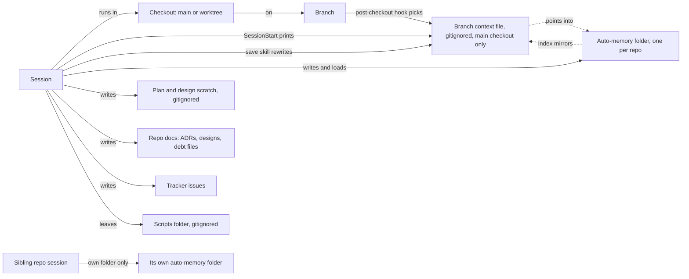

# Memory and context saving

Status: planned (#270, #271, #272, #273, #274, #275, #276, #277, #278) · Scale: explore · 2026-10-30

Amended 2026-11-02 (#301): R10 narrowed to save and pick-up. W-b's per-write commits moved to backlog (#273), and R3's stub and compaction records were dropped. #274 prints the matched workstream's state and takes a snapshot commit of the store at session start. #277 and #300 moved to backlog.

Issue: #269. Gate 1 approved by the operator on 2026-10-30 ("yeah to all"), with G2, G3, G4, and G6 confirmed. Gate 2's threads were settled on 2026-10-30 and 2026-10-31 (§Rulings on the trial). Gate 3 approved on 2026-10-31 ("yeah to all, looks fine at first glance"): the note, option A over A0, the store at `~/AI-Memory-Store`, and the ADR inside piece 2.

Research: [`docs/research/memory/`](../../research/memory/README.md), in particular the two reports dated 2026-10-30, and [the 2026-10-12 memory-and-context report](../../research/control-centre/2026-10-12-memory-and-context.md) with [its probes](../../research/control-centre/2026-10-12-probes.md).

This design takes the immediate problem: the operator's day-to-day loss of working context. The wider memory goals in [the loop design](../loop/design.md) stay there, as the operator ruled on 2026-10-30.

## Problem

The operator loses working context: decisions, findings, procedures, and the state of a workstream. It happens across parallel sessions, worktrees, branches, and a family of related repos. They have never found a way to stop it (#269, 2026-10-30).

Cases are named in generic terms, since this repo is public. The originating work repo's history and its auto-memory hold the details.

### Cases

The operator gave these on 2026-10-30. Each is traced to where the knowledge lived and where it should have lived.

| # | Case, in the operator's terms | Loss mode | Where it lived | Where it should have lived |
|---|---|---|---|---|
| C1 | Navigating the branch-keyed context system with worktrees is "a major pain" | Never loaded | A gitignored file per branch, in the main checkout only | A store outside the checkout, keyed by workstream, reachable from any checkout |
| C2 | Finishing work "not really being sure we haven't lost anything from the session" | Never written down, or not known to be written | The transcript, which Claude Code deletes after 30 days by default | A capture at the session's end, plus a receipt saying where each finding went |
| C3 | Awareness of the other repos in the family has to be repeated every time | Written, not found | Each repo's own auto-memory, which no other repo's session loads | A family area that every family repo's session can reach |
| C4 | Repeating instructions for tasks done well before | Written, not found, or never written | A past session's transcript, or one repo's memory | A procedure (#8's Playbooks) at the scope where it applies |
| C5 | Loose one-off scripts that "end up often not being one-offs"; after weeks away the operator forgets what each does and relearns it | Rotted | A gitignored scripts folder in the main checkout: 27 folders, 1,481 files, none tracked, 2 READMEs | A catalogue entry per script, saying what it does, how it runs, and when it last ran |
| C6 | Design decisions: "never quite sure if they're tracked anywhere or not" | Not known to be written | Any of six places: tracker, design notes, ADRs, memory, branch files, plan scratch | One home per decision, and one index that points to it |
| C7 | Several sessions on one repo doing different things, on one branch or several, must not step on each other | Overwritten | One shared file per branch; the main branch's file holds 8 workstreams | One file per session for capture; workstream pages with a write guard |
| C8 | Off the main branch, "everything we've done while sorting prod issues is lost" | Wrong home | The context file of whatever branch the session was on | A support workstream with no branch, whose findings reach the repo's debt files or runbooks |

The C5 counts come from `git ls-files`, `find -type f`, and `find -maxdepth 2 -iname 'README*'`, run on 2026-10-30.

Three findings follow from the table:

1. **The branch is the wrong key.** C1, C7, and C8 trace to it. A workstream spans branches, a branch carries several workstreams, and support work has no branch at all.
2. **Most loss is "not found", not "never written".** C3 to C6 are knowledge that existed somewhere. Only C2 is mainly about capture. This weighs against making forced capture the main lever, which #269 proposed.
3. **The operator cannot tell what was kept.** C2 and C6 are about uncertainty, not a measured loss. A receipt that names where each item went addresses them, even when nothing was lost.

### Forces

- **Forced capture adds noise.** Every external tool that forces capture reports noise or token cost, which moves loss towards "not found" and "rotted" (`2026-10-30-capture-and-concurrency-prior-art.md`).
- **One pile is wanted.** The operator ranks findability above tidiness, so a noisy pile is a cost to manage, not a reason to split it.
- **Little time.** The operator has little time for sidekick and wants the immediate problem solved first (memory note, 2026-10-30; this design's scope ruling).

### Goals

Each is marked stated (the operator said or confirmed it, with the date) or inferred.

- **G1, stated 2026-10-30:** a session loads the right workstream's context without a paste. That holds in any checkout, on any branch or none (C1, C8; #269 §How it is verified).
- **G2, confirmed 2026-10-30:** what a session learned or decided has a home when it ends. The session says where each item went.
- **G3, confirmed 2026-10-30:** knowledge about the other repos in the family reaches a session without the operator repeating it.
- **G4, confirmed 2026-10-30:** a procedure done well once is found and reused, not re-explained.
- **G5, stated 2026-10-30:** loose material can be found and understood after months away. It covers one-off scripts (C5) and outside technical documents such as PDFs and docs, which the operator drops into an inbox.
- **G6, confirmed 2026-10-30:** every decision has one findable home, or a pointer to it.
- **G7, stated 2026-10-30:** parallel sessions on one repo all save, and none loses another's write. That holds on one branch or several, support sessions included (C7; #269 §How it is verified).
- **G8, stated 2026-10-30, in #269:** a sibling repo with no tooling of its own reaches the store.

Preferences, stated 2026-10-30:

- A store outside any repo, with one area per scope. The scopes are the operator, the product family, and each repo. The operator confirmed the three scopes on 2026-10-30.
- One big pile beats many small ones. An item is useful the moment it lands, and filing is an optional tidy-up that nothing waits on.
- Every item describes itself: its date, its scope, and where it came from. Confirmed 2026-10-30.
- An inbox for capture and for outside sources. Ingest should be accommodated for technical PDFs and docs.
- Auto-memory moves into the store (#269).
- Obsidian is a viewer only (#269; ADR-0007 Decision 5).
- **Adopt, don't hand-roll** (stated at gate 1, 2026-10-30): use what the community built. Wrap it in skills, agents, hooks, and rules, as sidekick does with superpowers.
- **One global store that Claude owns** (stated at gate 1, 2026-10-30): context, memory, and loose files in one place on this machine. Claude reads it, writes it, and organises it, from every project.
- **See it working before deciding** (stated at gate 1, 2026-10-30): the operator finds the design hard to judge on paper.

### Non-goals

- Worktree and parallel-session mechanics beyond what G1 and G7 need. They get their own design session next (operator, 2026-10-30).
- Email and chat. The operator reaches those over MCP (2026-10-30).
- Sync, a remote, or sharing with a team, for now (2026-10-30).
- Moving or restructuring any repo's own docs, and replacing any tracker as the status surface (#269 §Out of scope).
- Picking a substrate before the requirements are known (#9).

## Constraints

Each constraint is marked verified, with what was read or run, or assumed.

### Stated by the operator

- **K1.** The store lives on this machine only: no GitHub, no sync, for now (2026-10-30).
- **K2.** It is part of sidekick: sidekick ships the tooling, and the store is the operator's own (2026-10-30). sidekick is public, so it never ships content (#269).
- **K3.** The product family is a set of the operator's work repos, which they named on 2026-10-30. Some are deprecated and some are dead ends. A dead end's lessons still count.
- **K4.** It works where sidekick's PM layer does not apply, including a repo tracked in another tool (#269 question 7). The family's repos are tracked outside GitHub.
- **K5.** Repo docs stay in their repos. The store holds working state and points into them, per `sk-pm-conventions.md` §No mirroring (#269).

### Verified mechanism facts

From `docs/research/memory/2026-10-30-claude-code-mechanisms.md` (Claude Code 2.1.314, docs fetched 2026-10-30) unless another source is named.

- **K6.** Auto-memory is one folder per git repo, shared across worktrees, on one machine. The first 200 lines or 25KB of `MEMORY.md` load at session start; topic files load when read (§2, §3).
- **K7.** `autoMemoryDirectory` moves that folder and takes an absolute or `~/` path. Passed with `--settings`, it worked for headless sessions, and for background sessions' writes (probes, 2026-10-12). In a gitignored `.claude/settings.local.json` it worked for the main checkout and for a worktree with no `.claude/` folder, and a symlinked `memory/` folder was blocked (`2026-10-31-auto-memory-location-probes.md`). The worktree result is documented behaviour since v2.1.211: "In a worktree, it uses the file at the main checkout's root." The exceptions are a folder outside git, a repository rooted at the home folder, Windows, and a root, `.git`, or `.claude` entry the user does not own (settings docs, §Where Claude Code keeps the local file, fetched 2026-10-31). The 2.1.316 settings schema says the key is ignored in project settings, so only the local route is used. Every probe ran headless, which skips the trust check.
- **K8.** A plugin cannot set `autoMemoryDirectory` or any memory key. Its settings file takes only `agent` and `subagentStatusLine` (§6).
- **K9.** A SessionStart hook's `additionalContext` is capped at 10,000 characters; past that, it is spilled to a file with a 2,000-character preview (§5).
- **K10.** A Stop hook can return `decision: "block"` with a reason, which makes the model continue. `stop_hook_active` guards the loop, with an 8-continuation cap (§5).
- **K11.** A SessionEnd hook gets `transcript_path`, a 1.5-second default budget, and at most 60 seconds per hook; a plugin's own timeouts do not raise it. It fires only on graceful exits (§5; prior-art report).
- **K12.** PreCompact can block compaction but cannot inject text. PostCompact receives the compaction summary (§5).
- **K13.** Edit applies a change to a file modified since it was read, and says so; Write refuses. Writes through Bash skip both checks. Two writers on one memory folder lost no update (probes, 2026-10-12; §7).
- **K14.** Transcripts are deleted after `cleanupPeriodDays`, 30 by default. The memory folder is exempt from that sweep (§8).
- **K15.** A `CLAUDE.md` import of a file outside the repo asks for approval once per project (§4).
- **K16.** Claude Code's Read tool reads PDFs and images, so an ingested source can stay in its original form (tool description, read 2026-10-30).
- **K20.** `permissions.additionalDirectories` in a repo's gitignored local settings made a family folder writable from the main checkout and a worktree. A `CLAUDE.md` in that folder did not load, with `CLAUDE_CODE_ADDITIONAL_DIRECTORIES_CLAUDE_MD=1` set in settings or in the shell; it loaded only when the folder came from `--add-dir` (`2026-10-31-auto-memory-location-probes.md`).
- **K21.** After compaction, auto-memory and the project-root `CLAUDE.md` are re-read from disk, while context a hook added earlier is summarised. A SessionStart hook that matches `compact` runs again (context-window docs, fetched 2026-10-31).

### Measured in the work repo, 2026-10-30

- **K17.** The branch-context folder is gitignored, so a worktree has neither the folder nor its symlink (#269).
- **K18.** Its scripts folder is gitignored and untracked, with 27 folders and 1,481 files (C5).
- **K19.** The family's repos keep separate auto-memory folders, and each loads only in its own repo. Measured with `ls ~/.claude/projects/*/memory`.

### Assumed

- **A1.** One operator on one machine. Every multi-writer case is parallel sessions, not people.
- **A2.** The store stays small enough for plain-text search, in the tens of megabytes. One repo's memory was 800KB on 2026-10-30 (`du -sh`).
- **A3.** A sidekick profile can pass `--settings` when it launches a session. Not checked against `sidekick profile launch`.

### Read and skipped

Read:

- #269, and the loop design;
- the work repo's save skill, post-checkout hook, switch script, template, and README;
- its auto-memory index and redesign note, and two sibling repos' memory listings;
- the 2026-10-12 memory report and probes, and both 2026-10-30 reports;
- claude-obsidian's README, fetched 2026-10-30.

Skipped, except where #269 or the 2026-10-30 survey cites them:

- ADR-0007 beyond the decision #269 quotes;
- `docs/research/memory/REPORT.md` and `docs/research/context-memory/REPORT.md`;
- closed issues #7, #8, #9, and #61.

Each is re-read before an option rests on it.

## System map

As it stands in the work repo, 2026-10-30.

- **Nouns.** A session runs in one checkout, which is on one branch. A branch has at most one context file. A repo has one auto-memory folder, which every checkout of it shares. A workstream has no noun of its own: it lives inside branch files and memory topic files.
- **Who writes.** Every session on a branch rewrites that branch's file whole. Every session in a repo writes its auto-memory folder, with Edit's precondition as the only guard.
- **Extension point.** None for a new scope. A sibling repo, a support workstream, or an outside document has nowhere to go.

## Trial

A sandboxed trial on 2026-10-30 ran the cases against three community tools, as the operator asked to see them working (`docs/research/memory/2026-10-30-trial-method.md`). The table's grades count a pass by a guessed project or by browsing the store as partial, since the trial put the store beside the repos.

| Base | Pass | Partial | Fail | Not applicable | Per save |
|---|---|---|---|---|---|
| Claude Code auto-memory, moved into the store with `--settings` | 6 | 1 | 0 | 1 | $0.50, 64 s |
| basic-memory | 4 | 3 | 1 | 0 | $0.63, 98 s |
| claude-obsidian, used directly | 2 | 5 | 1 | 0 | $1.24, 205 s |
| episodic-memory, with nothing saved | 5 | 1 | 1 | 1 | no save |

Findings:

- **The platform carried it, when asked.** In the claude-obsidian trial's out-of-the-box runs, sessions saved to auto-memory, which read back from a worktree. Every write prompt said "Save" except S4w, the one unprompted capture. The operator's memory-steering user rules were loaded. In the basic-memory trial, auto-memory stayed empty, because that tool's output style took the saves (`2026-10-30-trial-basic-memory.md`).
- **Two stores drift.** The vault fell behind auto-memory and answered a settled question with "Not decided yet". The design needs one store.
- **Every tool left the same gaps.** None keys by workstream or has a family scope. Only claude-obsidian ingests a PDF, at three sessions and $3.29. None gives a receipt at the session's end.
- **episodic-memory changed user settings.** Its summariser runs a bundled older Claude Code against `~/.claude`, which dropped two keys from `settings.json`; they were restored. Its code skips the summariser on the sync path when `EPISODIC_MEMORY_SKIP_SUMMARIES=1` (`src/sync.ts:240` and `:353` at `7e06519`, read 2026-10-31). That is untested end to end.

The per-save figures for auto-memory and claude-obsidian are the claude-obsidian trial's averages; basic-memory's averages its six single-session writes.

### Rulings on the trial

The operator ruled on 2026-10-31:

- **The base is auto-memory, improved and customised to the operator's workload.** The operator noted that it needs guidance to organise itself, and that guidance largely exists at user level already.
- **The right tool for the right job.** A vault tool such as claude-obsidian suits research or a repo's `docs/` folder, which have formalities anyway. That is a per-repo tooling choice for a specific problem, outside this design.
- **episodic-memory gets a trial in real use** (ruled 2026-10-31, "let's try it and evaluate"). Transcripts are kept only for 30 days today. `cleanupPeriodDays` is unset in the user settings, so the default of 30 applies, and the oldest transcript on disk is dated 2026-09-30 (checked 2026-10-31 with `jq` and `find ~/.claude/projects -name '*.jsonl'`).
- **The inbox for PDFs and docs leaves this design** (ruled 2026-10-31). It needs another tool, which the operator will explore separately. This design keeps a place in the store for whatever that tool produces, so its results land in the shared memory folder.
- **The store is named `AI-Memory-Store`** (ruled 2026-10-31), so its purpose is obvious on disk.
- **Parallel and concurrent sessions are the operator's next design topic** (2026-10-31). This store must lend itself to them, so concurrency is weighed as its own sub-problem in §Options.

- **W-b is agreed** (2026-10-31), from §How parallel sessions write. The operator's parallel patterns, stated the same day:
  - **Several features in one repo at once**, which may or may not collide. The operator pushes for worktrees there, and that loop is broken; it is the next design's.
  - **Support on the main branch** (prod issues, support, reporting) while feature work runs in other sessions or workers. Profiles will start to play a role here.
  - **Sessions in adjacent family repos at once.** A full-stack feature can touch several of them, so these are parallel sessions with a common objective, and coordinating them is hard.

## Options

The base was weighed as three options and ruled at the trial (§Rulings on the trial). A fourth, raised by the second review, is weighed with them. The wrapper's three load-bearing choices follow: how parallel sessions write, how the family reaches a session, and how a session ends.

### The base

**A. Claude Code's auto-memory, moved into one store folder.** Chosen.

1. The pattern is registration and declarative configuration: each repo registers with one settings key, and the store's layout is the contract. The source is Claude Code's memory and settings docs (K6, K7).
2. It solves one home for working memory, reachable from every checkout, with one history and one place to search. The trial showed it saving when asked, once unprompted, and reading back from a worktree.
3. New here, and against a precedent. sidekick's pre-plugin installer wrote entries into repos' `settings.local.json` and left them broken (#126). Closing #126, the operator read changing a settings file as needing an amendment to ADR-0009 §Decision 3.
4. Costs: no typed records, search by grep, an index the operator's user rule caps at 80 lines (`~/.claude/CLAUDE.md`), and one settings key per repo. Avoid it when structured queries over memory are the point.
5. The fifth repo is one `sidekick memory link` call. A new ingest tool writes into the store's `sources/` area and changes nothing else.

**A0. Auto-memory left where it is, and the store holding only the shared areas.** Raised by the second review; rejected on the operator's stated preferences, which they may revisit.

1. No pattern: the platform's default folder per repo, shared across worktrees (K6), plus one store for the family, sources, and catalogues.
2. C1's loss was the branch file, not auto-memory, and the default folder already serves worktrees. Only the shared areas need a new home.
3. Every repo's memory today.
4. Costs: it gives up two stated preferences, "auto-memory moves into the store" and one global store. Each repo's memory keeps its own folder, outside one history and one search. It saves piece 2's settings key, the migration of memory folders, and the lost-setting failure.
5. A new repo needs nothing; a new family repo needs only its family folder.

**B. basic-memory as the store.** Rejected at the trial.

1. An adapter over an MCP service, with typed notes and a SQLite index (`2026-10-30-trial-basic-memory.md`).
2. It gives structure: decisions with a status, and a brief listing the open ones.
3. New here.
4. Costs: a Python runtime with 159 packages, telemetry and a self-updater to switch off, and per-checkout mapping that misses worktrees. Its output style fences sessions inside one project.
5. Each new repo needs its own setup, and every worktree needs the mapping fix the trial lacked.

**C. claude-obsidian as the store.** Rejected for memory; the operator places it with research or a repo's `docs/`.

1. A vault with a transaction core: an inbox, wiki pages, an index, and a log (`2026-10-30-trial-claude-obsidian.md`).
2. It organises the most, which matches the "Claude owns and organises it" picture.
3. New here.
4. Costs: about 2.5 times the cost per save, approval stops in headless sessions, and it never saves unasked. Run beside auto-memory, it drifts and answers wrong.
5. Each save keeps paying the model to relearn the transaction format from source.

### How parallel sessions write

No measurement found a lost write in auto-memory. Two writers on one folder lost nothing (`2026-10-12-probes.md`), and in the trial S3b saw S3a's edit, re-read, and kept both facts (`2026-10-30-trial-claude-obsidian.md`). The damage measured was a stale handoff through shared notes. So W-b's value is attribution, history, and records the next design can read, more than protection from races.

| Failure | Evidence | W-b's answer |
|---|---|---|
| A save rewrites a whole shared file and drops another session's lines | The work repo's save skill rewrites its whole branch file (#269) | Shared files change only through targeted edits; a session's own record has one writer |
| A handoff goes stale: a fact lands in one note while another keeps the old claim | The 2026-10-12 audit's "handoffs through shared notes, not races" | One home per fact, with a workstream's state section as the handoff point. Consolidation finds the rest |
| Nobody can tell which session wrote what | #269's "no history" row | Every write through Edit or Write is a commit naming its session |
| A write skips the tools, through Bash | Bash skips Edit's and Write's checks (K13); sessions appended with `cat >>` (`2026-10-12-probes.md`) | Made visible, not blocked: the sweep commits such changes as made outside the tools, and the lint counts them |
| The index is a hot spot | Auto-memory's own index file (K6) | The index lists workstreams, never session records |

**W-a. Auto-memory as it is: shared files, guarded by Edit's check alone.**

1. No pattern: the platform's default.
2. It costs nothing to adopt, and no lost write was measured under it.
3. Every repo's memory today.
4. Costs: no attribution or history, and nothing stops a save that rewrites a whole file.
5. The next design has nothing to read about who did what.

**W-b. One writer per session record, targeted edits to shared state, and history made by hooks.** Agreed by the operator on 2026-10-31.

1. Single writer by construction, plus an interceptor at the tool-call boundary for the commits.
2. A session's record has one writer, so it cannot collide. Shared files change only through small edits under Edit's check. A hook makes every write a commit carrying its session id.
3. sidekick's `hooks.json` already registers PostToolUse hooks.
4. Costs: a hook on every Edit and Write that touches the store, a commit per write, and a record file per session.
5. A new kind of shared file needs a line in the rule; the hook doesn't change.

Its parts:

- **Session records.** `sessions/<date>-<session>.md` in the repo's folder, one per session. Auto-dream's own prompt reviews a `sessions/` subfolder when one exists (2.1.316 binary, `strings`, 2026-10-31), so the name follows the platform.
- **Targeted edits.** A workstream's state section and the index change only through Edit on the lines that changed, never a whole-file rewrite.
- **Per-write history.** A PostToolUse hook on Edit and Write commits the one path written, with the session id. It retries briefly on a locked index, then leaves the path for the sweep. Hooks run git outside the model's permission prompts.
- **The sweep.** The memory session-start hook commits whatever is still uncommitted, and labels changes no hook committed as made outside the tools.

A guard that denies Bash writes into the store is not part of W-b. It would block the store's own upkeep, since Edit and Write cannot delete or rename a file, and `python3 -c` writes get past a check on command text (`2026-10-12-probes.md`). #72 rejected that shape: "a hook keyed on tool name is one inconvenience away from being bypassed". The guard is registered as backlog, to revisit if the lint's count of outside-the-tools changes ever shows a lost write.

**W-c. #269's capture inbox with a single filer.**

1. Single writer: sessions write only inbox files, and one filing step merges them into topic files.
2. It removes contention on topic files entirely.
3. #269's direction, and the lesson of #61.
4. Costs: auto-memory writes topic files directly, so the filer can never be the only writer. A parallel session also cannot see a fact until it is filed, which breaks the handoff between sessions running side by side.
5. Every new kind of capture needs a filing rule.

W-b keeps W-c's per-session capture files and drops its mandatory filer, which matches the "one big pile" ruling.

### How the family reaches a session

No base has a family scope (C3). The operator's third parallel pattern adds a cross-repo workstream: one feature, one objective, sessions in several family repos.

**F1. One auto-memory folder shared by every family repo.**

1. No pattern: the platform's own folder, pointed at one place for several repos.
2. Every family session would load the family's index with no new mechanism, and it matches "one big pile".
3. New here.
4. Costs: one index across the family, under the operator's 80-line rule. One work repo's index already has 79 lines (`wc -l`, 2026-10-31); the four family indexes total 122 lines and 25,486 bytes (the first review's `wc -lc`).
5. Each new repo competes for the same index lines.

**F2. A folder per repo plus a family folder, whose index a sidekick session-start hook prints.** Recommended.

1. Observer at one boundary: a SessionStart hook.
2. The family's index reaches every family session at the start and after each compaction. A SessionStart hook that matches `compact` runs again and adds its output (K21). Each repo keeps its own index, and a cross-repo workstream file lives in the family folder.
3. Partly. sidekick's existing hook prints only the board's pickup, exits silently without one, and matches only `startup|clear` (`plugin/hooks/session-start:13-14`; `plugin/hooks/hooks.json`). Memory gets a hook script of its own, which also keeps it out of the pickup's timeout (#176).
4. Costs: characters at every session start, within the 10,000-character cap (K9). The hook prints index lines only, never note bodies, so a note's body reaches context only through Read, which the injection scanner watches (#219). One poisoned index line can still reach every family repo, so the lint bounds line length and flags instruction-shaped lines.
5. A new family repo is a `--family` flag on `sidekick memory link`.

**F3. A pointer line in each repo's index, and nothing printed.**

1. No pattern: a link the model follows when it decides to.
2. The cheapest option, with no new code.
3. New here.
4. Costs: it relies on the model choosing to look. In the trial, sibling knowledge reached a session only when the question named the sibling.
5. Each new repo needs the pointer line added.

**F4. The family folder as an added directory whose `CLAUDE.md` the platform loads.**

1. A platform feature: `CLAUDE_CODE_ADDITIONAL_DIRECTORIES_CLAUDE_MD` loads `CLAUDE.md` and rules from added directories (memory docs).
2. No hook, and the platform owns the loading and the compaction.
3. New here.
4. Costs: it loads only from a folder given with the `--add-dir` flag; a folder from `permissions.additionalDirectories` did not load (K20). Plain `claude` sessions would miss it.
5. Usable in sessions a sidekick profile launches, which can pass the flag; it is not the default route.

### Which workstream a session is on

The branch is the wrong key (§Cases, finding 1). The main branch carries many workstreams, a new worktree branch is listed by no file, and a dispatched worker's branch is `worktree-<name>` (`bin/helpers/worker-dispatch.ts:162`). The hook therefore tries keys in this order:

1. **A named workstream.** The session's title, or a worker's brief, names it. SessionStart receives the session's title (`2026-10-30-claude-code-mechanisms.md` §5).
2. **The branch**, matched against each workstream's front matter, which lists its branches per repo.
3. **A menu.** With no match, the hook prints the open workstreams' names, and the rule says to ask when the request is ambiguous.

The save skill adds the current branch to its workstream's front matter on the first save from that branch, so a new worktree is found from then on. Passing the workstream into a worker's brief belongs to the next design.

### How the session ends

Forced capture adds noise when its output is loaded. Capture that nothing loads, kept in session records the index never lists, costs disk but no context.

**R1. A save skill that ends with a receipt, plus a rule.** Recommended.

1. No pattern: one skill, replacing the work repo's own save skill, which the operator already uses.
2. It answers C2's uncertainty directly: the receipt names each item kept and where it went, and becomes the session's record.
3. The work repo's save skill is the precedent; this one writes auto-memory and the session record instead of a branch file.
4. Costs: it runs only when asked or when the model offers it.
5. A new kind of item is one line in the rule saying where it goes.

**R2. A Stop hook that blocks once, when a long session saved nothing.**

1. A harness forcing function (K10; `docs/research/context-memory/REPORT.md`, Pillar 2).
2. It catches the session that never saved.
3. New here.
4. Costs: a turn and its tokens on every qualifying stop, and noise the survey reports for every forced-capture tool.
5. Each tuning change is a hook change and a release.

**R3. Records with no model call: the compaction summary, and a stub for each missed session.** Recommended with R1; raised by the second review.

1. Recovery at the next start, from claude-remember, and a compaction summary saved as-is (`2026-10-30-capture-and-concurrency-prior-art.md`).
2. A PostCompact hook writes the `compact_summary` it receives into the session's record (K12). The memory session-start hook writes a stub record for any earlier session in the repo that left none: its title, time, and transcript path. G2 then holds without anyone asking, and R1 upgrades a record to a receipt.
3. New here.
4. Costs: disk, and a stub is a pointer, not a summary.
5. A new source of capture is another hook writing the same record.

R2 is registered as backlog. Its revisit condition is measurable: the lint counts long sessions with only a stub record.

## Recommendation

Adopt A, W-b, F2, R1 with R3, and the selection order in §Which workstream a session is on. Auto-memory is the store, moved into `~/AI-Memory-Store` by one gitignored setting per repo. A thin sidekick layer adds:

- per-write history and per-session records (W-b);
- the family index and the workstream match at session start (F2);
- a save skill whose receipt becomes the session's record, and records made without a model (R1, R3);
- a rule that tells auto-memory how to organise itself;
- a lint, and a trial of the platform's auto-dream as the consolidation step.

episodic-memory runs a real trial beside it.

The other threads:

- **Location.** `~/AI-Memory-Store`, outside `~/Documents`. Whether this Mac syncs `Documents` to iCloud could not be confirmed: listing iCloud Drive returned "Operation not permitted" (2026-10-31), so a home-folder root keeps K1 independent of that toggle.
- **Access.** One user-level `permissions.additionalDirectories` entry for the store lets every session read and write all of it. That makes the family folder writable and the whole store searchable from any repo.
- **Scopes.** The operator's own scope lives in the user rules and user-level skills, as the loop design ruled on 2026-10-12. The store holds the family and repo scopes, and a cross-repo workstream lives in the family folder.
- **The index.** It lists open workstreams and points to one reference file and one archive file, so it stays under the operator's 80-line rule.
- **Decisions, procedures, and scripts.** One home per decision: a team-facing one goes in the repo's ADR, design, or tracker, and the memory points to it. A procedure that repeats becomes a skill. A script catalogue file per repo says what each one-off does, how it runs, and when it last ran.
- **Consolidation.** Claude Code 2.1.316 ships auto-dream, a background consolidation pass over this folder, off for this account by a server flag and switchable with `autoDreamEnabled`. It is trialled before anything is built. A review skill on the 2026-10-12 audit's classes is the fallback.
- **Sources.** The store's `sources/` area is the output contract for a future ingest tool: Markdown with front matter naming the date, the scope, and the original's path.
- **Transcripts.** `cleanupPeriodDays` is raised as its own step, so episodic-memory is judged on its search alone.
- **#7's principle.** "Never silently agent-edited" becomes "visible after the fact": every write is a commit with its session, and the receipt lists what a save changed. That is weaker than approval before the write. The operator chose it by asking for a store that Claude owns (gate 1).
- **The loop design's memory mod.** Its write guard is covered here by Edit's check and the commits; its review pane stays the loop's.

Assumptions, and what changes if each is wrong:

1. **Auto-memory saves when asked, and sometimes unprompted.** One unprompted run is thin evidence. R3 keeps a record either way, and the lint's count of stub-only sessions says when R2 is needed.
2. **sidekick resolves the same settings file as Claude Code.** That is the main checkout's root, per the settings docs, with their exceptions. Piece 2 resolves the root through git's common directory, never the working directory, and refuses the documented exceptions.
3. **Interactive sessions, nested `.claude/worktrees/` worktrees, and profile launches honour the setting.** The probes ran headless only. A profile's `--setting-sources` can leave out `local` (`bin/helpers/profile-launch.ts:96-107`). Piece 2 verifies all three before anything migrates.
4. **sidekick's key survives Claude Code's own writes to the file.** Claude Code saves permission approvals there, from any worktree. Piece 2 merges its key and verifies it survives an approval.
5. **Auto-dream, once on, works with W-b.** It deletes notes with shell commands, which no Edit or Write hook sees, so the sweep commits its changes as made outside the tools. Its trial checks that its edits are attributable and revertible.

## Lenses

| Lens | Load-bearing | Where it bites |
|---|---|---|
| Data model | Yes | The store's layout is the contract. Sessions write workstream files, the index, and their records; hooks write commits and records |
| Boundaries | Yes | sidekick ships tooling only; content stays on this machine and never enters this repo (K2) |
| Extension points | Yes | A new repo is a registration; a new ingest tool writes to `sources/`; a new capture source writes the same record |
| Contracts | Yes | The settings key, the layout README, the workstream front matter, and the rule's text, which the model reads every session |
| Concurrency and failure | Yes | W-b: one writer per record, Edit's check on shared files, per-write commits that retry and defer to the sweep |
| Operability | Yes | The registration check, the workstream match, and the lint count at start; the receipt at the end |
| Testability | Yes | CLI and hook tests over temporary folders; the trial's scenarios replayed as acceptance |
| Security | Yes | Work data stays local, and the store holds no secrets. The hook prints index lines, never bodies. Memory poisoning is a known attack class (`2026-10-12-memory-and-context.md`). episodic-memory keeps prod support transcripts for good, on this machine only |
| Performance | Yes | One hook per store write, and a session-start hook that prints the lint's cached count rather than running it |
| Reversibility | Yes | Removing the settings key returns a repo to the default folder. Migration moves the old default folder into the store's archive, so a lost setting starts empty and the hook says so |

## Breakdown

Each piece is a self-contained brief for an issue. Piece 1 is configuration and evaluation; pieces 2 to 8 are sidekick code and settings; piece 9 is work in each repo.

1. **Transcripts and the episodic-memory trial** (#270).
   - Problem: transcripts expire after 30 days, and search over them is raw grep.
   - Resolves it:
     - Raise `cleanupPeriodDays` first, as its own change.
     - Back up `~/.claude/settings.json`, and install episodic-memory with `EPISODIC_MEMORY_SKIP_SUMMARIES=1` in the user settings' `env`.
     - Run one supervised sync, and check that `settings.json` is unchanged before trusting the hook.
     - Never run the manual `index` or `verify` commands, which still summarise (`src/indexer.ts:45`, `src/verify.ts:163` at `7e06519`).
   - Out of scope: patching its upstream defects.
   - Verified: after two weeks, a keep-or-drop call on search value, noise from its own search sessions, and disk use.
2. **Store and registration** (#271). `sidekick memory link <repo> [--family <name>]`, and an ADR.
   - Resolves it:
     - Create the store once, as a local git repository with a layout README.
     - Merge one key, `autoMemoryDirectory`, into the gitignored `settings.local.json` at the root Claude Code uses. Refuse when that file is tracked or a documented exception applies.
     - Copy the existing auto-memory in, then move the old default folder into the store's archive.
     - The operator adds the user-level `additionalDirectories` entry for the store.
     - An ADR records that sidekick may merge this one key into a repo's gitignored local settings and never removes or rewrites entries. That follows the operator's #126 reading of ADR-0009 §Decision 3.
   - Out of scope: the hooks, which are pieces 4 to 6.
   - Verified:
     - Interactive sessions in the main checkout, a sibling worktree, and a nested `.claude/worktrees/` worktree load the moved index, and so does a profile-launched session.
     - The key survives a permission approval.
     - A sibling repo with no tooling registers in one command (G8).
3. **The memory rule** (#272).
   - Resolves it: one short rule covering:
     - workstream files, their branches, and cross-repo workstreams in the family folder;
     - the support file, the index's shape, and one home per decision;
     - procedures and the script catalogue;
     - scopes, self-describing items, targeted edits, and retirement.

     It goes in `plugin/rules/`, per `sk-guidance-authoring.md`.
   - Out of scope: per-repo conventions.
   - Verified: the trial's S1, S2, S4, S7, and S8 replayed with the rule loaded, with "carry on" in place of the topic in S1's read.
4. **Per-write history** (#273). The PostToolUse commit per Edit or Write in the store.
   - Verified: two parallel sessions on one workstream both land, each commit names its session, and a Bash append into the store is committed as made outside the tools.
5. **The memory session-start hook** (#274). A hook script of its own, matching `startup|resume|clear|compact`.
   - Resolves it:
     - It prints the session id, the matched workstream or the menu, the family index within a set character budget, the registration check, and the lint's cached count.
     - It runs the sweep, and writes stub records for missed sessions.
   - Verified:
     - A fact saved from one family repo reaches another's session without the question naming the first (S5), and again after `/compact`.
     - Two sessions in two family repos update one cross-repo workstream, and each sees the other's state at its next start.
     - A repo whose setting is missing gets a warning.
6. **Session records** (#275). The save skill with a receipt (R1), and the PostCompact record (R3).
   - Resolves it: the session's decisions, findings, and next steps go to their homes. The receipt, a table of each item and where it went, becomes the session's record. Team-facing items are suggested for the repo rather than written. A compaction writes its summary into the same record.
   - Verified: a C2 replay ends with a receipt, and a worktree session then finds each item. A session that compacts and ends without a save still leaves a record.
7. **`sidekick memory lint`** (#276).
   - Resolves it: a read-only check, run in the background, whose count the hook prints. It covers:
     - dead index links, and files the index doesn't list, with `sessions/` exempt;
     - an index past the operator's line cap, oversized files, and missing status lines;
     - untouched stubs, key-shaped strings, and instruction-shaped index lines;
     - changes made outside the tools, stale locks, and unregistered repos;
     - long sessions with only a stub record.
   - Verified: a fixture with each defect reports each one.
8. **Consolidation** (#277). Trial auto-dream with `autoDreamEnabled` on, at user level.
   - Verified: after two weeks, its passes are attributable in the history, revertible, and judged against the 2026-10-12 audit's classes.
   - If it falls short, a review skill on those classes replaces it, proposing edits for the operator to approve in one pass.
9. **Migration** (#278).
   - Resolves it: register every family repo and home project. Fold the work repo's branch context files into workstream files, with the operator reviewing. Retire that repo's post-checkout hook, its SessionStart print, and its save skill. Archive the dead ends.
   - Out of scope: the repos' own docs (§Non-goals).
   - Verified: #269's checks, in §How it is verified there.

Order:

- **Piece 1** is configuration with no dependency, so it ships alone and first.
- **Piece 2** comes next, with its ADR, since everything after it rests on the store.
- **Pieces 3 to 8** follow. Pieces 4, 5, and 6 are hooks with shared tests, so they go in one plan.
- **Piece 9** comes last.

**What ships alone:** piece 2 adds a command and changes no sidekick contract. It does change where each registered repo's memory lives, which removing the key reverses.

**Release:** the whole is one release, R10. Pieces #270 to #278 joined it at its Opening on 2026-10-31, and the three registered as backlog stay there until their conditions hold (operator, 2026-10-31).

**Settings changes the operator makes at user level, after work hours:** `cleanupPeriodDays`, the episodic-memory `env` line, the store's `additionalDirectories` entry, and `autoDreamEnabled`.

**Registered as backlog with this design:**

- R2's Stop hook, #279. Revisit when: the lint counts long sessions with only a stub record across two weeks of R1 and R3.
- The guard on Bash writes into the store, #280. Revisit when: the lint's count of changes made outside the tools shows a lost or wrong write.
- The ingest tool for PDFs and docs, #281. Revisit when: the operator starts the separate exploration they named on 2026-10-31.

**Could ride along, named and not widened:**

- #176, the session-start brief's timeout. Piece 5 adds a second session-start hook beside it.
- #198, the reviewer's sealing. Moving memory changes what a subagent reviewer can see.

**Watch:** the 2.1.316 binary contains `teamMemory`, `orgMemory`, and `CLAUDE_CODE_POST_TURN_MEMORY` strings that no changelog entry explains. Its team-memory prompt places a synced `team/` folder inside the memory folder, which would conflict with K1 if it ships (the second review, `strings`, 2026-10-31; behaviour unverified). A post-turn capture feature would replace R2 and part of R1.

## Handed to the next design

The parallel-sessions design inherits these from the store:

- **Every write is attributable.** Each commit names its session, so "who changed this workstream, and when" is a `git log` query.
- **Per-session records** in `sessions/`, one writer each, holding receipts, compaction summaries, and stubs.
- **Workstream files as the coordination surface.** A workstream's state section is the handoff point between sessions, and a cross-repo workstream in the family folder is the one place sessions in several repos share.
- **A workstream key** that a session's title or a worker's brief can carry.

Live coordination stays with that design: who is doing what right now, handoffs mid-flight, and passing the workstream into a dispatched worker. The store gives it shared, attributed state to read, not messaging.

## Decision

Approved by the operator at gate 3 on 2026-10-31.

In the context of losing working context across worktrees, parallel sessions, and a family of repos, facing community tools that all left the same gaps, we decided for Claude Code's auto-memory as the store. One gitignored setting per repo moves it into `~/AI-Memory-Store`. A thin sidekick layer adds per-write history, per-session records, the family index and workstream match at session start, a save skill with a receipt, a rule, and a lint. The platform's auto-dream and episodic-memory get trials. That achieves one home for working memory that every checkout, parallel session, and sibling repo reaches. We accept no typed records or semantic search, a settings key per repo under a new ADR, and a model that may not save unprompted. We also accept history visible after the fact rather than approval before.

## Review

Two rounds, each by a fresh subagent on 2026-10-31. The second ran because the first round's answers changed the recommendation; per the review procedure, no third round runs.

### Round 1

| # | Finding | Answer |
|---|---|---|
| 1 | The index's binding cap is the operator's 80-line rule, not 200 lines, and one work repo is at 79 | **Accepted.** The index lists open workstreams and points to a reference file and an archive file; F1 uses the review's measurement |
| 2 | Unprompted capture rests on one run; every other write prompt said "Save", and nothing detects the failure | **Accepted.** §Trial and assumption 1 say so; R3 and the lint's stub count answer it |
| 3 | Bash writes into the store rely on rule text | **Accepted, then revised in round 2.** The guard was added, and round 2 finding 3 removed it; Bash changes are now made visible |
| 4 | The existing session-start hook exits without a pickup and skips `compact`; hook context does not survive compaction; F4 went unconsidered | **Accepted.** Memory has its own hook matching `compact` (piece 5). F4 is weighed and kept for profile launches (K20) |
| 5 | Nothing reports a lost setting; nested worktrees and profile launches are untested; the kept old folder would load stale | **Accepted.** The hook checks registration, piece 2 verifies nested worktrees and profiles, and migration moves the old folder away |
| 6 | The operator scope has no home | **Accepted, with a correction.** Its home exists, the user rules, as the loop design ruled on 2026-10-12; the recommendation names it |
| 7 | The capture inbox was dropped without a ruling | **Accepted.** W-b keeps per-session capture files and drops only the mandatory filer; the operator agreed W-b on 2026-10-31 |
| 8 | Snapshot history mixes sessions and loses middle versions | **Accepted.** W-b commits per write with the session id; #7's principle is restated and named as weaker |
| 9 | Semantic rot goes undetected, and there is no consolidation step | **Accepted.** Piece 8 adds consolidation, revised in round 2 to trial auto-dream first |
| 10 | Piece 1's safety guard is untested and stated as fact | **Accepted.** §Trial says what the code shows; piece 1 backs up the settings and runs one supervised sync first |
| 11 | Nothing picks the workstream for a session that says only "carry on" | **Accepted, then revised in round 2.** §Which workstream a session is on |

Round 1's minor findings, as they came: sessions could not list the store; F1's figure; K7's background wording; per-profile `--settings`; Option A's precedent; AGPL as a weak cost; `cleanupPeriodDays` muddying the trial; the 2.1.316 strings. Each was acted on where the note now covers it.

### Round 2

| # | Finding | Answer |
|---|---|---|
| 1 | The note missed Claude Code's own background consolidation, auto-dream, which prunes this folder and reads `sessions/` | **Accepted.** Verified in the 2.1.316 binary and `~/.claude.json` (flag off). Piece 8 trials it before anything is built, and assumption 5 covers its writes |
| 2 | W-b defends against races no measurement found, while the measured damage, stale handoffs, is left open | **Accepted.** §How parallel sessions write now says no lost write was measured, states W-b's value as attribution and history, and gives the stale handoff its own answer |
| 3 | The Bash guard is the tool-name-keyed shape #72 rejected, and it blocks the store's own upkeep | **Accepted.** The guard is removed and registered as backlog; the sweep makes such changes visible |
| 4 | Selection still keys on the branch, which fails on main and on new worktree branches | **Accepted.** Keys in order: a named workstream, the branch, then a menu; the save skill registers new branches |
| 5 | The worktree resolution is documented, with exceptions, so the risk is mislabelled | **Accepted.** K7 quotes the settings docs; assumption 2 and piece 2 resolve the root through git and refuse the exceptions |
| 6 | Leaving auto-memory where it is went unweighed | **Accepted.** A0 is weighed and rejected on the operator's stated preferences, which gate 3 lets them revisit |
| 7 | The session-end options skipped capture with no model call | **Accepted.** R3 adds the compaction record and stubs for missed sessions |
| 8 | Writing a repo's `settings.local.json` has a history (#126) and, on the operator's reading, needs an ADR | **Accepted.** Piece 2 carries an ADR for one merged key |

Round 2's minor findings, as they came:

- `profile-store.ts` refuses a `settings.local.json` rather than reading one. Acted on in A's card.
- "Additive first" conflicted with moving the default folder. Acted on under What ships alone.
- "One settings line" was two keys. Acted on: one key per repo, plus one user-level entry.
- The lint's unindexed check contradicted session records. Acted on: `sessions/` is exempt.
- Every probe ran headless, which skips the trust check, and the 2.1.316 schema ignores the key in project settings. Acted on in K7.
- The hook-printed index bypasses the Read-only injection scanner. Acted on in F2: index lines only, bounded, and linted.
- The lint and sweep on every start would grow the hook's run time. Acted on: the lint runs in the background and the hook prints its cached count.
- A team-memory `team/` folder may ship inside the memory folder. Acted on under Watch.
- episodic-memory keeps prod support transcripts forever. Acted on in the Security lens.
- The iCloud check could not be confirmed. Acted on: the store moved to `~/AI-Memory-Store`, and §Recommendation corrects the earlier claim.
- The loop design's memory mod overlaps W-b's guard. Acted on in §Recommendation.

Still open after round 2: assumptions 3 and 5, which pieces 2 and 8 verify.
