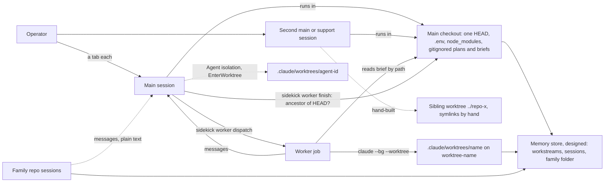

# Worktrees and parallel sessions

Status: planned (#266, #267, #282, #283, #284, #285, #286, #287) · Scale: explore · 2026-10-31

Amended 2026-10-31 (#266): piece 3's landed check became a simulated merge over the target's history. A review found that the two patch-id checks missed a landing after the target edited near the landed lines, and matched a change of meaning. The merge caught every landing that kept the content. Every `finish` now keeps its branch in a backup ref. The text that follows records the design as it stood.

The design became #282 to #291, and took #266 and #267 as one of its pieces. #266, #267, and #282 to #287 joined R10 beside the memory design's #270 to #278, and #288 to #291 stay in backlog (operator, 2026-10-31). Gate 1 approved by the operator on 2026-10-31, with the assumed A3 replaced by the stated K18, and P3's missing case answered (§Constraints, §Cases). Gate 2: T1 and T2 ruled on 2026-10-31, and T4 settled after a survey (§Rulings at gate 2). Gate 3 approved on 2026-10-31 (§Decision).

Research: [`docs/research/parallel-sessions/`](../../research/parallel-sessions/README.md).

This design consumes the memory store's contract and does not redesign it. [The memory design's §Handed to the next design](../memory/design.md#handed-to-the-next-design) gives four parts: per-write commits naming the session, and `sessions/` records. Workstream files are the coordination surface, and a worker's brief can carry a workstream key.

## Problem

The operator runs three parallel patterns, stated 2026-10-31:

- **P1.** Several features in one repo at once, which may or may not collide, in worktrees where possible. That loop is broken today.
- **P2.** Support work on the main branch (production issues, support, reporting) while features run in other sessions or workers. Profiles will play a role.
- **P3.** Sessions in sibling family repos with one objective, a full-stack feature across them, which are hard to coordinate.

Issues that bear on it: #266, #267, #252, #255, #248, #241. #248, a flag for `profile launch`, belongs to the profiles work and no piece takes it.

### Cases

The operator gave C1 to C3 on 2026-10-31; C4 turned up the same day. Each was traced on 2026-10-31 through the work repo's transcripts, its git history, and sidekick's code at `c190201`. Cases are named in generic terms, since this repo is public; the work repo's transcripts hold the details until Claude Code's 30-day sweep.

| # | Case, in the operator's terms | What the trace found | Pattern |
|---|---|---|---|
| C1 | A workstream of five plans run as workers: "the first 3 plans could be done in parallel, but we didn't" | The design note said plans 1 to 3 could run in parallel, and the operator asked for that. The model read "we'll go in order", an answer about planning order, as a ruling against parallel runs. It wrote that reading into the branch's context file as an operator ruling, and every later session inherited it. The three plans' commits shared only the design note's amendment lines and two code files | P1 |
| C2 | A parallel session on the same branch "had to worktree to main" to run a cleanup script. Harmless because it touched only gitignored files, "but it's not always like that". The context save at exit, "who knows what it removed and kept" | Three sessions shared the main checkout on one feature branch. The support session hand-built a sibling worktree with `git worktree add ../<repo>-x origin/main` and hand-made symlinks to `node_modules` and `.env`. It then ran the script in the shared checkout, importing tracked code, while another main fast-forwarded that checkout 13 commits. The save removed the morning session's entry, as the save skill's "replace the previous one" requires | P2 |
| C3 | "Bad worktree usage that needed manual cleanup or workarounds" | Two worker runs needed hand steps. One integrated into a feature branch that the main checkout did not have checked out, with `git update-ref`. That bypassed `finish`, so the report, the stop, and the removal were done by hand. The other is #267: `claude rm` outlasted `finish`'s 30-second limit, and the re-run refused `finish`'s own partial delete | P1 |
| C4 | Found on 2026-10-31, not given by the operator | A sibling repo holds a locked agent worktree from 2026-04-23. Its folder is gone, its branch never merged, and its lock stops `git worktree prune` | P1 |

C2's context-file half is the memory design's C7 and C8, which #270 to #281 answer; this design takes its checkout half. C3's first run corrects #266: `finish` was never run there, and what defeated it was the integration target, not the rebase. The correction is on #266, posted 2026-10-31 with the operator's approval.

A sweep of every home repo's transcripts on 2026-10-31 found the same kinds again:

| Kind | Count |
|---|---|
| Hand-built sibling worktrees, the usual route in the work repo | 16, in 11 sessions |
| A shared checkout changed under a running session | 14 |
| Gitignored files copied into or out of a worktree by hand | 7 sessions |
| A worktree teardown that did not finish | 6 |
| Isolation-guard refusals, 8 of them aimed at the shared checkout | 120, in 16 sessions |
| `EnterWorktree` renaming a branch, or setting an upstream nobody wanted | 4 |
| A worktree nested in `.claude/worktrees/` breaking the linter in the main checkout | 1 |

No case covers P3. The operator has avoided it: "I stayed on the safe route, another session completely detached" (2026-10-31). P3 is therefore anticipated, not traced.

### Findings

Ranked by blast radius.

1. **The main checkout is one seat that everything needs.** `dispatch` runs only there (`bin/helpers/worker-repo.ts:51-56`). It starts from that checkout's `HEAD` with clean tracked files (`bin/helpers/worker-dispatch.ts:140-157`). `finish` counts work as integrated only in that `HEAD` (`bin/helpers/worker-finish.ts:120`). Briefs, plans, and rulings sit in its gitignored folder, and so do `.env` and `node_modules`. Support work, feature mains, and integration therefore compete for one `HEAD` (C1, C2, C3; the sweep's 14).
2. **Four things make worktrees, and none shares a lifecycle with another.** sidekick's `dispatch` uses `claude --bg --worktree` (`worker-dispatch.ts:383-393`). superpowers uses `EnterWorktree` or `.worktrees/`. Claude Code makes agent and `-w` worktrees. Sessions hand-build sibling folders. Setup is copied by hand, teardown fails partway, and orphans stay (C2, C3, C4; the sweep).
3. **Integration is recognised one way.** `finish` asks whether the branch's head is an ancestor of the main checkout's `HEAD`, and `claude rm` asks whether it is reachable from a remote or the default branch. A rebase or squash merge, a feature branch not checked out, and a milestone branch all read as not landed (C3; #266).
4. **Parallel runs failed before the mechanics.** In C1, nothing showed the plans' overlap, and nothing offered to dispatch them together. No sidekick skill mentions running two workers at once (`grep -i parallel`, 2026-10-31). A misread ruling then persisted in shared context. The memory store answers the persistence: one home per decision, and attributed writes.
5. **Sessions in one repo cannot see each other's footprint.** An interactive session without worker markers is a main (`plugin/hooks/role.ts:56-60`), so two interactive sessions are two mains with no guard between them. The desk shows each session's repo but not its branch or checkout (`bin/helpers/desk-snapshot.ts:137-142`).

### Forces

- **The operator has little time for sidekick** and wants daily pains fixed first (memory note, 2026-10-30).
- **Adopt, don't hand-roll.** The operator stated it at the memory design's gate 1 on 2026-10-30, and their standing preference is to survey and integrate thinly before building.
- **Review is the bottleneck** of parallel agent work, in every practitioner account the survey read (`2026-10-31-parallel-agent-tools-survey.md` §Documented failure modes). More parallel features raise review load, not only throughput.

### Goals

Confirmed by the operator on 2026-10-31 ("those goals ring true, G1 especially so").

- **G1:** any session can start a feature in its own worktree, then land it and clean it up. That holds whatever the repo's merge style (P1; #266, #267).
- **G2:** the operator knows before landing when two parallel features touch the same files (P1).
- **G3:** a support session on main runs beside workers without disturbing them, and its findings reach the memory store's support workstream (P2).
- **G4:** one objective across family repos has one place showing each repo's session and where it stands (P3).
- **G5:** no more windows to watch than today (all; `about-me.md`).

### Non-goals

Stated by the operator on 2026-10-31:

- The memory store, designed as #270 to #281.
- Profiles as roles, which come later (#241, and R10's proposal).

## Constraints

Each constraint is marked stated, verified with its source, or assumed.

### Stated by the operator

- **K1.** Sessions are peer processes with profiles, one main per terminal tab, and sidekick owns the view of them, not a terminal's cockpit (#241's comment, 2026-10-22).
- **K2.** The operator runs `bypassPermissions` almost everywhere (#241, #252).
- **K3.** Each repo integrates its own way. sidekick fast-forwards onto `master` or a `milestone/<name>` branch (`AGENTS.md` §Working here); the work repo merges pull requests by rebase (#266).
- **K4.** The family's repos are tracked outside GitHub (the memory design's K4), so no one GitHub board can show a cross-repo objective.
- **K5.** User-level setting changes wait until the operator stops work for the day (operator, recorded in session memory).
- **K18.** The operator moves the editor between checkouts as the work needs, and avoids it while another session has active work on the checkout's branch. That is why C2 ran on the feature branch. The operator will "follow a set of rules to make this smoother" (2026-10-31).

### Verified mechanism facts

From the three reports in `docs/research/parallel-sessions/`, dated 2026-10-31, on Claude Code 2.1.316 and superpowers 6.4.1, unless another source is named.

- **K6.** `worker dispatch` refuses outside the main checkout, off its `HEAD`, or with uncommitted tracked changes (`worker-repo.ts:51-56`, `worker-dispatch.ts:140-157`). It runs `claude --bg --worktree <name>`, which makes `.claude/worktrees/<name>` on `worktree-<name>`. Its overlay sets `worktree.baseRef` to `"head"` (`bin/helpers/worker-overlay.ts:40`).
- **K7.** `worker finish` refuses unless the branch's head is an ancestor of the main checkout's `HEAD` (`worker-finish.ts:120`) and the worktree holds no change but the report (`:147-162`). Each `claude` call it makes has a 30-second limit (`:313-319`). Once the job is gone, it stops before it forgets the desk record (`:78-83`).
- **K8.** `sk-execute` says a re-run of `finish` "works until `claude rm` succeeds" (`plugin/skills/sk-execute/SKILL.md:94`). K7's dirty check contradicts that for a partial delete (#267).
- **K9.** sidekick never invokes superpowers' `using-git-worktrees`. `sk-worker` overrides its consent step, its project setup, and the finish menu in text (`plugin/skills/sk-worker/SKILL.md:31-41`, `:68`), and `dispatch` bypasses it. Native worktrees branch from the remote's default branch unless `worktree.baseRef` is `"head"`, which no settings file in the repo sets.
- **K10.** `WorktreeCreate` replaces Claude Code's git creation for `--worktree`, `EnterWorktree`, subagent isolation, and background sessions. A hook-made worktree skips `.worktreeinclude`, and the hook must delete the branch. `WorktreeRemove` fires only for hook-made worktrees. The report infers that nothing fires after a git-made worktree appears. `SessionStart` under `--worktree` carries the new `cwd`, a `PostToolUse` hook on `EnterWorktree` would see its result (inferred), and `CwdChanged` did not fire on `EnterWorktree` (probe).
- **K11.** `worktree.symlinkDirectories` links folders such as `node_modules` into each worktree. With a trailing-slash ignore pattern, the link reads as untracked, so `ExitWorktree` refuses removal (probe).
- **K12.** In a worktree, transcripts follow the worktree's path, while auto-memory and `settings.local.json` resolve to the main checkout. `CLAUDE.md` loads from the worktree.
- **K13.** Claude Code detects no overlap between branches, merges nothing back, and coordinates nothing across repos. Messages between sessions are plain text. They cannot approve a prompt, and `notify_when_idle` fires once.
- **K14.** Cross-session messages reach a session in any repo on the machine. A session in another permission mode holds them for approval, and they expire (`sk-execute` §Hand off to a worker, step 2).
- **K15.** worktrunk recognises a squash merge with a simulated merge and a patch-id match. It gives each branch a stable port, and runs hooks at create, start, merge, and remove. Its Claude Code plugin routes Claude Code's worktrees through `WorktreeCreate` and `WorktreeRemove`. It has no multi-repo mode. These come from its docs; nothing was run.
- **K16.** Clash runs a pairwise `git merge-tree` between worktrees, read-only. A `PreToolUse` hook asks before an edit that would conflict. It is at v0.2.0 and sees textual conflicts only (docs; not run).
- **K17.** No local multi-repo tool for agents is maintained. vibe-kanban had multi-repo workspaces, and its company shut down on 2026-04-10 (survey).
- **K19.** Launched from a linked worktree, sibling or nested, `claude --bg --worktree <name>` makes its worktree under the main checkout's `.claude/worktrees/` on `worktree-<name>`. With `baseRef: "head"` it starts at the launching worktree's `HEAD`. The listing reports the new worktree as the session's `cwd`, and a linked worktree of a trusted repo needs no trust prompt (`2026-10-31-worktree-from-a-worktree-probe.md`, measured).
- **K20.** Co-active pairs of agent pull requests conflict textually in 19.8% of same-agent pairs and 41.7% of cross-agent pairs, a lower bound. The median conflicting merge has 2 chunks, and humans commit 96.1% of the resolutions (`2026-10-31-overlap-and-merge-coordination.md` §How often agent-parallel work conflicts, citing Xu et al. and Campos Junior and Murta, both 2026).
- **K21.** Replaying a merge with `git merge-tree` took a median 0.02 seconds. At that cost, its authors judged full replay better than a prediction model (same report, citing Subramanian et al. 2026).
- **K22.** Behaviour broke after a clean merge in 1 of 834 runs on real pull-request pairs, and in 97% of constructed interface changes. An accurate note on the other change that landed recovered 82% of the constructed cases (same report, citing Xia et al. 2026). A pre-agent study found a third of conflicts behind clean merges (Brun et al. 2011).
- **K23.** Branches cut from one baseline cannot conflict on content when their changed files are disjoint. Renames and a file meeting a folder of the same name still can (the review measured a file/directory conflict). This is inferred from git's three-way merge; the report found no study of the case.

### Assumed

- **A1.** One operator on one machine runs the sessions, as the memory design assumes. Landing need not be local. In the work repo, pull requests are also merged on the host, some by a second account (the review, round 1).
- **A2.** worktrunk's plugin and Clash's hook behave as their docs say. Neither was installed or run.

### Read and skipped

Read on 2026-10-31:

- the three reports and the two case traces;
- the memory design, and the six issues;
- each code line this section cites, re-read.

Skipped:

- interactive `EnterWorktree` and the isolation guard in an interactive session, which no probe ran;
- superpowers' shell lines run as written in a worktree;
- concurrent writes to `$.store`;
- Conductor, which is closed source, and pages the survey could not fetch (its §Not read).

## System map

As it stands on 2026-10-31.

- **Nouns.** A repo has one main checkout and any number of linked worktrees, each on one branch. A session runs in one checkout at a time, and `EnterWorktree` or `/cd` moves it. A worker is a session with a brief, a background job, and a desk record keyed by the repo's common git folder. A workstream, from the memory design, spans branches, sessions, and repos.
- **Who writes.** Every session writes the checkout it runs in. The main checkout's `HEAD` moves under every session in it. A worker writes only its worktree, and its main integrates it.
- **Extension points.** Worktree creation has one platform seam, `WorktreeCreate`, and four creators that use none. Integration has none: the main checkout's `HEAD` is written into `finish`. Setup has the brief's `setup` field and `.worktreeinclude`.

## Prior art

Three reports, all dated 2026-10-31, in `docs/research/parallel-sessions/`:

- `2026-10-31-worktree-handling-in-sidekick-and-superpowers.md`;
- `2026-10-31-claude-code-worktree-features.md`;
- `2026-10-31-parallel-agent-tools-survey.md`.

Each find is weighed as used or rejected in §Options.

## Options

Five threads, each with its own options and a proposed stance for gate 2. The first decides the layout the other four assume.

### T1. Which checkout holds what

Findings 1 and 5; G3.

**S-a. The main checkout stays on the default branch, and every feature lives in a worktree.** Set aside at gate 2 for S-d, which the operator described. Its first cost still applies to S-d.

1. Trunk checkout plus one worktree per branch: the layout worktrunk, Conductor, and Claude Code's `-w` assume (survey, §Worktree CLIs and §Claude Code itself).
2. Support work always has a clean seat on main, and no feature's active work sits in the main checkout. It turns K18's own rule into the layout, and C2 cannot recur.
3. New here: the work repo's feature mains run in the main checkout today (C1, C2).
4. Costs:
   - every feature main runs in a worktree, so `dispatch` must work from a linked worktree, which it refuses today (K6; #255's first half). The refusal came in with `dispatch` (`46bce35`, #206) with no reason recorded there, in #206, or in the control-centre design's workers note at `c0906d6`. The code derives the worktree folder, the branch, the brief's bounds, the baseline, and the integration target from the checkout's top (`worker-dispatch.ts:160-170`, `worker-brief.ts:166-171`, `worker-finish.ts:236-238`). From a feature worktree, all but the folder come out as S-a wants. Claude Code puts the worker's worktree under the main checkout's `.claude/worktrees/`, starting at the launching worktree's `HEAD` (K19). So lifting the refusal takes the folder from the main checkout's top and the rest from the launching worktree's;
   - `finish` must integrate into the feature's branch (T3), and each feature worktree needs setting up (T2);
   - plans and briefs then sit in the feature worktree's ignored folder, and go when the worktree goes.

   Not worth it in a repo that runs one feature at a time.
5. The fifth parallel feature is one more worktree, with no code change.

**S-b. A standing support worktree of main per repo; features stay where they are.**

1. A second long-lived seat, as the work repo's hand-built sibling worktrees already are.
2. C2's support session gets its own checkout, with no change to `dispatch` or `finish`.
3. 16 hand-built sibling worktrees in 11 sessions (§Cases).
4. Costs: a second feature main still shares the main checkout. C1's parallel runs needed only workers, which already get worktrees, so S-b leaves C1 no worse than S-d does (the review, round 2). The seat needs refreshing before each task: a fetch, a detached checkout of `origin/main`, and an install when the lockfile moved. Two support tasks at once need a second seat.
5. The fifth feature changes nothing, and still has no seat.

**S-d. A session moves to a worktree on the operator's word.** Ruled at gate 2, with S-c.

1. One worktree per task, made when the task starts and removed when it ends. `EnterWorktree` and `claude --bg --worktree` do it natively (K10, K19), and worktrunk's `wt switch -c` is the trial's route.
2. The operator says "start a session off main for this support issue", or tells a fresh session so. The session makes its own worktree off the default branch, and works there. Most end with no code change and are removed. One that changes code becomes a new branch and a pull request (operator, 2026-10-31). A second feature goes the same way, so the main checkout keeps whatever the operator has there. C2 would have run in its own worktree, leaving the feature's checkout alone.
3. The 16 hand-built sibling worktrees do this by hand (§Cases). `EnterWorktree` does it natively, from the remote's default branch under its default `baseRef`, `"fresh"`.
4. Costs:
   - interactive sessions keep `baseRef` at `"fresh"`, so a support worktree starts from the remote's default branch. Workers keep `"head"` through the dispatch overlay (K6). A repo-wide `"head"` would start support from the feature branch;
   - a throwaway worktree still needs removing, or orphans pile up (C4), and T2's lifecycle covers that;
   - a feature main that moves to a worktree and dispatches workers needs `dispatch` from a linked worktree, S-a's first cost, which K19 sizes;
   - it relies on the operator's word or S-c's notice; nothing forces the move;
   - more sessions run under Claude Code's isolation guard, the sweep's largest count. Its command-shape check cannot be turned off, and it was never probed in an interactive session;
   - a session that plans before it moves leaves its plan in the main checkout, where the guard stops it editing the rulings. It moves first, and its plans then go when its worktree goes;
   - `EnterWorktree` refuses a second worktree from inside one, so a session already in a support worktree starts a new session for a feature;
   - `"fresh"` reads an `origin` fetched up to 24 hours ago, so the move fetches first (`2026-10-31-claude-code-worktree-features.md` §`claude --worktree`);
   - each throwaway worktree pays a full install, and its removal deletes that install, which is where #267 timed out. A reused seat (S-b) pays the install once;
   - support tooling in an ignored folder of the main checkout, such as a scripts folder, is absent from a fresh worktree unless `.worktreeinclude` copies it. It must be a copy, not a link. A copied script imports the worktree's code, not the main checkout's, which was C2's hazard. Whatever the session writes to an ignored folder goes with the worktree unless a removal path checks for it;
   - worktrees that run gates side by side share one `.env`, so one database and one set of ports, if the repo's gates need either (assumption 9);
   - a feature main in a worktree cannot move a branch that another checkout has checked out, and the guard stops it entering that checkout. In a fast-forward repo, each landing is a handoff (O-d).
5. The fifth support task is one more throwaway worktree.

**S-c. A shared-checkout notice, and a rule.** Composes with S-a, S-b, or S-d.

1. Observer: a session learns which other live sessions share its checkout and branch, from what each publishes (T5).
2. It makes K18's judgement visible instead of remembered, and the operator asked for rules.
3. The publisher and the desk (`plugin/hooks/publish/contract.ts`, `bin/helpers/desk-snapshot.ts`). Claude Code's Agent tool result carries an internal `sharesCwd` field, marked as no stable consumer field, so the platform tracks the same fact (`2026-10-31-worktree-handling-in-sidekick-and-superpowers.md` §4).
4. Costs: two new published fields, and a rule the model can ignore. Alone it fixes neither setup nor integration.
5. A new kind of seat is one line in the rule.

### T2. One worktree lifecycle

Finding 2; G1.

**L-b. Claude Code's own creation everywhere, configured per repo, plus a rule.** Proposed now, with the seam that T2 ends on.

1. Platform features and declarative configuration.
2. One creator for every path, with no new dependency:
   - `worktree.baseRef` stays `"fresh"` for interactive sessions, so S-d's worktrees start from the remote's default branch. The dispatch overlay keeps `"head"` for workers;
   - `.worktreeinclude` copies `.env` and the repo's ignored support tooling, and each worktree installs its own dependencies through the repo's declared setup. Linking `node_modules` with `worktree.symlinkDirectories` is rejected. The main checkout's install matches whatever branch it holds, not the remote's default branch. An install in any worktree would also write through the link under every other session (the review, round 1; K11);
   - the rule says never to hand-build a worktree, and to run the repo's declared setup after creating one.
3. `dispatch` already uses `--worktree`, and this repo's `.worktreeinclude` is #228's.
4. Costs:
   - worktrees nest under `.claude/worktrees/`, which broke a linter once, and branches take a `worktree-` prefix;
   - no hook runs setup after creation, so the model or the brief runs it;
   - each worktree pays its own install in time and disk, and its removal deletes more, which is #267's timeout;
   - `claude rm` still misses squash merges (K13).

   A team-shared repo takes the settings in its local file only.
5. The fifth repo needs three settings and a setup line in its guidance.

**L-a. Adopt worktrunk, through its Claude Code plugin, as the one creator.** Proposed as a trial.

1. Adapter at the platform seam: the plugin answers `WorktreeCreate` and `WorktreeRemove` with `wt` (K15).
2. Every creator, background sessions and `dispatch` included, would get the repo's setup hooks and its ignored-file copy. Each would also get a port per branch, the branch name asked for, and squash-aware cleanup.
3. New here.
4. Costs:
   - a binary in the path of every worktree;
   - a hook-made worktree skips `.worktreeinclude` and keeps its transcript at the launch folder (K10);
   - the plugin auto-approves entering worktrees through a `PermissionRequest` hook.

   - its hook takes every `--worktree` in the scope it is installed in, `dispatch` included. The hook's input carries only `name`, and worktrunk bases branches on the default branch, so a worker's `baseRef: "head"` may never reach it.

   Its behaviour comes from docs alone (A2). Installed at local scope in one repo, the trial stays out of every other repo. Not if memory or settings resolve wrongly in a hook-made worktree, and not for workers unless a hook-made worker starts at its baseline.
5. The fifth repo needs its worktrunk config with a setup hook.

**L-d. A sidekick hook runs the repo's declared setup after Claude Code creates a worktree.** Raised by the review, round 2; proposed as a probe inside piece 7.

1. Observer at a boundary: a `PostToolUse` hook on `EnterWorktree`, and `SessionStart` when its `cwd` is a new worktree (K10).
2. It removes L-b's "the model or the brief runs setup" cost, and keeps `.worktreeinclude` and the transcript's placement, which a `WorktreeCreate` hook loses. Setup is most of what L-a's trial would buy.
3. sidekick's `hooks.json` already registers `PostToolUse` hooks with tool matchers.
4. Costs: neither event is probed for this use. An install can outlast a hook's time limit, so the hook may only start it. It adds nothing for squash cleanup or ports, which stay with L-a or piece 5.
5. The fifth repo declares its setup command once.

**L-c. A `sidekick worktree` verb as the one creator.** Rejected: it hand-rolls what worktrunk does, against the operator's adopt-first preference. It would still need `WorktreeCreate` to catch Claude Code's own creators.

**The seam both need.** sidekick's worker verbs find a worker's worktree and branch, and stop computing them as `.claude/worktrees/<name>` and `worktree-<name>` (`worker-dispatch.ts:160-170`). The desk then finds a worktree's repo through git, not by stripping a path suffix (`desk-snapshot.ts:137-142`). The desk's children compute the folder and branch, and count a worker's commits against the main checkout's `HEAD` (`bin/helpers/desk-children.ts:86`, `:93-102`). The desk prunes a record whose computed worktree is missing (`desk-snapshot.ts:455-466`), and the desk mod reads the folder too (`plugin/hooks/desk/look.ts:131`). `finish`'s lock wait assumes git's admin folder carries the worker's name (`worker-finish.ts:354-359`). All of these move to the found worktree and the recorded target. The same convention sits in skill text, which the seam updates too (`plugin/skills/sk-worker/SKILL.md:19`, `:33`, `:87`; `plugin/skills/sk-execute/SKILL.md:94`; `plugin/skills/sidekick/references/workers.md`). With the seam, L-a against L-b is a per-repo setting the trial decides.

### T3. Recognising landed work

Finding 3; G1; #266, #267.

**I-a. A simulated merge into a named target.** Proposed, with I-c and #267's fix.

1. worktrunk's "a simulated merge adds nothing" check (survey, §worktrunk).
2. `finish` counts the branch as landed when `git merge-tree --write-tree <target> <branch>` yields the target's own tree. That covers a fast-forward, a merge, a rebase, and a squash, and a part-landed branch still refuses. The target defaults to the branch the worker was dispatched from, recorded at dispatch, and `--into <ref>` overrides it. That covers C3's feature branch and a milestone branch.
3. The ancestor check it replaces (`worker-finish.ts:120`).
4. Costs:
   - a target that later changed the landed lines, or a line beside them, reads as not landed. Two patch-id checks back it up. `git cherry` marks each of the branch's commits that landed by rebase. The branch's cumulative diff, matched against each target commit since the merge base, catches a squash, which is worktrunk's second check. A target that rewrote the lines outright still needs I-c;
   - git 2.38 or later, and git 2.50.1 is installed.
5. A sixth merge style needs nothing.

**I-b. Delegate to `wt remove`'s checks.** Rejected as the default: it ties `finish` to L-a, which is a trial.

**I-c. `--discard` on the operator's word.** Composes with I-a. It saves the report, stops the job, and removes the worktree and the record, so a hand-run `claude rm` is never the way out (C3). It moves the branch to a backup ref rather than deleting it, and refuses a worktree with uncommitted work. A wrong `--discard` is then undone with one `git branch`, as the 2026-10-10 ruling on cleanup asks: no deletion whose safety rests on an argument being right. Backup refs accumulate, so piece 5's tidy lists them, and removes one on a yes.

**#267 rides along:** `finish` lets `claude rm` run without the 30-second limit. A re-run completes a removal whose only changes are deleted tracked files at a landed head, which honours `sk-execute`'s re-run promise (K8).

### T4. Parallel runs and overlap

Finding 4; G2; C1. The operator's framing at gate 2: overlap is plain for plans from one design and not for unrelated issues, and it "will never be perfect". Also: "at the end of the day it's just a merge and I can help with priority". Each feature should keep working "in alignment with all objectives". K20 to K23 carry the evidence: conflicts are common and small, replay is cheap, and a note about what landed recovers most semantic breaks.

**O-b. Replay every pair of in-flight branches.** Proposed; the other options read its result.

1. Clash's pairwise check (K16), run with git itself, and attributed to what each branch wrote. `git merge-tree --write-tree` changes no ref, index, or working tree.
2. For each in-flight branch, the files it wrote since it left its target: `git diff --name-only` from the merge base. Branches whose written files meet are an overlap, which is G2's "same files". For each such pair, a replay onto the target's tip says whether it conflicts. It runs in landing order, as git.git's `seen` does. Replaying the two branches against each other would blame a branch for its base's changes, since their bases differ. The review measured that, and Subramanian et al. traced 79 of 167 conflicts to it. This covers worker branches, feature worktrees, and the branch the main checkout holds, planned or not. Replay beats prediction at this cost (K21). The desk shows each overlapping pair, so the operator can set priority.
3. The desk's poll (`sidekick desk --json`) and the published footprint (T5).
4. Costs: textual conflicts only, and a check per pair. It sees commits, not uncommitted work. Landing order is the operator's priority, else oldest first, and an interactive worktree's target is the default branch. The desk mod kills a run after 8 seconds on its 10-second tick. So the replay runs as its own command, started detached by the desk at most every few minutes, and the desk reads its cached result. It is noisy where the overlap is intended.
5. A fifth in-flight branch adds four pairs.

**O-a. Planning reads the in-flight set, and dispatch offers parallel runs.** Proposed.

1. Static partitioning, the platform docs' own advice (K13), fed by O-b's live data.
2. Two inputs meet before work starts:
   - each plan lists the files its tasks touch (superpowers `writing-plans/SKILL.md:99-102`);
   - O-b names the files each in-flight branch has changed.

   `sk-execute` intersects them and shows the overlap. When ready plans are disjoint, it offers to dispatch them together from one baseline, where disjoint files cannot conflict textually (K23). When they overlap, the operator orders them or accepts the overlap. C1 would have shown its plans sharing two code files, for the operator to rule on.
3. New here; the plans header orders plans today (`sk-pm-conventions.md` §Where things live).
4. Costs: a plan's file list is intent, so an unlisted file is missed until O-b sees it. Work with no plan is covered by O-b alone. Each parallel worker adds a whole-branch review for the main session (`sk-execute` §Hand off to a worker, step 5), and review is the bottleneck (§Forces). So the offer names that cost, and the operator picks how many run at once.
5. The fifth plan adds a row to the intersection.

**O-d. Land through one gate, and tell the others what landed.** Proposed.

1. The merge-queue rule without the service (survey of queues, §What a local operator could borrow). It is also git.git's `seen` idea of testing the combination (overlap report, §Checking after integration).
2. Each branch lands the same way. It is rebased onto the current tip in its own worktree. It runs the full gates and its own acceptance checks there, then lands.
   - **A local landing** fast-forwards the target to exactly the commit tested. It runs in the checkout that holds the target, by the session that owns that checkout. When S-c's notice names another session there, it asks first. Moving a checkout under a running session is the sweep's 14. superpowers' "merge locally" option switches the main checkout's branch (`finishing-a-development-branch/SKILL.md:90-96`). A worktree session takes this route instead, as `sk-worker` already overrides that menu.
   - **A landing from a worktree** into a branch another checkout holds is a handoff. git refuses to move a branch checked out elsewhere, and the guard keeps the session out of that checkout. The feature session sends the gated commit to the session that owns the target's checkout, or to the operator when none does. That session fast-forwards to it, or asks for a fresh rebase when the tip moved. In sidekick, where the main checkout usually holds `master`, that is one message and one fast-forward per landing.
   - **A pull-request landing** opens the rebased, gated branch, and the host merges it, by rebase or squash and sometimes by another account (A1). The tested commit is not what lands, so the guarantee is weaker. The re-check of other objectives then happens when each in-flight branch rebases onto the new tip.

   A later feature's gates run over every earlier feature, so each landing re-checks the landed objectives. Then the landing session messages every in-flight session with the same target, not only those O-b shows overlapping. K22's 82% recovery was measured on pairs that merged cleanly, so a clean replay is no reason to skip the note. The message is a few lines on what landed and where. On the pull-request route it goes when the session sees the merge. A worker acts on files, not on a message's text (`sk-worker` §Rulings), so its note goes into its rulings file, with a message pointing at it. The 82% comes from a constructed benchmark, and is unmeasured for a session already running, so the note is a cheap extra, not a guarantee.
3. `sk-execute` §Hand off to a worker, step 5, integrates today without the rebase or the message.
4. Costs: one rebase and one gate run per landing, and a message per in-flight session on the target. A gate is only as good as the tests, so a semantic break that no test covers still lands.
5. A fifth in-flight feature is one more message on each landing it overlaps.

**O-e. Mergiraf as a local merge driver, per repo.** Registered as backlog.

1. A syntax-aware merge driver for `.ts`, `.tsx`, `.json`, and `.yaml`, falling back to git's line merge (overlap report, §Mergiraf and weave).
2. It resolves the small structural conflicts that K20 says are typical, and keeps the markers where a case looks suspicious.
3. New here.
4. Costs: GPL-3.0 as a tool the operator installs, not code sidekick ships. It needs the `diff3` conflict style, and no accuracy figure was found. Set through `.git/info/attributes`, it stays out of a team's tracked files.
5. The fifth repo adds one attributes line.

Revisit when: a conflict at landing costs a session more than a few minutes.

**Rejected:**

- **O-c, Clash's edit hook.** It is at v0.2.0, and its hook asks before a conflicting edit. In a background worker, an ask is a prompt the operator must answer, which is #252's kind of stop (inferred; not run under `bypassPermissions`).
- **Declared intents or leases.** Foremerge (pre-1.0, no benchmark) and MCP Agent Mail add a declaration step. MCP Agent Mail's setup writes `~/.claude.json`, and its licence rider denies rights to Anthropic and anyone acting for it. O-b reads the same overlap from git with no declaration (overlap report, §Awareness and reservations among agents).
- **Hard claims that block writes outside a scope.** In the one study, they doubled pass rates by serialising 96.7% of runs (overlap report, §Research on coordination before writing).
- **A merge-queue service or Gas Town's Refinery.** A queue service puts the host and its CI in the landing path, and sidekick lands locally by fast-forward. Whether the work repo's plan offers GitHub's queue is unchecked. The Refinery launches its own Claude Code. O-d borrows the rule.

### T5. One objective across repos

G4; P3, anticipated.

**X-a. Sessions publish their footprint, and the desk groups them by workstream.** Proposed.

1. Additive fields on an existing contract (`PublishedSession`, version 1).
2. Each session adds its checkout, branch, and workstream key, from the memory hook's match (#274). The desk shows them on each row and groups sessions that share a workstream, across repos. The memory store's cross-repo workstream file says where the objective stands. That gives G4's one place without a new window, and gives S-c its data.
3. The publisher and the desk, in every main.
4. Costs: it rests on #274 matching the workstream, and sessions with none group apart.
5. A fifth repo needs nothing.

**X-b. A task folder holding one worktree per family repo.** Registered as backlog.

1. A per-task multi-repo workspace: vibe-kanban's model, grove, and ericclemmons/workspace (survey, §Multi-repo approaches).
2. One place on disk and one branch name for a full-stack feature.
3. New here.
4. Costs: no mature tool to adopt (K17), so it is built. No case exists yet.
5. A fifth repo is one more worktree in the folder.

**X-c. An orchestrator main that dispatches workers into each family repo.** Registered as backlog: it is #241's and #255's ground, and profiles come later.

### Rulings at gate 2

On 2026-10-31:

- **T1: S-d with S-c.** The operator: "I also don't mind being able to say, let's start a new session or whatever off main to do support, or production checks, spawn a worker and do move there, or start a new fresh session and say something similar and just have that session be in a worktree. It'll likely just get discarded with no real code changes; if there is, it'll be a new branch and PR."
- **T2: the worktrunk trial goes ahead** ("yeah sure"). It becomes the breakdown's first piece. Installing its binary waits for the evening (K5), and its plugin goes in at local scope.
- **T4: open, proposed after the survey (§T4).** Overlap is plain for plans from one design, and not for unrelated issues, unless planning knows what other live sessions touch: "it will never be perfect". The operator asked what solutions exist, since "at the end of the day it's just a merge and I can help with priority". Each feature should keep working "in alignment with all objectives". A survey is running.
- **T3 and T5:** not yet ruled; they stand as proposed for gate 3.

## Recommendation

Adopt S-d with S-c, L-b with the seam, L-d's probe, and a worktrunk trial, I-a with I-c, O-b with O-a and O-d, and X-a. One choice stays open for gate 3. S-d's support worktree is thrown away each time, as ruled, or kept and refreshed, as S-b's card argues. In practice:

- **A session goes to its own worktree on the operator's word.** Support starts from the remote's default branch and is thrown away unless it changed code. A second feature gets a new branch. The main checkout keeps whatever the operator has there.
- **Every worktree comes from Claude Code's own creation**, configured per repo. Each installs its own dependencies through setup declared in the repo's guidance. A hook runs it if L-d's probe allows, and none is built by hand. worktrunk is trialled behind Claude Code's `WorktreeCreate` hook, in one repo.
- **sidekick's worker verbs find worktrees rather than compute them**, and run from any checkout. They count work as landed when the branch's head is an ancestor of the target, or a simulated merge into the target adds nothing, at its tip or at a commit of its history. Every finish keeps the branch as a backup ref.
- **Sessions publish their checkout, branch, and workstream.** The desk groups sessions by workstream across repos, and says when two share a checkout and branch. It shows which in-flight branches wrote the same files and whether they conflict on the target's tip. It lists worktrees no live session holds, and removes the clean, landed ones on the operator's yes.
- **Work lands through one gate.** It is rebased onto the tip and runs the full gates and its own acceptance checks. A local landing moves the target only in its owner's checkout, handed off when the feature runs in a worktree, and lands the tested commit. A pull-request landing is the host's, with a weaker guarantee. Every in-flight session on the target hears what landed.
- **One rule carries the conventions**, and the operator follows it with the sessions.

Assumptions, and what changes if each is wrong:

1. **Interactive `EnterWorktree` behaves as its docs say.** Only background sessions were probed (K19). If it misbehaves, S-d's move becomes a new session started with `claude -w`, or worktrunk's `wt switch`.
2. **The listing keeps reporting a worker's worktree as its `cwd`** (K19). On 2.1.299 a respawn lost it (the first report's F15). Piece 2 falls back to `git worktree list`, so `finish` never rests on the listing alone.
3. **Auto-memory and `settings.local.json` resolve to the main checkout from every worktree.** The docs say so for worktrees in general (K12), and the memory design probed one under `.claude/worktrees/`. The trial checks sibling and hook-made worktrees, and worktrunk is dropped if they fail, since the memory store rests on that file.
4. **Plans list their files**, as superpowers' plan template asks. A plan that omits them leaves O-a blind, and O-b covers it.
5. **A repo's tests cover its features' objectives** well enough for O-d's re-run to catch most semantic breaks. Where they are thin, O-d's note helps a little more, unmeasured for running sessions (K22).
6. **The operator's word, S-c's notice, and the rule are enough** to send sessions to worktrees. If sessions keep sharing checkouts, a guard on writes in a shared checkout is the next step, registered as backlog.
7. **The isolation guard lets an interactive worktree session do its usual work.** It refused 120 commands in 16 sessions in the sweep, never probed interactively. Piece 7 probes it first. If it blocks common shapes, the rule names the spellings that pass, and S-d costs more than it saves until it does.
8. **Landing on the pull-request route re-checks objectives only through each later rebase** (A1). If that misses breaks in the work repo, the gate moves to the host's CI, which is the work repo's own call.
9. **Each repo's gates run in a worktree with no shared local service**, such as a database or a fixed port. It is unchecked for the work repo. If they need one, parallel gate runs collide, and each worktree needs its own port or service from setup. worktrunk's port per branch is one way, which the trial weighs.

## Lenses

| Lens | Load-bearing | Where it bites |
|---|---|---|
| Data model | Yes | The published session gains a checkout, a branch, and a workstream. The worker record gains the branch it was dispatched from, which is `finish`'s default target |
| Boundaries | Yes | sidekick reads git and Claude Code's listing; creation stays with Claude Code, or with worktrunk behind its hook |
| Extension points | Yes | `WorktreeCreate` is the one creation seam. `finish`'s target is data, recorded or given with `--into`, so a new merge style or target needs no code |
| Contracts | Yes | `PublishedSession` version 1 takes additive fields only. The worker record, the brief, `sk-execute`'s landing steps, and the rule's text, which every session reads |
| Concurrency and failure | Yes | Two sessions in one checkout (S-c). A removal that times out partway (#267). Landings in order, each rebased. A message to a session in another permission mode is held (K14) |
| Operability | Yes | The desk shows each session's footprint, conflicting pairs, and orphaned worktrees. `finish`'s refusals name the way out |
| Testability | Yes | git fixtures for every landing case in #266's table, for dispatch from a sibling and a nested worktree, and for conflicting pairs. Contract tests for the published fields |
| Security | Partly | worktrunk's plugin auto-approves entering worktrees and puts a binary in every worktree's path. Messages between sessions are plain text and cannot approve a prompt (K13) |
| Performance | Yes | Replay is pairwise per repo, so it runs on a slower cadence than the desk's poll. Each landing costs one rebase and one gate run |
| Reversibility | Yes | The rule, the per-repo settings, and worktrunk all come out cleanly. Published fields are additive. `finish`'s new check replaces the ancestor check behind a fixture suite |

## Breakdown

Each piece is a brief for one issue. They joined R10 beside #270 to #278 at its Opening on 2026-10-31.

1. **The worktrunk trial** (L-a; #287). Installing the binary changes the machine, so it waits for the evening (K5), and the plugin goes in at local scope in one repo.
   - Problem: worktrees are set up and cleaned by hand, and Claude Code's own creation has no setup hook, prefixes branches, and misses squash merges.
   - Resolves it: install `wt`, and its Claude Code plugin at local scope in one repo, so no other repo's `--worktree` goes through it. Give that repo a setup hook that installs dependencies and copies `.env`. Run S-d's support flow and a feature flow through it. Check what K10 warns of: memory and settings resolution in a hook-made worktree, where the transcript goes, the skipped `.worktreeinclude`, and the plugin's auto-approval. Check a worker's base: whether a hook-made worker starts at its baseline under `baseRef: "head"`. Until it does, run no `dispatch` in that repo.
   - Out of scope: making sidekick depend on worktrunk.
   - Verified: after a week of use, a keep-or-drop call per repo, with the evidence.
2. **Worker verbs find their worktree, and run from any checkout** (T2's seam; S-d; #255's first half; #282).
   - Problem: `dispatch` and `finish` refuse a linked worktree and compute the worker's folder and branch (K6, K19).
   - Resolves it:
     - `dispatch` takes the worker's folder from the main checkout, through the common git folder. It takes the baseline and the brief's bounds from the launching checkout, and records that checkout's branch as `finish`'s default target.
     - `finish` finds the worktree from the listing's `cwd`, checked against `git worktree list`. The worker record's schema is strict, so the new field takes a version 3 record (`bin/helpers/worker-record.ts:20-28`).
     - The brief takes an optional `workstream` key, which the memory design handed here (#274 §Out of scope). The worker carries it into its title, so #274's first matching step finds it.
     - The brief's plan and spec may sit in the launching checkout or the main checkout, read-only. Its rulings file sits in the launching checkout, which the orchestrator can edit.
     - The desk finds a session's repo through git, not by stripping a path suffix.
     - The desk's children, its pruning, the desk mod's folder read, and `finish`'s lock wait move to the found worktree too. Commits count against the recorded target. The worktree's path is recorded the first time the listing shows it, so a later respawn cannot lose it.
     - The skill text that names `.claude/worktrees/<name>` and `worktree-<name>` changes with the code.
     - #252 rides along: the overlay lets a worker read its brief, plan, and rulings file without a prompt.
   - Out of scope: the desk nesting a worker's own workers, #255's second half.
   - Verified: fixtures dispatch from a sibling and from a nested worktree. By hand, a feature main in a worktree dispatches a worker, and `finish` lands it in the feature's branch.
3. **`finish` recognises landed work** (I-a, I-c). Filed as the existing #266 and #267, each with a comment carrying this resolution.
   - Resolves it: the ancestor test, then a simulated merge into the target's tip and into commits of its history since the merge base, where the target is the main checkout's `HEAD` or `--into <rev>`. Its last step deletes the branch with `git update-ref -d` at the verified head, since `git branch -d` refuses a squash-landed branch. Every finish keeps the branch as a backup ref. `--discard` on the operator's word skips the check and refuses uncommitted work. `claude rm` without the 30-second limit, and a re-run that completes a partial removal at a landed head. `sk-execute` §Hand off to a worker step 5 and its re-run line match.
   - Verified: #266's fixture table (rebase, squash, not landed, part-landed), plus a fast-forward and a merge. A squash and a rebase are each followed by an edit beside the landed lines. #267's partial delete, and a discard undone from its backup ref.
4. **Sessions publish their footprint, and the desk shows it** (X-a, S-c; #283).
   - Resolves it: `PublishedSession` gains optional `checkout`, `branch`, and `workstream` fields. The workstream comes from #274's match once that hook exists, and the other two ship before it. Desk rows show the branch and checkout, and the desk groups sessions by workstream across repos. The band says when another live session shares this session's checkout and branch.
   - Out of scope: the pane's layout beyond the new fields, which #226 holds.
   - Verified: contract tests for the fields. Two sessions in one checkout each see the notice, and sessions in two repos on one workstream group together.
5. **In-flight overlap, and tidying landed worktrees** (O-b; C4; G1 for interactive worktrees; #284).
   - Resolves it:
     - A command of its own computes, per repo, the files each in-flight branch wrote since leaving its target, and the pairs whose files meet. It replays each such pair onto the target's tip in landing order. It caches the result, which the desk reads, and which piece 6 reads as the in-flight files.
     - The desk lists worktrees no live session holds, and whether each has landed in the default branch. Piece 3's check says so, or the host's pull-request state.
     - On the operator's explicit yes, it removes the ones that are clean and landed, and no others. Clean includes ignored files: one created or changed since the worktree was made, outside the repo's declared disposable folders, keeps the worktree listed. It lists I-c's backup refs the same way.
     - The removal paths in `finish` and `--discard` check ignored files the same way. The scope is fixed in code and tested, and listing is the default, as the 2026-10-10 cleanup ruling asks. It is the removal path for an interactive worktree, which `finish` never sees.
   - Verified: a fixture of three branches on different bases with one real overlap and one inherited change, which must not be blamed. An orphaned worktree like C4's is listed and not removed, and a clean landed one is removed only on a yes. A landed worktree holding a new ignored script is kept.
6. **Parallel dispatch, and landing through one gate** (O-a, O-d), in `sk-execute` (#285).
   - Resolves it:
     - Before work starts, `sk-execute` intersects a plan's files with piece 5's in-flight files and with the other ready plans. It offers parallel dispatch for disjoint plans, and the operator orders overlapping ones.
     - A sequencing ruling is recorded where the plans are listed, with its scope, so C1's misreading has one home.
     - Landing rebases onto the tip in the worktree, and runs the full gates and the plan's acceptance checks. A local landing moves the target only in its owner's checkout. A pull-request landing hands the gated branch to the host. Either way, every in-flight session on the target then hears what landed.
     - The offer names the review each parallel worker adds, and the operator picks how many run at once.
     - A landing from a worktree hands the gated commit to the owner of the target's checkout.
   - Verified: a fixture repo with two disjoint plans and two overlapping ones. Two workers dispatched at once from one checkout both start at the baseline, which no probe has measured yet. By hand, a landing note reaches a worker's rulings file and a peer session's messages.
7. **The parallel-sessions rule, and per-repo worktree settings** (S-d, S-c's rule, L-b; #286).
   - Resolves it:
     - One short rule in `plugin/rules/`, per `sk-guidance-authoring.md`. A session moves into a worktree on the operator's word, or when the notice names another session with active work on its branch.
     - Support worktrees start from the remote's default branch, and are removed if unchanged; a changed one becomes a branch and a pull request. Nothing is hand-built, and the repo's declared setup runs after creation. Interactive sessions keep `baseRef` at `"fresh"`.
     - Per repo: `.worktreeinclude` for `.env` and the ignored support tooling, and a setup line in the repo's guidance that installs dependencies. Both are tracked files, so in a team repo they are a change the team agrees. A team repo keeps its settings in its local file.
     - The rule also says to move before writing plans, and to fetch before a fresh worktree. A support session's title names its workstream, for #274. Landing happens only in the target's owner checkout.
     - Override superpowers' "merge locally" option for a worktree session, and check its Step 6 against `.claude/worktrees/`, which the first report flagged.
     - Probe the isolation guard in an interactive worktree session running the repo's usual commands, and name in the rule the spellings that pass.
     - Probe L-d: whether a `PostToolUse` hook on `EnterWorktree`, or `SessionStart` in a new worktree, can start the repo's setup. If it can, the hook runs it.
     - Per repo, check whether the gates need a local database or a fixed port (assumption 9), and whether its linters ignore `.claude/worktrees/`.
   - Verified: in the work repo, a fresh session told to go off main for support makes a worktree from `origin`'s default branch. It sets it up, and removes it unchanged at the end. A second session in the feature's checkout gets the notice.

Order:

- **S-d works today** on the operator's word, since `EnterWorktree` and `claude -w` need nothing new. Each repo's own settings and setup line can land in that repo at once. Piece 7's rule reaches sessions only through a sidekick release (`AGENTS.md` §Working here). So whether it ships ahead of the milestone, as a release of its own, is the operator's call at planning. The notice arrives with piece 4.
- **Piece 3, then piece 2.** Both change `finish`, so they run one after the other, never as two implementers on the same files.
- **Piece 4**, whose fields are additive, before **piece 5**, which **piece 6** reads.
- **Piece 1**'s interactive legs run any evening; its dispatch leg follows piece 2.

**What ships alone:** pieces 3, 4, and 7, and each repo's settings. Every piece is plugin content, so it reaches the work repo's sessions only through a release. Piece 3 fixes defects in the shipped binary (#266, #267), which `AGENTS.md` §Releasing lets a patch release carry. The operator decides at planning whether piece 3, and piece 7's rule, go out ahead of the milestone that way. Piece 4's fields are additive, so the desk and the publisher can ship on separate days.

**Release:** the whole is one release, with the memory design's pieces.

**Registered as backlog with this design:**

- X-b, a task folder with one worktree per family repo, #288. Its condition, rewritten at R10's Opening, waits on the first full-stack feature run with one worktree per repo.
- X-c, an orchestrator main dispatching into each family repo, #289. Its condition, rewritten at R10's Opening, no longer waits on profiles: the operator starts in one repo involved in the work.
- O-e, Mergiraf as a local merge driver, #290. Revisit when: a conflict at landing costs a session more than a few minutes.
- A guard on writes in a shared checkout, #291. Revisit when: piece 4's notice fires on two sessions writing tracked files in one checkout, in a week after pieces 4 and 7 ship.

**Could ride along, named and not widened:** #226, the desk's follow-ups, which pieces 4 and 5 touch. #176, the session-start brief's timeout, if piece 4's notice lands in a start hook.

## Decision

Approved by the operator at gate 3 on 2026-10-31 ("yeah"). Their rulings:

- **The support worktree is thrown away**, over S-b's reused seat: "memory is more important, not the worktree itself; if we need to keep something then we just make it a branch and push a PR".
- **Release timing is left to planning.** The early-release suggestion sits on #266 and #267, and the operator "will likely bundle this and the memory work in the milestone".
- **T3 and T5 as proposed**, with a caveat: "bit uncertain as it's difficult to make a determination without seeing it in action". So at planning, the probes in #286 and the trial in #287 go first, and their results can reshape the later pieces.

In the context of parallel sessions sharing one checkout, and worktrees made and cleaned by hand, we faced several gaps. Claude Code makes worktrees, but neither sets them up, recognises a rebase or squash landing, nor sees overlap. We decided for sessions that move to their own worktree on the operator's word. Claude Code makes it, and each repo's declared setup prepares it. sidekick's worker verbs find worktrees and recognise landed work by simulated merge and patch-id. Sessions publish their footprint, overlap is replayed from the files each branch wrote, and work lands through one gate. That achieves support work beside features without disturbing them, landing whatever the merge style, and an early view of overlap. We accept a full install for each throwaway worktree, and a handoff for each landing from a worktree in a fast-forward repo. We also accept a rule the model can ignore, and overlap that is textual only. A landing note's benefit to a running session is unmeasured.

## Review

### Round 1

A fresh subagent on 2026-10-31, given only the note's path. Its answers changed the recommendation, so a second round runs.

| # | Finding | Answer |
|---|---|---|
| 1 | Linking `node_modules` into worktrees gives a support worktree the feature checkout's install, and a worker's install would write through the link under every session | **Accepted.** L-b drops `symlinkDirectories`; each worktree installs its own dependencies through declared setup, and L-b's costs name the time and disk |
| 2 | Landing into a checked-out branch moves that checkout, and superpowers' "merge locally" option switches the main checkout's branch | **Accepted.** O-d lands locally only in the target's owner checkout, asking when S-c names another session there. Piece 7 overrides that superpowers option for worktree sessions |
| 3 | The strongest case for S-a: only a main checkout pinned to the default branch makes the link, the fast-forward, and superpowers' merge safe | **Rejected.** S-a does not make them safe. Under S-a, support sessions sit in the main checkout on the default branch, so landing there moves files under them, which is C2's kind again. Feature worktrees still need their own installs. Findings 1 and 2's fixes serve both layouts, and the operator ruled S-d at gate 2 |
| 4 | Pairwise replay between branches on different bases blames a branch for its base's changes | **Accepted.** O-b attributes overlap to the files each branch wrote since leaving its target, and replays overlapping pairs onto the target's tip in landing order. Piece 5's fixture includes an inherited change that must not be blamed |
| 5 | O-d's message goes only to textually overlapping sessions, while K22's evidence is on pairs that merged cleanly. G2's "same files" and piece 6's input were never produced | **Accepted.** The message goes to every in-flight session on the target. O-b now produces each branch's written files, which G2 and piece 6 read |
| 6 | A1 does not hold for landing in the work repo, where pull requests merge on the host, some by a second account | **Accepted.** A1 is restated, and O-d has a pull-request route with its weaker guarantee named. Assumption 8 says what changes if it misses breaks |
| 7 | An S-d worktree has no removal path once its pull request lands | **Accepted.** Piece 5 lists orphaned worktrees with their landed state, and removes the clean, landed ones on an explicit yes. Its scope is fixed in code, per the 2026-10-10 cleanup ruling |
| 8 | A main that moves into a worktree loses its plan folder, since the guard stops edits to the main checkout | **Accepted.** S-d's costs say a session moves before it plans. Piece 2 lets the plan and spec sit in either checkout, read-only, and the rulings in the launching one |
| 9 | The trial's premises are wrong. The plugin installs per repo, and a user-level hook would take every `--worktree` at once. worktrunk may ignore a worker's base, and skill text hard-codes the convention | **Accepted.** Piece 1 installs at local scope in one repo, checks a worker's base, and runs no `dispatch` there until the base holds. The seam covers the skill text |
| 10 | I-a's false negatives are wider than stated, so `--discard`, a deletion on "the operator's word", becomes routine, against the cleanup ruling | **Accepted.** A patch-id match backs I-a. `--discard` keeps the branch as a backup ref and refuses uncommitted work, so it is undone with one command |
| 11 | Piece 7 cannot ship first: a rule reaches sessions only through a release, and the design is one release | **Accepted.** §Breakdown's order now says S-d works today on the operator's word, and each repo's settings land at once. Whether the rule ships ahead as its own release is the operator's call at planning |
| 12 | No piece passes a workstream key into a worker's brief, which the memory design handed here | **Accepted.** Piece 2 adds an optional `workstream` field, which the worker carries into its title for #274's first matching step |
| 13 | S-d puts more sessions under the isolation guard, the sweep's largest failure count, never probed interactively | **Accepted.** S-d's costs name it, assumption 7 states it, and piece 7 probes the guard first and names the spellings that pass |
| 14 | Review is named as the bottleneck, and O-a's parallel offer adds whole-branch reviews without weighing them | **Accepted.** O-a's costs and piece 6 name the review each parallel worker adds, and the operator picks how many run at once |

Round 1's minor findings, as they came:

- Piece 5's replay cannot run inside `sidekick desk`, whose mod run is killed after 8 seconds. Acted on: it runs as its own command, with a cached result.
- The worker record is a strict schema, so the new field takes version 3. Acted on in piece 2.
- K23 missed file/directory conflicts. Acted on.
- `git merge-tree` writes objects, so "read-only" overstated it. Acted on: it changes no ref, index, or working tree.
- The merge-queue rejection gave the wrong blocker. Acted on.
- The `grep -i parallel` claim matches two unrelated lines. The claim holds in substance.
- `"fresh"` reads an `origin` up to 24 hours old. Acted on in S-d's costs and the rule.
- Claude Code's `sharesCwd` field is prior art for S-c. Acted on.
- `EnterWorktree` refuses a second worktree from inside one. Acted on in S-d's costs.
- The Bash tool's own timeout still bounds `claude rm`; the partial-removal re-run is what closes #267.
- Piece 5's landed state needed a target for a worktree that is not a worker's. Acted on: the default branch.
- A support worktree's branch matches no workstream under #274's order. Acted on: the rule titles a support session with its workstream.
- The mod declarations are 2.1.312 while the probes ran on 2.1.316.

### Round 2

A second fresh subagent on 2026-10-31, given only the note's path. Per the review procedure, no third round runs; what stays open is named under §Decision at gate 3.

| # | Finding | Answer |
|---|---|---|
| 1 | Support tooling in an ignored folder of the main checkout is absent from a fresh worktree. A script run by path imports the main checkout's code, and removal ignores ignored files | **Accepted.** `.worktreeinclude` copies the tooling, and a copy imports the worktree's code. Every removal path keeps a worktree holding a new or changed ignored file outside the declared disposable folders (pieces 3 and 5) |
| 2 | Ports, databases, and shared local services go unmentioned, though the survey rates them a strong failure mode | **Accepted.** S-d's costs name them, assumption 9 states what is unchecked, and piece 7 checks each repo. worktrunk's port per branch is weighed in the trial |
| 3 | I-a with a cumulative patch-id misses a rebase landing once the target edits near the landed lines; `git cherry` catches it | **Accepted.** I-a adds `git cherry` per commit, and piece 3's fixtures add that case |
| 4 | The seam misses the desk's children, its pruning, the desk mod's folder read, and `finish`'s lock wait | **Accepted.** The seam and piece 2 list each, and count a worker's commits against its recorded target |
| 5 | A feature main in a worktree cannot land into a branch another checkout holds. Each landing in a fast-forward repo is then a handoff, which the note neither sizes nor gives a mechanism | **Accepted.** O-d's worktree landing hands the gated commit to the owner of the target's checkout, or to the operator: one message and one fast-forward per landing. S-d's costs name it |
| 6 | O-d's message is a channel that sidekick tells workers to ignore, and the 82% is from a constructed benchmark | **Accepted.** A worker's note goes into its rulings file with a pointer, as `sk-execute` already steers. The note is labelled a cheap extra, unmeasured for running sessions, and assumption 5 no longer leans on it |
| 7 | S-b was rejected on a cost the C1 trace contradicts, and S-d's per-task install and removal were never sized | **Accepted.** S-b's card is corrected, and S-d's costs carry the install and removal. The choice between a throwaway and a reused support worktree goes back to the operator at gate 3 |
| 8 | A setup hook on Claude Code's own creation was never weighed, and K10 marked an inference as verified | **Accepted.** K10 is relabelled. L-d is weighed, and piece 7 probes it |
| 9 | Every piece is plugin content, so the fix for #266 and #267 waits for the combined release | **Accepted.** §Breakdown names a patch release for piece 3, which `AGENTS.md` §Releasing allows for a defect in the shipped binary, as the operator's call at planning |

Round 2's minor findings, as they came:

- `sharesCwd` is an internal Agent tool field, not the listing's. Acted on.
- An unmarked background session settles as `other`, not `main`. Acted on in finding 5.
- The T2 ruling's "user-level install" contradicts piece 1's local scope. Acted on.
- `finish`'s `git branch -d` refuses a squash-landed branch. Acted on in piece 3.
- Two workers dispatched at once from one checkout were never measured. Acted on in piece 6's verification.
- Assumption 2's fallback has no key once the naming goes. Acted on: piece 2 records the path when the listing first shows it.
- I-c's backup refs accumulate. Acted on: piece 5 lists them.
- O-b leaves landing order, uncommitted work, and an interactive worktree's target undefined. Acted on in O-b's costs.
- Nothing says what runs the overlap command. Acted on: the desk starts it detached.
- `.worktreeinclude` and a setup line are tracked files in a team repo. Acted on in piece 7.
- The backlog conditions name no measurement. Acted on for the shared-checkout guard.
- #248 is listed and taken by no piece. Acted on in §Problem.
- S-b's seat sits detached only if the main checkout holds `main`. Acted on in S-b's card.
- O-a gave C1 the offer although its plans overlapped. Acted on.
- The linter break from nested worktrees carries no answer as S-d multiplies them. Acted on in piece 7's check.
- X-a's workstream key has no stated channel from #274 into the publisher, and `CwdChanged` did not fire on `EnterWorktree`. Open for piece 4. The session's title is the default channel, since the rule titles sessions with their workstream. The publisher re-reads the checkout at each heartbeat.
